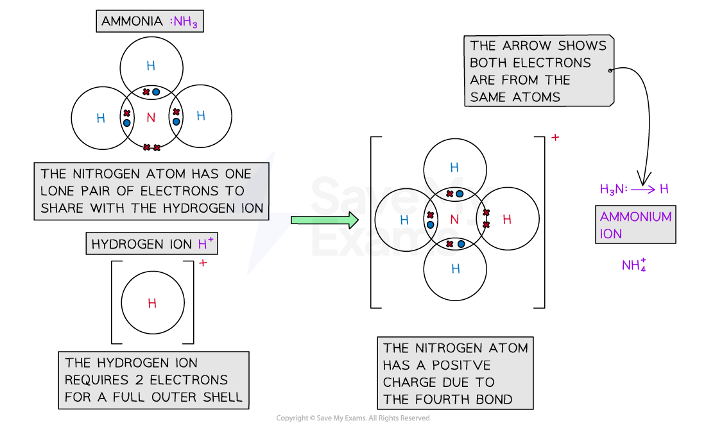
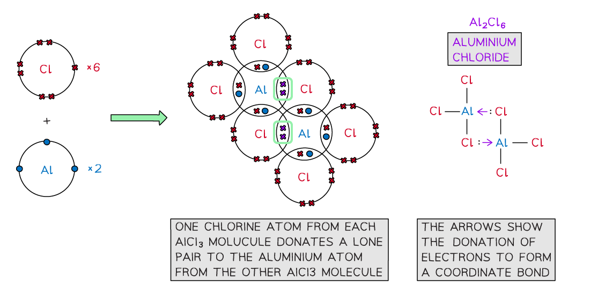

# Coordinate Bonding

## Examples of Coordinate Bonding

> **Spec point** — `spcpt_gkJdM8KCSST8S2JX`

## Examples of Coordinate Bonding

- In **simple** **covalent** **bonds** the two atoms involved share electrons
- Some molecules have a **lone** pair of electrons that can be donated to form a bond with an **electron-deficient** atom

  - An electron-deficient atom is an atom that has an **unfilled outer orbital**
- So **both electrons** are from the **same atom**
- This type of bonding is called **dative covalent bonding** or **coordinate bond**
- An example of a dative bond is in an **ammonium ion**

  - The hydrogen ion, H+ is **electron-deficient **and has space for two electrons in its shell
  - The nitrogen atom in ammonia has a lone pair of electrons which it can donate to the hydrogen ion to form a dative covalent bond

#### Coordinate bonding in the ammonium ion

***Ammonia (NH******3******) can donate a lone pair to an electron-deficient proton (H******+******) to form a charged ammonium ion (NH******4******+******)***

- **Aluminium** **chloride** is also formed using dative covalent bonding
- At **high temperatures, **aluminium chloride can exist as a **monomer** (AlCl3)

  - The molecule is electron-deficient and needs two electrons to complete the aluminium atom’s outer shell
- At **lower temperatures, **the two molecules of AlCl3 join together to form a more stable dimer (Al2Cl6)

  - The molecules combine because lone pairs of electrons on two of the chlorine atoms form **two coordinate bonds **with the aluminium atoms

#### Coordinate bonding in aluminium chloride

***Aluminium chloride is also formed with a dative covalent bond in which two of the chlorine atoms donate their lone pairs to each of the aluminium atoms to form a dimer***

> **Exam Hint**
> - In dative covalent bonding, both electrons in the covalent bond come from (are donated by) one atom.
> - A dative covalent bond uses an arrow from the donated pair of electrons to the electron-deficient atom.
