# Hybridisation

## Orbitals & Hybridisation in Covalent Bonding

> **Spec point** — `spcpt_NbtHdZ2KrTzhrkdg`

## Orbitals & Hybridisation in Covalent Bonding

### Bond overlap in covalent bonds

- A single **covalent** **bond** is formed when two nonmetals combine
- Each atom that combines has an **atomic** **orbital** containing a single unpaired electron
- When a covalent bond is formed, the **atomic orbitals **overlap to form a **combined orbital **containing two electrons

  - This new orbital is called the **molecular orbital**
- The **greater **the atomic orbital overlap, the **stronger **the bond
- **Sigma** (σ) bonds are formed by **direct overlap **of orbitals between the bonding atoms
- **Pi** (π) bonds are formed by the **sideways overlap **of **adjacent p orbitals above and below **the σ bond

### σ bonds

- **Sigma** (σ) bonds are formed from the **end-on** **overlap** of atomic orbitals
- S orbitals overlap this way as well as p orbitals

#### Forming sigma bonds

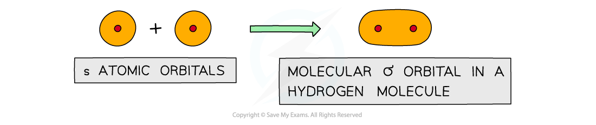

*Sigma orbitals can be formed from the end-on overlap of s orbitals*

- The electron density in a σ bond is symmetrical about a line joining the nuclei of the atoms forming the bond
- The pair of electrons is found between the nuclei of the two atoms
- There is an electrostatic force of attraction between the electrons and nuclei which bonds the atoms to each other

### π bonds

- **Pi** (π) bonds are formed from the **sideways** **overlap** of **adjacent **p orbitals
- The two lobes that make up the π bond lie **above** **and** **below** **the** **plane** of the σ bond
- This maximises the overlap of the p orbitals
- A single π bond is drawn as **two electron clouds** one arising from each lobe of the p orbitals
- The two clouds of electrons in a π bond represent **one **bond containing **two electrons**

#### Forming pi bonds

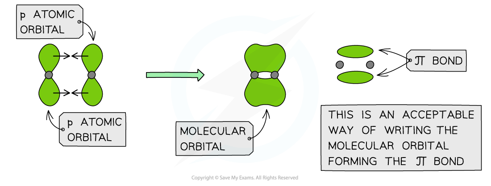

*π orbitals are formed from the sideways overlap of p orbitals*

### Examples of sigma & pi bonds

- **Hydrogen**

  - The hydrogen atom has only one s orbital
  - The s orbitals of the two hydrogen atoms will overlap to form a σ bond

#### Sigma bonding in hydrogen

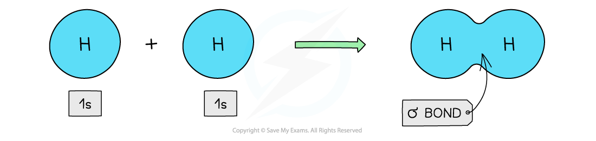

*Direct overlap of the 1s orbitals of the hydrogen atoms results in the formation of a σ bond*

- **Ethene**

  - Each carbon atom uses **three **of its **four **electrons to form σ bonds
  - Two σ bonds are formed with the hydrogen atoms
  - One σ bond is formed with the other carbon atom
  - The fourth electron from each carbon atom occupies a p orbital which overlaps **sideways **with another p orbital on the other carbon atom to form a π bond
  - This means that the C-C is a **double bond**: one σ and one π bond

#### Pi bonding in ethene

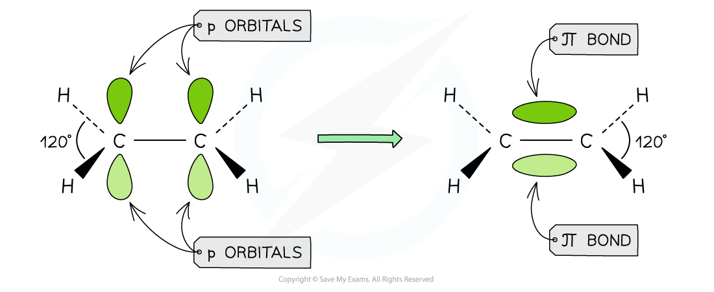

*Overlap of the p orbitals results in the forming of a π bond in ethene*

#### Sigma and pi bonding in ethene

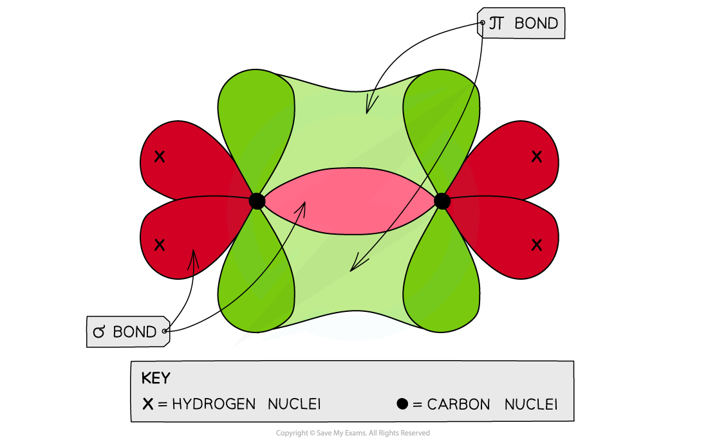

*Each carbon atom in ethene forms two sigma bonds with hydrogen atoms and one σ bond with another carbon atom. The fourth electron is used to form a π bond between the two carbon atoms*

- **Ethyne**

  - This molecule contains a **triple bond** formed from **two π bonds **(at right angles to each other) **and one σ bond**
  - Each carbon atom uses **two **of its **four **electrons to form σ bonds
  - One σ bond is formed with the hydrogen atom
  - One σ bond is formed with the other carbon atom
  - Two electrons are used to form two π bonds with the other carbon atom

#### Sigma and pi bonding in ethyne

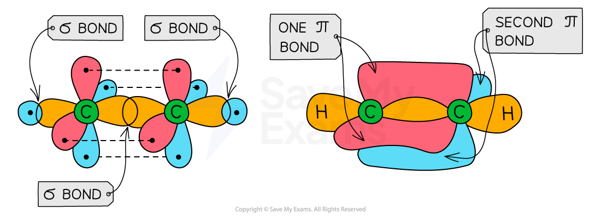

*Ethyne has a triple bond formed from two π bonds and one σ bond between the two carbon atoms*

- **Hydrogen cyanide**

  - Hydrogen cyanide contains a **triple bond**
  - One σ bond is formed between the H and C atom (**overlap of an sp C hybridised orbital with the 1s H orbital)**
  - A second σ bond is formed between the C and N atom (**overlap of an sp C hybridised orbital with an sp orbital of N)**
  - The remaining **two sets** of p orbitals of **nitrogen and carbon **will overlap to form **two** **π bonds **at right angles to each other

#### Sigma and pi bonding in hydrogen cyanide

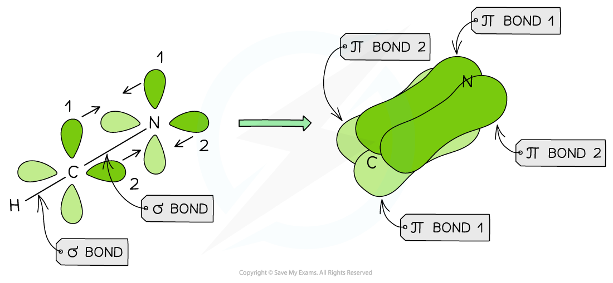

*Hydrogen cyanide has a triple bond formed from the overlap of two sets of p orbitals of nitrogen and carbon and the overlap of an sp hybridised carbon orbital and an sp hybridised orbital on the nitrogen*

- **Nitrogen** ** **

  - Nitrogen too contains a **triple bond**
  - The triple bond is formed from the overlap of the sp orbitals on each N to form a **σ bond **and the overlap of **two sets** of p orbitals on the nitrogen atoms to form **two π bonds**
  - These π bonds are at **right angles to each other**

#### Sigma and pi bonding in nitrogen molecules

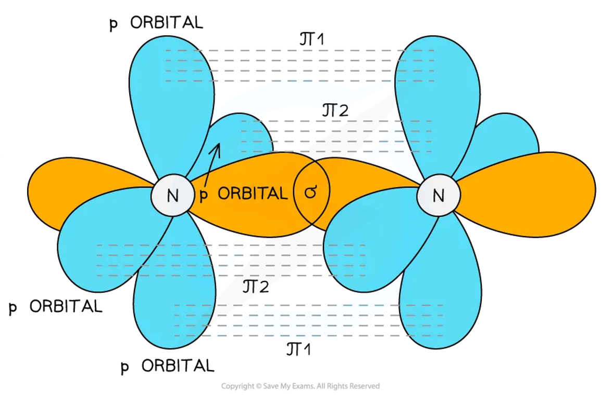

*The triple bond is formed from two π bonds and one σ bond*

### Hybridisation

- The **p atomic orbitals **can also overlap **end-on** to form σ bonds
- In order for them to do this, they first need to become **modified **in order to gain **s orbital character**
- The orbitals are therefore slightly changed in shape to make one of the p orbital **lobes bigger**
- This mixing of atomic orbitals to form covalent bonds is called **hybridisation**

### What is sp3 hybridisation?

- One s orbital and three p orbitals from the same shell mix to form **four sp****3**** hybrid orbitals**
- These hybrid orbitals have **¼ s character and ¾ p character**

  - These orbitals are asymmetric, with a larger lobe similar in shape to a p orbital
- The four sp3 orbitals arrange themselves with **tetrahedral geometry**

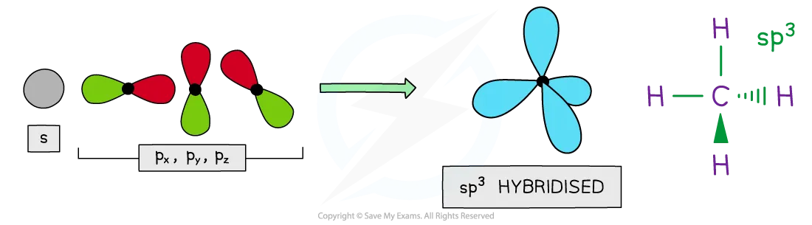

*4 x sp³ hybrid orbitals are formed from one s orbital and three p orbitals*

- This hybridisation explains the bonding and shape in molecules like methane and ammonia
- **Methane, CH****4****:**

  - The carbon atom forms four single covalent bonds
  - Each carbon sp3 hybrid orbital overlaps head-on with a hydrogen 1s orbital
  - This results in:
  
    - Four identical sigma bonds
    - Tetrahedral electron domain geometry
    - Tetrahedral molecular geometry
    - A 109.5° bond angle
- Hybrid orbitals can accommodate both bonding pairs and lone pairs of electrons
- **Ammonia, NH****3****:**

  - The nitrogen atom forms three single covalent bonds
  - Each nitrogen has three bonding pairs and one lone pair in sp3 hybrid orbitals
  - This results in:
  
    - Three identical sigma bonds and one lone pair
    - Tetrahedral electron domain geometry
    - Trigonal pyramidal molecular geometry
    - A 107° bond angle

### What is sp2 hybridisation?

- One s orbital and two p orbitals from the same shell mix to form **three sp****2**** hybrid orbitals**
- These hybrid orbitals have **⅓ s character and ⅔ p character**

  - These orbitals are asymmetric, with a larger lobe similar in shape to a p orbital
- The three sp2 orbitals arrange themselves with **trigonal planar geometry**

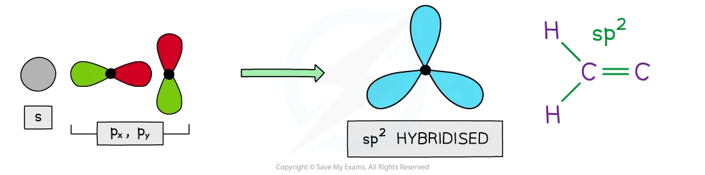

*3 x sp2 hybrid orbitals are formed from one s orbital and two p orbitals*

- This explains the bonding and geometry seen when carbon forms a double bond, such as in alkenes
- **Ethene:**

  - Each carbon atom forms three sigma bonds and one pi bond
  - The carbon atoms are **sp² hybridised**
  - Each carbon uses three sp² orbitals to form σ bonds:
  
    - Two with hydrogen atoms
    - One with the other carbon
  - One unhybridised p orbital to form a π bond with the other carbon
  - This results in:
  
    - One C=C double bond containing 1 σ and 1 π bond
    - Trigonal planar electron domain geometry
    - Trigonal planar molecular geometry
    - A 120° bond angle around each carbon
- This bonding arrangement also occurs in carbonyl groups, where both carbon and oxygen use sp2 hybrid orbitals to form the double bond

### What is sp hybridisation?

- One s orbital and one p orbital from the same shell mix to form **two sp hybrid orbitals**
- These hybrid orbitals have **½ s character and ½ p character**

  - These orbitals are asymmetric, with a larger lobe similar in shape to a p orbital
- The two sp orbitals arrange themselves with **linear geometry**

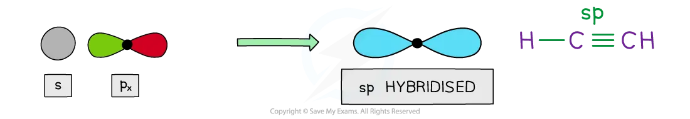

*2 sp hybrid orbitals are formed from one s orbital and one p orbital*

- This explains the bonding and geometry seen when carbon forms a triple bond, such as in alkynes
- **Ethyne:**

  - Each carbon atom forms two sigma bonds and two pi bonds
  - The carbon atoms are **sp hybridised**
  - Each carbon uses two sp orbitals to form σ bonds:
  
    - One with hydrogen
    - One with the other carbon
  - Two unhybridised p orbitals form two π bonds with the other carbon
  - This results in:
  
    - One C$\equiv$C triple bond containing 1 σ and 2 perpendicular π bonds
    - Linear electron domain geometry
    - Linear molecular geometry
    - A 180° bond angle around each carbon

> **Exam Hint**
> Carbon forms four bonds. The type of bond depends on how many p orbitals are used in hybridisation:
> 
> - **sp****3**
> 
>   - 4 - 3 = 1
>   - So, the carbon atom forms **single **bonds
> - **sp****2**
> 
>   - 4 - 2 = 2
>   - So, the carbon atom forms a **double **bond
> - **sp**
> 
>   - 4 - 1 = 3
>   - So, the carbon atom forms a **triple **bond
> 
> This page focuses on carbon (a second-period element), but hybridisation also occurs in third-period elements like phosphorus and sulfur.
> 
> - These atoms use 3s and 3p orbitals
> - They may also use 3d orbitals when forming expanded octets
