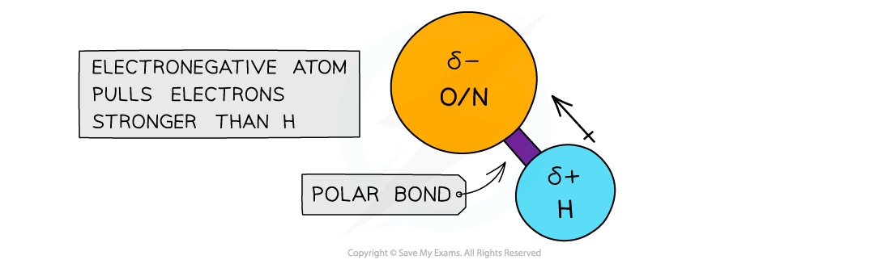
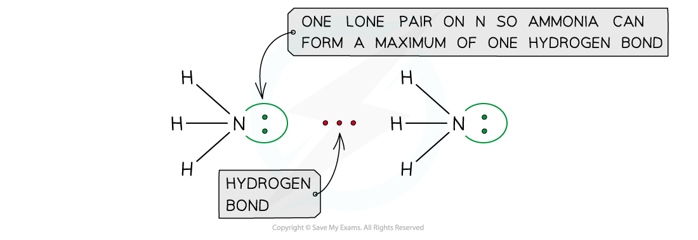
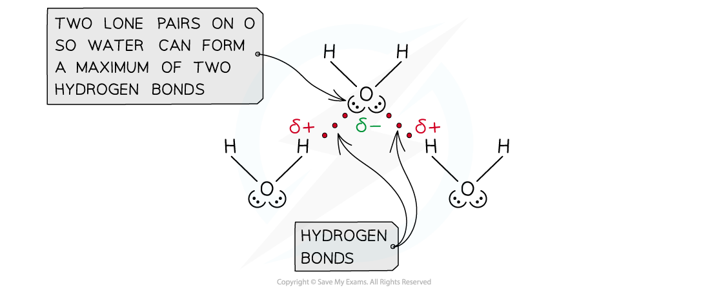
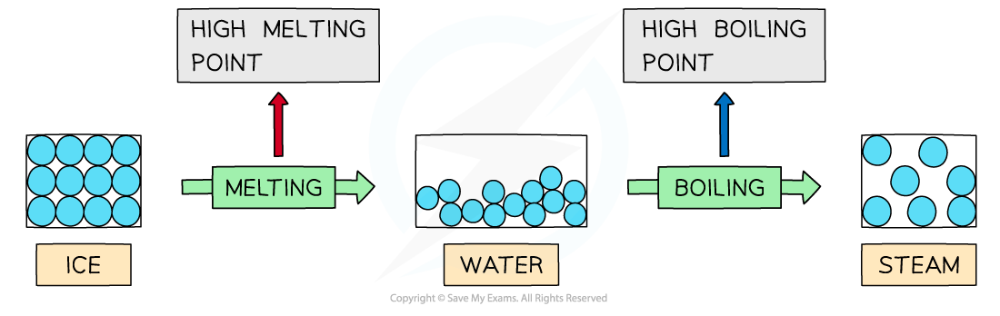
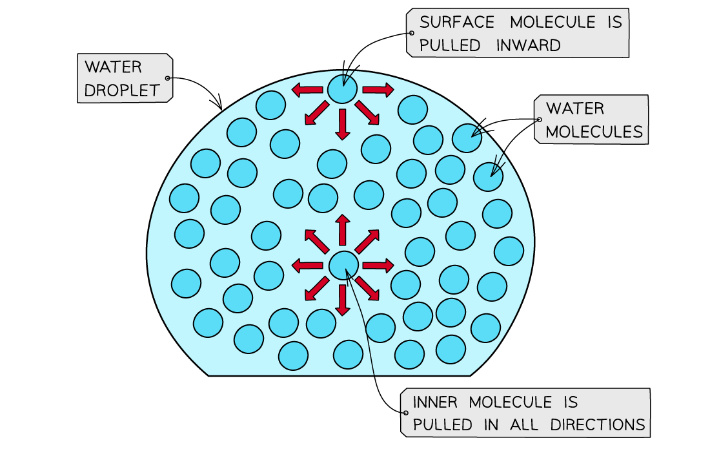
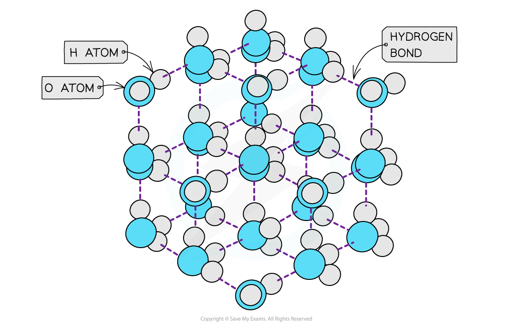

# Hydrogen Bonding

## Hydrogen Bonding

> **Spec point** — `spcpt_n4nGC5RWnyFMgkVg`

## Hydrogen Bonding

- **Hydrogen bonding **is the **strongest **form of **intermolecular bonding**

  - Intermolecular bonds are bonds **between **molecules
  - Hydrogen bonding is a type of **permanent dipole – permanent dipole **bonding
- For hydrogen bonding to occur, two conditions must be met:

  1. A molecule must contain a highly electronegative atom (O, N, or F) with a lone pair of electrons.
  2. A hydrogen atom must be covalently bonded to O, N, or F, making the bond highly polar.
- When hydrogen is covalently bonded to an **electronegative **atom (O, N, or F) the bond becomes very highly **polarised**
- The H becomes so **δ****+** charged that it can form a bond with the **lone pair **of an **O, N **or **F atom** in another molecule

#### Polarity of the OH bond

*The electronegative atoms O or N have a stronger pull on the electrons in the covalent bond with hydrogen, causing the bond to become polarised*

- The strongest hydrogen bonds are formed when the angle between the covalent bond (e.g., O-H) and the hydrogen bond is 180°, as this linear arrangement maximizes the electrostatic attraction.
- The number of hydrogen bonds depends on:

  - The number of hydrogen atoms attached to O or N in the molecule
  - The number of **lone** **pairs** on the O or N

#### Hydrogen bonding in ammonia

*Ammonia has only one lone pair on nitrogen, so on average each molecule forms one hydrogen bond (each bond is shared between two molecules)*

#### Hydrogen bonding in water

*Each water molecule has two lone pairs on oxygen and two δ+ hydrogen atoms, so on average it forms two hydrogen bonds per molecule (each bond is shared between two molecules). In total a molecule can take part in up to four: two to the δ- oxygen atom and one from each δ+ hydrogen atom*

### Properties of water

- Hydrogen bonding in water, causes it to have **anomalous properties **such as high melting and boiling points, high surface tension and anomalous density of ice compared to water

#### High melting & boiling points

- Water has high **melting **and **boiling points** which is caused by the **strong intermolecular forces **of hydrogen bonding between the molecules
- In **ice** (solid H2O) and water (liquid H2O) the molecules are tightly held together by hydrogen bonds
- A lot of energy is therefore required to overcome the hydrogen bonds between the water molecules and melt or boil them

#### Changing states and hydrogen bonding

*Hydrogen bonds are strong intermolecular forces which are difficult to break causing water to have high melting and boiling points*

- The graph below compares the **enthalpy of vaporisation **(energy required to boil a substance) of different hydrides
- The enthalpy changes **increase **going from H2S to H2Te due to the increased number of electrons in the Group 16 elements
- This causes an **increased instantaneous dipole - induced dipole forces **as the molecules become larger
- Based on this, H2O would have a much lower enthalpy change (around 17 kJ mol**-1**)
- However, the enthalpy change of vaporisation (about 41 kJ mol-1) is more than twice as **large** which is caused by the **hydrogen bonds **present in water but not in the other hydrides

#### Graph of enthalpy of vaporisation for different hydrides

*The high enthalpy change of evaporation of water suggests that instantaneous dipole-induced dipole forces are not the only forces present in the molecule – there are also those of the strong hydrogen bonds, which cause the high boiling points*

#### High surface tension

- Water has a **high surface tension**
- **Surface** **tension** is the ability of a **liquid surface **to resist any **external forces **(i.e. to stay unaffected by forces acting on the surface)
- The water molecules at the **surface **of liquid are bonded to other water molecules through **hydrogen **bonds
- The molecules below the surface pull the **surface molecules inwards (downwards)**, causing the surface molecules to be pulled more tightly together at the surface
- This increases water’s **surface** **tension**

#### The effect of hydrogen bonding in water

*The surface molecules are pulled downwards due to the hydrogen bonds with other molecules, whereas the inner water molecules are pulled in all directions*

#### Density

- **Solids **are **denser **than their **liquids **as the particles in solids are more **closely packed **together than in their liquid state
- In ice however, the water molecules are packed in a **3D** **hydrogen-bonded **network in a **rigid lattice**
- Each oxygen atom is surrounded by hydrogen atoms
- This way of packing the molecules in a solid and the relatively long **bond lengths **of the hydrogen bonds means that the water molecules are slightly further apart than in the liquid form
- Therefore, ice has a lower density than liquid water

#### Structure and density of water

*The ‘more open’ structure of molecules in ice causes it to have a lower density than liquid water*

> **Exam Hint**
> Ice floats on water because of ice's lower density.
