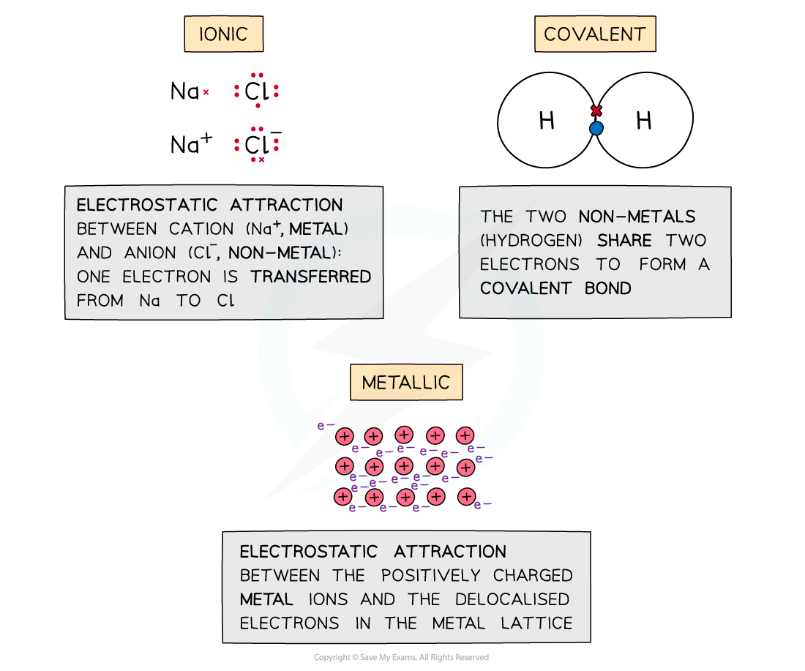
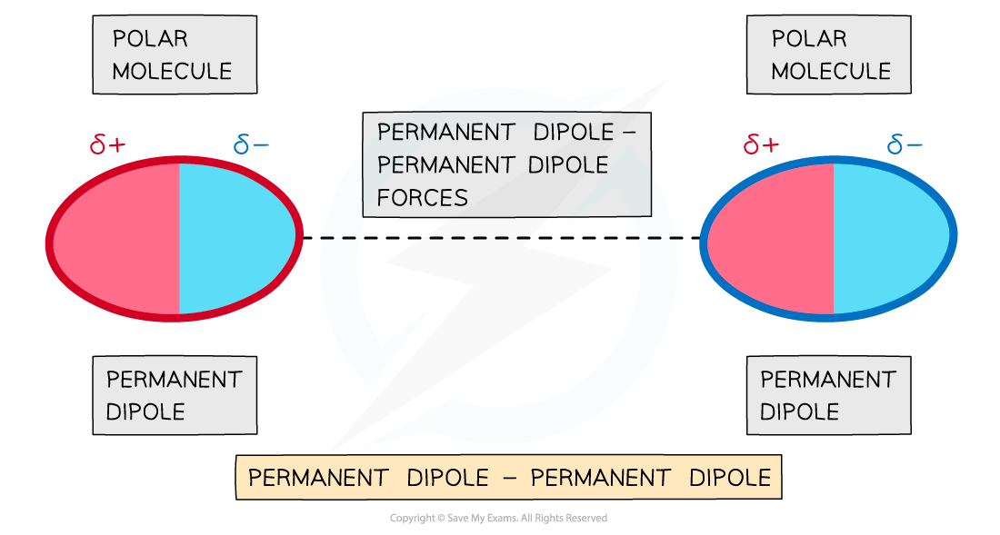
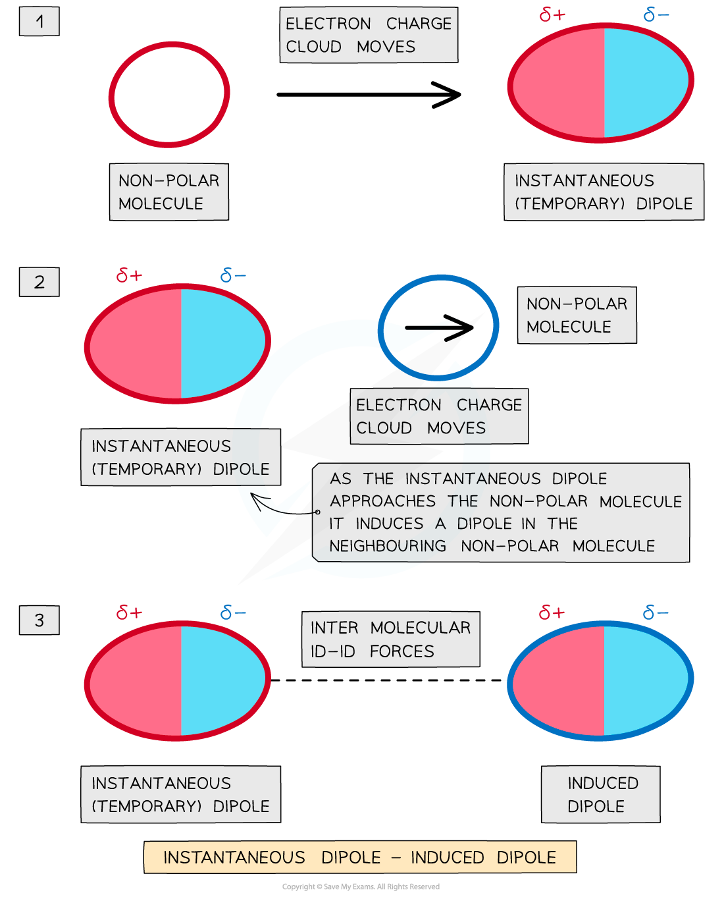
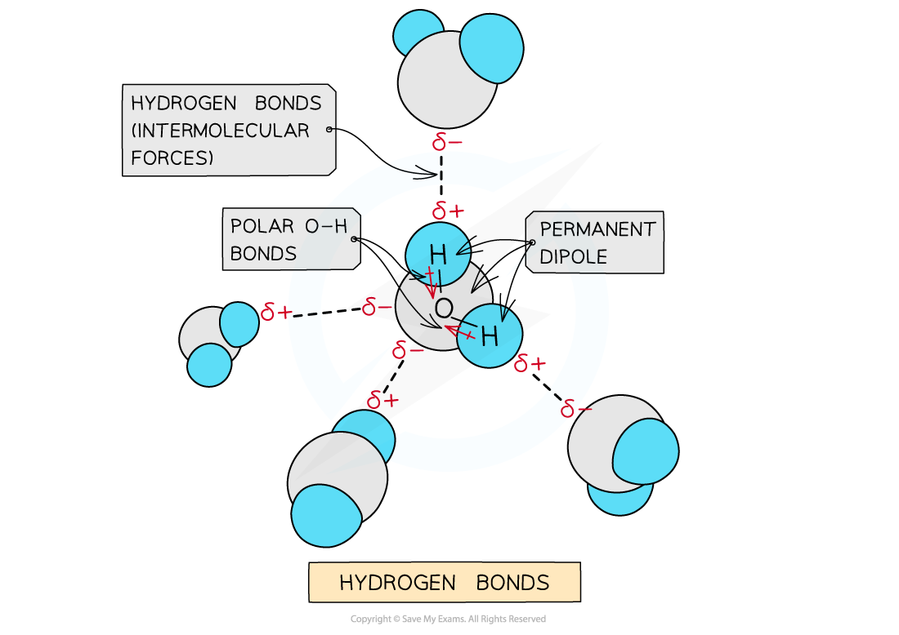
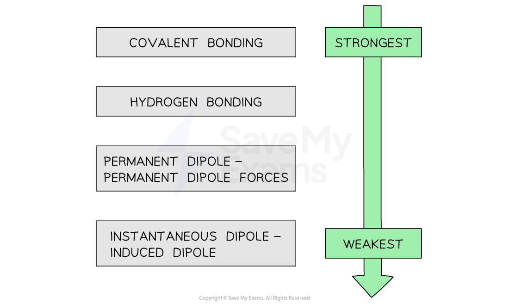

# Inter & Intramolecular Forces

## Comparing Bonds & Intermolecular Forces

> **Spec point** — `spcpt_WqHBvB6FP88QRGXb`

## Comparing Bonds & Intermolecular Forces

### Intramolecular forces

- **Intramolecular forces **are forces **within **a molecule
- **Ionic bonding **is the **electrostatic attraction **between **positive **(cations) and **negative **(anions) ions in an ionic **crystal lattice**

  - These ions are formed by transferring the electrons from one species to the other
- **Covalent bonds **are formed when the outer electrons of two atoms are **shared**
- **Metallic bonding **is the **electrostatic attraction **of positively charged metal ions and their delocalised electrons in a **metal lattice**

#### Intramolecular forces

*The three types of intramolecular forces are ionic, covalent and metallic bonding*

### Intermolecular forces

- **Intermolecular forces **are forces **between **molecules and are also called **van der Waals’ forces**
- **Permanent dipole - permanent dipole **are the attractive forces between two neighbouring molecules with a permanent dipole
- **Hydrogen** **bonds **are a special type of **permanent dipole - permanent dipole **forces
- **Instantaneous dipole - induced dipole **(London dispersion) forces are the attractive forces between a temporary dipole and a neighbouring molecule with an induced dipole

#### Permanent dipoles as intermolecular forces

*Permanent dipole - permanent dipole are the intermolecular forces that occur between two neighbouring molecules with a permanent dipole*

#### Instantaneous dipoles as intermolecular forces

*Instantaneous dipole - induced dipole (London dispersion) forces are the intermolecular forces that occur between a temporary dipole and a neighbouring molecule with an induced dipole*

#### Hydrogen bonding as an intermolecular force

*Hydrogen bonds are a special type of permanent dipole - permanent dipole forces*

- In general, **intramolecular forces **are **stronger** than intermolecular forces
- The strengths of the types of bond or force are as follows:

#### The varying strengths of different types of bonds

*In general, covalent bonding is the strongest force while instantaneous dipole - induced dipole is the weakest force*
