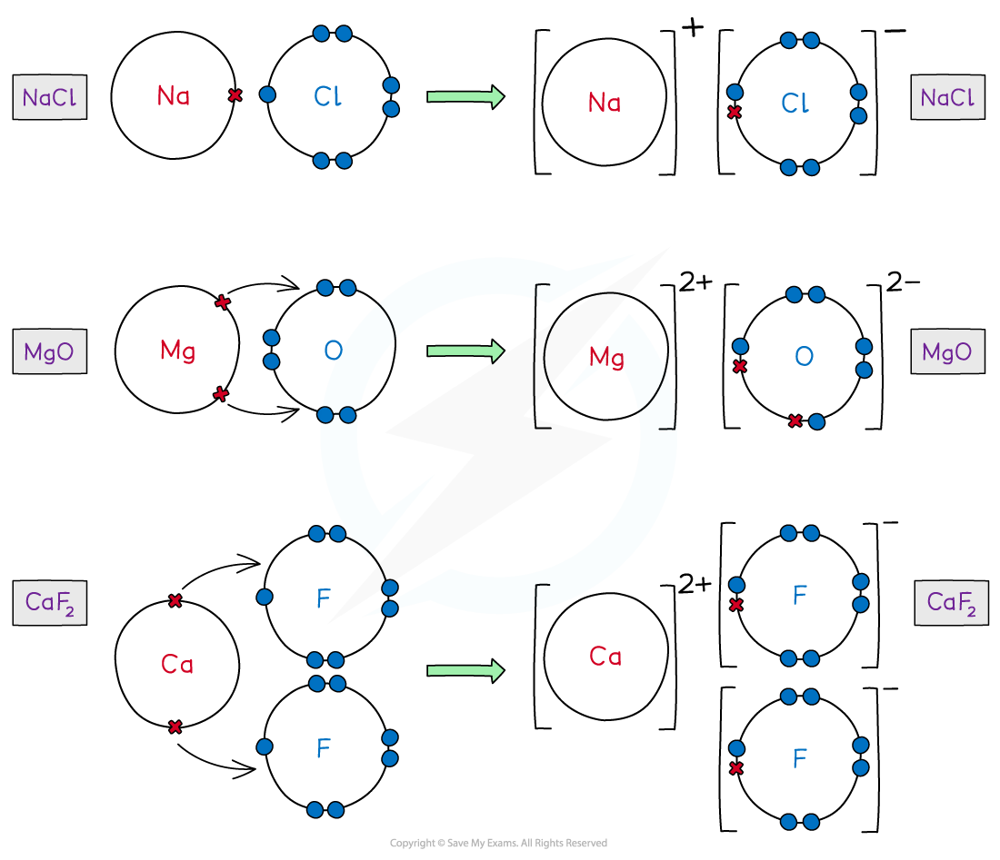
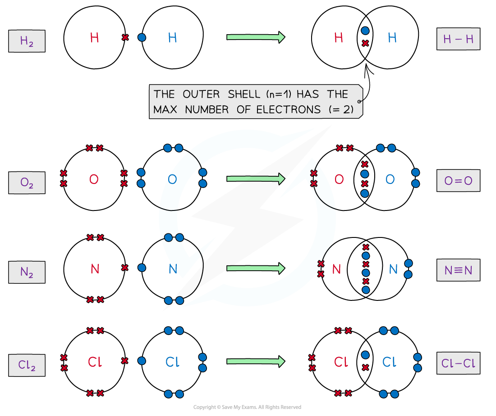
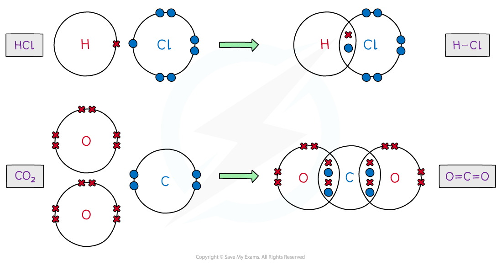
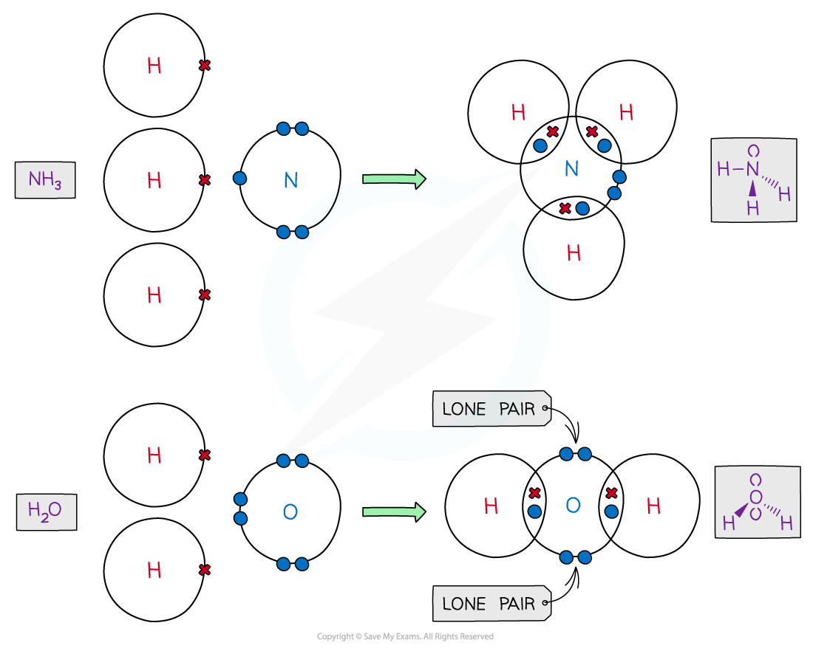
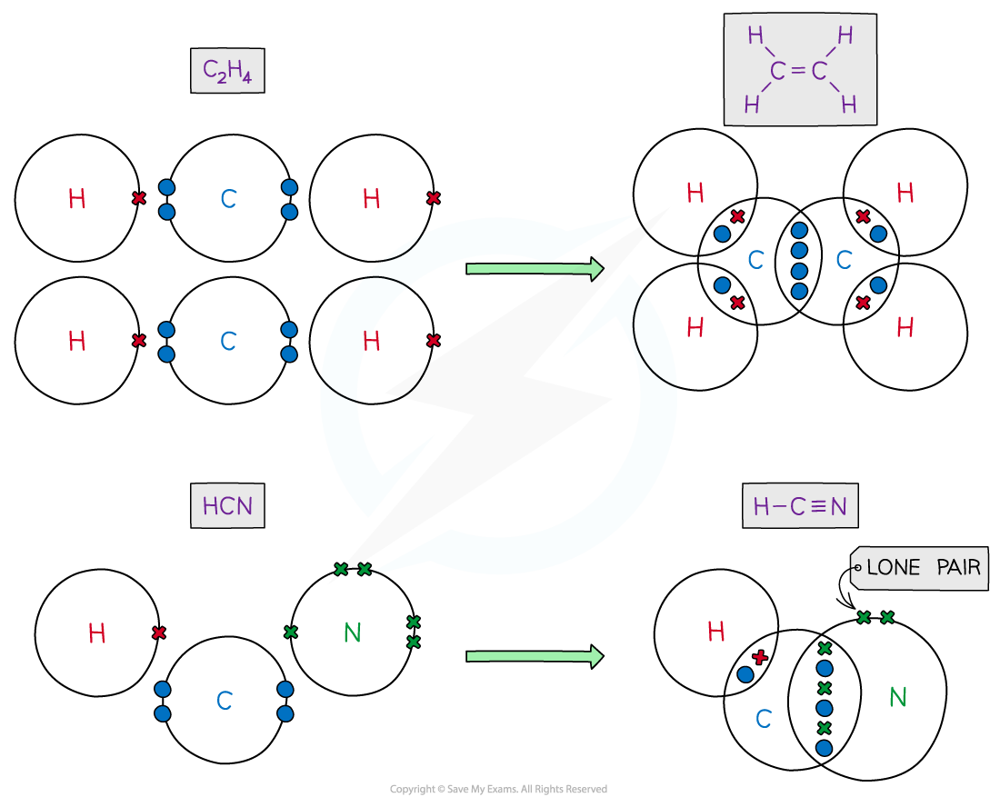
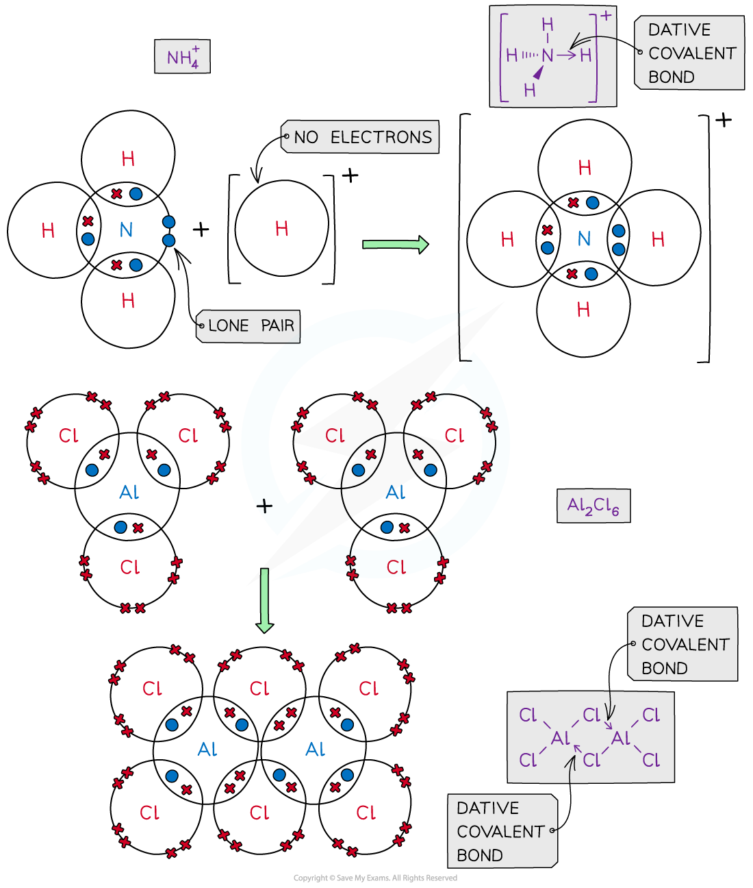
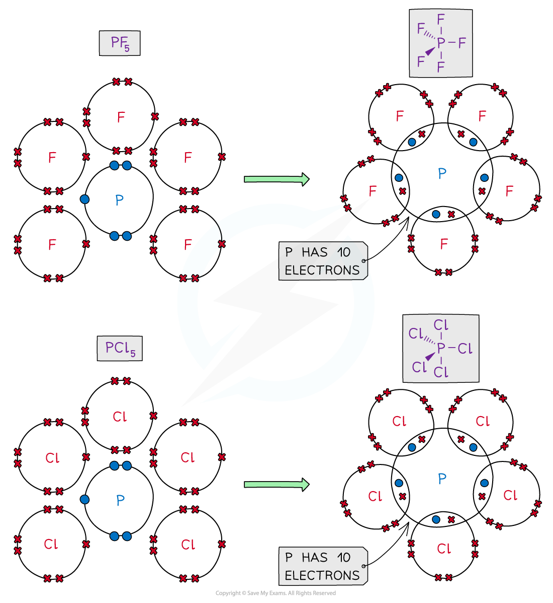
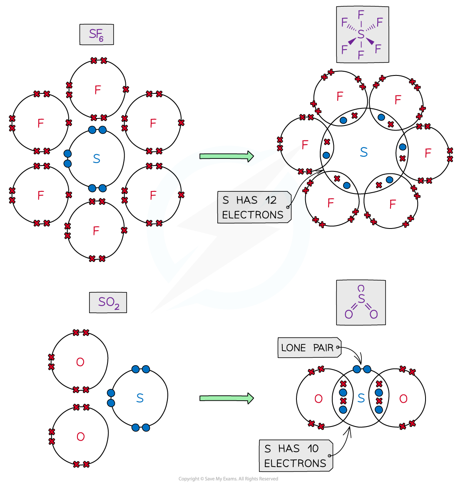
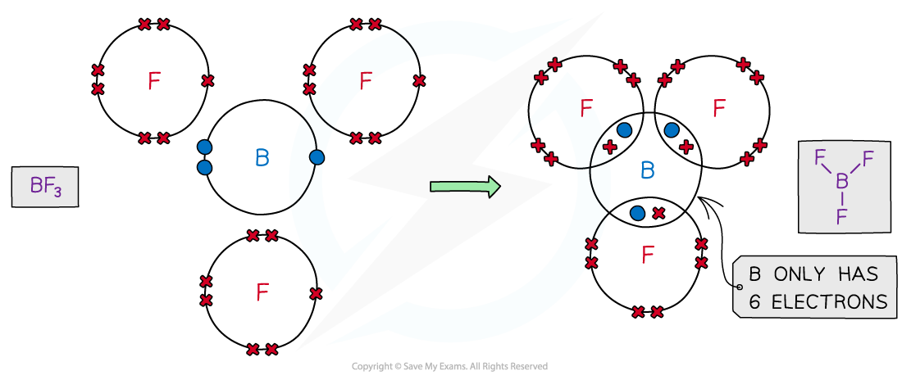
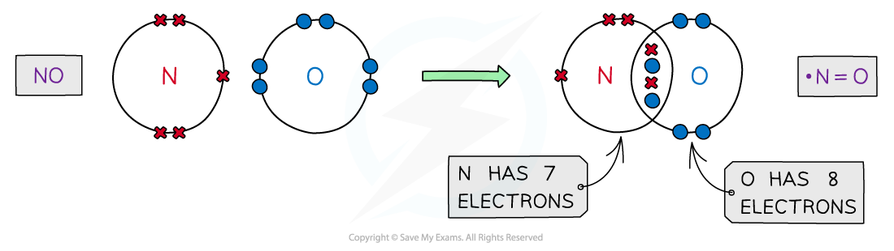

# Dot-&-Cross Diagrams

## Dot & Cross Diagrams

> **Spec point** — `spcpt_cbGwbCF5MyQYBRf5`

## Dot & Cross Diagrams

- **Dot and cross diagrams **are diagrams that show the arrangement of the outer-shell electrons in an **ionic **or **covalent **compound or element

  - The electrons are shown as dots and crosses
- In a dot and cross diagram:

  - Only the outer electrons are shown
  - The charge of the ion is spread evenly which is shown by using brackets
  - The charge on each ion is written at the top right-hand corner

### Ionic compounds

- Ionic bonds are formed when **metal **transfer electrons to a **non-metal** to form a positively charged and negatively charged ion
- The atoms achieve a **noble gas **configuration

#### Dot-and-cross diagrams of ionic compounds

*Dot-and-cross diagrams of ionic compounds show how the atoms transfer their outer / valence electrons *

### Covalent compounds

- The atoms in covalent compounds will** share **their outer valence electrons to achieve a **noble gas **configuration

#### Dot-and-cross diagrams of covalent compounds

*Dot-and-cross diagrams of covalent compounds show how atoms share their outer / valence electrons*

### Coordinate bonding

- **Coordinate bonding **or also called **dative covalent bonding **is formed when one atom provides **both **the electrons needed for a covalent bond
- In a displayed formula, the dative covalent bond is represented by an **arrow**
- The arrow starts at the lone pair of the donor atom and its **head** points to the electron-deficient atom that accepts the pair

#### Dot-and-cross diagrams of coordinate / dative covalent compounds

*Dot-and-cross diagrams of coordinate / dative covalent compounds show how one of the atoms provides both the electrons in a coordinate / dative covalent bond*

### Incomplete & expanded octet rule

- Some species may contain **more** (expanded) or **less **(incomplete) than eight electrons in their outer shell

#### Dot-and-cross diagrams for the expanded octet rule

*Dot-and-cross diagrams can show how atoms follow the expanded octet rule*

#### Dot-and-cross diagrams for the incomplete octet rule

*Dot-and-cross diagrams can show how the atoms in an electron deficient compound follow the incomplete octet rule*

### Odd number of electrons

- Some atoms in compounds may have an **odd number** of electrons in their valence shell

#### Dot-and-cross diagrams for compounds containing atoms with odd numbers of outer / valence electrons

*Dot-and-cross diagrams can show how some compounds contain atoms with odd numbers of outer / valence electrons*
