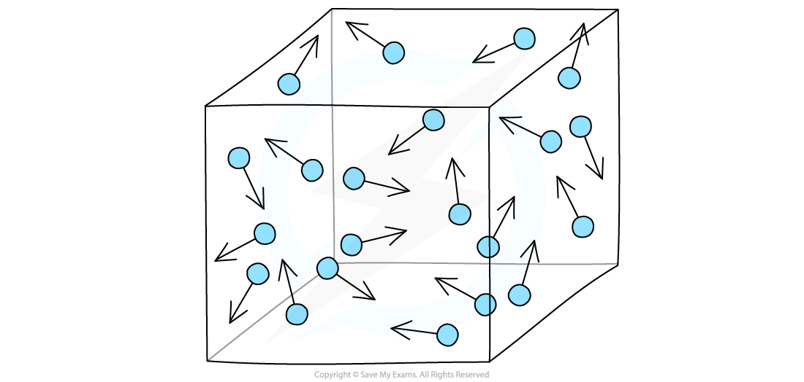
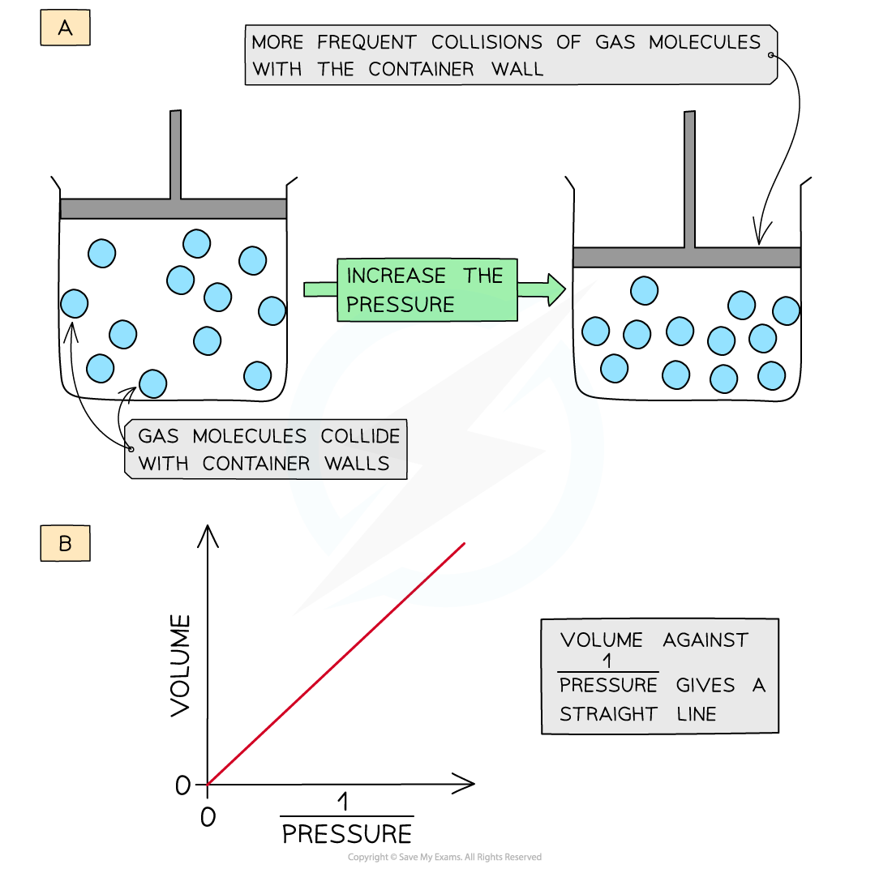
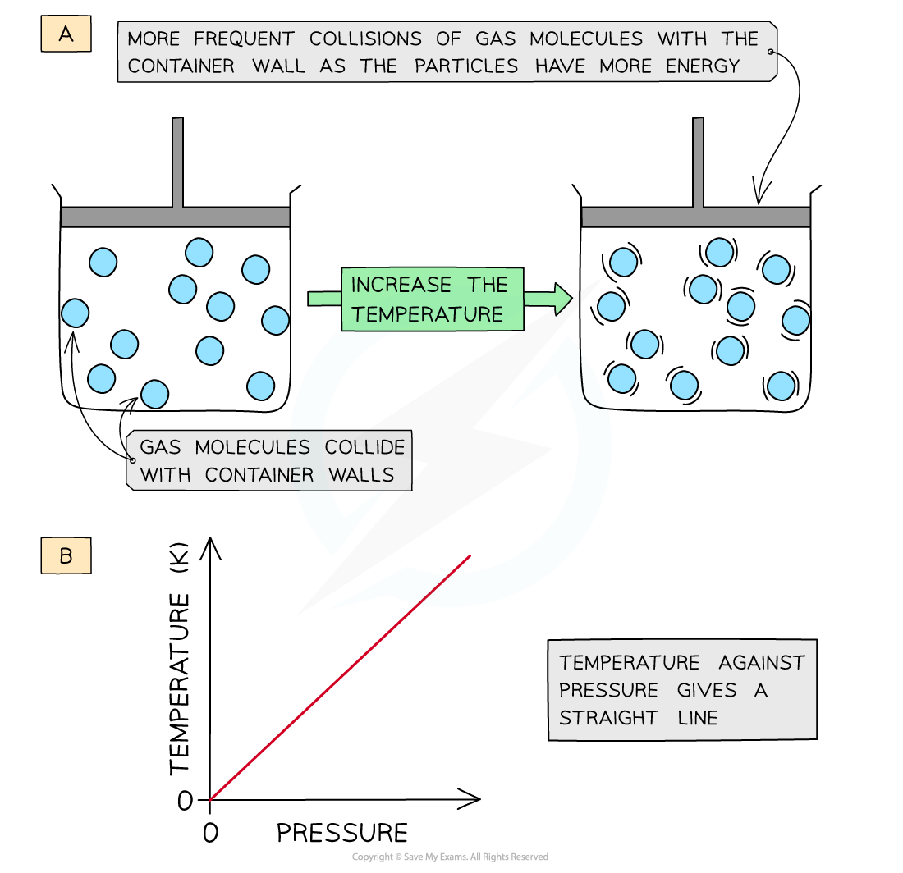

# Gas Pressure

## Gas Pressure

> **Spec point** — `spcpt_hwSNF3DCS6DXZjDz`

## Gas Pressure

- **Gases **in a container exert a **pressure **as the gas molecules are constantly **colliding **with the wall of the container

#### Illustration of gas pressure

*Gas particles exert a pressure by constantly colliding with the walls of the container*

### Changing gas volume

- **Decreasing **the **volume **(at constant temperature) of the container causes the molecules to be **squashed **together which results in more **frequent** collisions with the container wall
- The **pressure** of the gas **increases**
- The **volume **is therefore **inversely proportional **to the **pressure **(at constant temperature)

  - A graph of the **volume **of gas plotted against 1/pressure gives a straight line

#### How decreasing the volume of a gas affects collision frequency

*Decreasing the volume of a gas causes an increased collision frequency of the gas particles with the container wall (a); volume is inversely proportional to the pressure (b)*

### Changing gas temperature

- **Increasing **the **temperature **(at constant volume) of the gas causes the molecules to gain more **kinetic energy**
- This means that the particles will move **faster** and **collide **with the container walls more **frequently**
- The **pressure **of the gas **increases**
- The **absolute temperature** (in kelvin) is therefore **directly proportional **to the **pressure **(at constant volume)

  - A graph of the **temperature **of gas plotted against **pressure **gives a straight line

#### How increasing the temperature of a gas affects collision frequency

*Increasing the temperature of a gas causes an increased collision frequency of the gas particles with the container wall (a); absolute temperature (in kelvin) is directly proportional to the pressure (b)*
