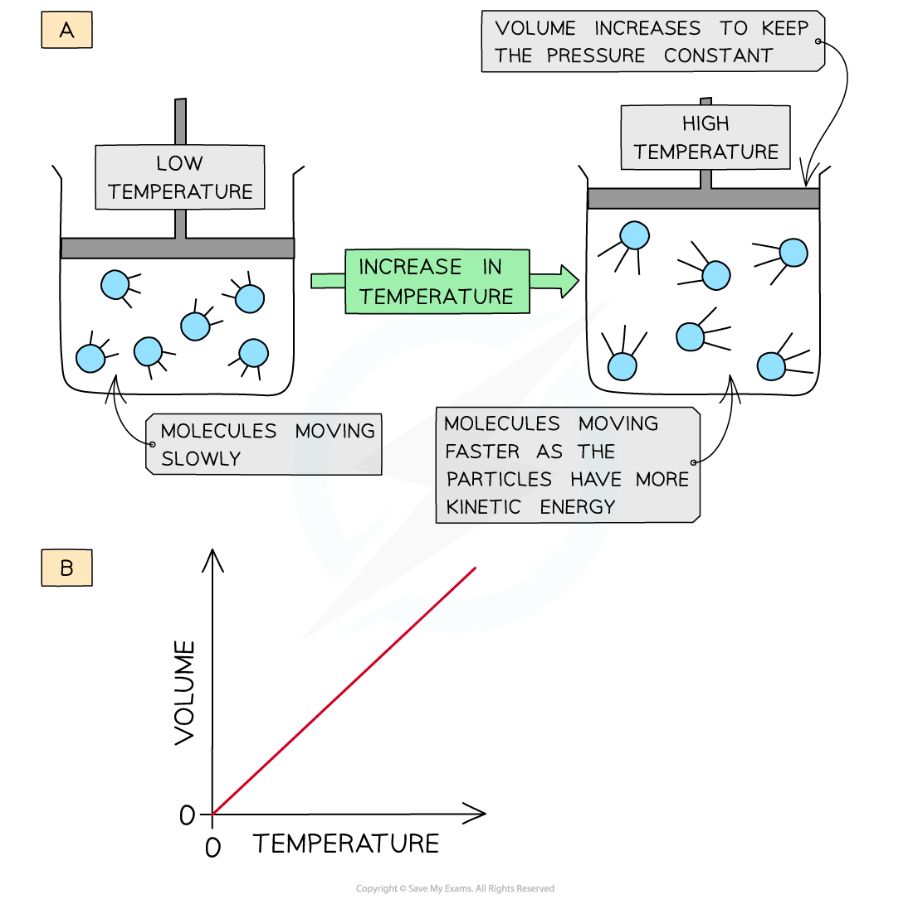

# Ideal Gases

## Ideal Gas Law

> **Spec point** — `spcpt_sFJ6ZPXvkT79fC2f`

## Ideal Gas Law

### Kinetic theory of gases

- **The kinetic theory of gases **states that molecules in gases are constantly moving
- The theory makes the following assumptions:

  - The gas molecules are moving very fast and randomly
  - The molecules hardly have any volume
  - The gas molecules do not attract or repel each other (**no** **intermolecular forces**)
  - No kinetic energy is lost when the gas molecules collide with each other (**elastic collisions**)
  - The temperature of the gas is related to the average kinetic energy of the molecules
- Gases that follow the kinetic theory of gases are called **ideal gases**
- However, in reality, gases do not fit this description exactly **but** may come very close and are called **real gases**

### Ideal gases

- The volume that an ideal gas occupies depends on:

  - Its pressure
  - Its temperature

- When a gas is **heated **(at constant pressure) the particles gain more **kinetic energy **and undergo more **frequent collisions **with the container wall
- To keep the **pressure constant**, the molecules must get further apart and therefore the **volume increases**
- The **volume **is therefore **directly proportional **to the **temperature **(at constant pressure)

#### How the volume of a gas increases upon heating

*The volume of a gas increases upon heating to keep a constant pressure (a); volume is directly proportional to the temperature (b)*

### Limitations of the ideal gas law

- At very **high pressures **and **low temperatures** real gases deviate from ideal gas behaviour because:

  - The gas molecules are much closer together.
  - Intermolecular forces (e.g. London forces or dipole-dipole attractions) become significant.
  - The molecules’ own volume can no longer be ignored.
- As a result, **two **key assumptions of the kinetic theory break down:

  - There are no intermolecular forces
  
    - In reality, attractive forces between molecules pull them slightly inward
    - So, they hit the container walls with less force than expected
    - This makes the measured pressure lower than the ideal gas law predicts.
  - The volume of the gas molecules can be ignored
  
    - In reality, the gas particles occupy space
    - So, the actual free volume available for movement is less than predicted by the ideal gas law.

## Ideal Gas Equation

> **Spec point** — `spcpt_mc6MCFF78DmWCrk8`

## Ideal Gas Equation

### Ideal gas equation

- The **ideal gas equation **shows the relationship between pressure, volume, temperature and number of moles of gas of an ideal gas:

  - *PV* = *nRT*

*P* = pressure (pascals, Pa)

*V* = volume (m3)

*n* = number of moles of gas (mol)

*R* = gas constant (8.31 J K-1 mol-1)

*T* = temperature (kelvin, K)

- The ideal gas equation can also be used to calculate the **molar** **mass** (*M**r*) of a gas

> **Worked Example**
> **Calculating the volume of a gas**
> 
> Calculate the volume occupied by 0.781 mol of oxygen at a pressure of 220 kPa and a temperature of 21 °C.
> 
> **Answer**
> 
> - **Step 1: **Rearrange the ideal gas equation to find the volume of gas:
> 
>   - *V* = $\frac{nRT}{P}$
> 
> - **Step 2: **Check that values have the correct units:
> 
>   - *P* = 220 kPa = 220 000 Pa
>   - *n* = 0.781 mol
>   - *R* = 8.31 J K-1 mol-1
>   - *T* = 21 oC = 294 K
> - **Step 3: **Calculate the volume the oxygen gas occupies:
> 
>   - *V* = $\begin{gathered} \frac{0.781 \text{mol} \times 8.31 \mathrm{J} \mathrm{K}^{- 1} mol^{- 1} \times 294 \mathrm{K} }{220 000 Pa} \end{gathered}$
>   - *V* = 0.00867 m3
>   - *V* = 8.67 dm3

> **Worked Example**
> **Calculating the molar mass of a gas**
> 
> A flask of volume 1000 cm3 contains 6.39 g of a gas. The pressure in the flask was 300 kPa and the temperature was 23 °C.
> 
> Calculate the relative molecular mass of the gas.
> 
> **Answer**
> 
> - **Step 1: **Rearrange the ideal gas equation to find the number of moles of gas:
> 
>   - *n* = $\frac{PV}{RT}$
> 
> - **Step 2: **Check that values have the correct units:
> 
>   - *P* = 300 kPa = 300 000 Pa
>   - *V* = 1000 cm3 = 0.001 m3
>   - *R* = 8.31 J K-1 mol-1
>   - *T* = 23 oC = 296 K
> - **Step 3: **Calculate the number of moles of gas:
> 
>   - *n* = $\frac{300000\mathrm{Pa}\times0.001m^{3}}{8.31JK^{-1}\mathrm{mol}^{-1}\times296K}$
>   - *n* = 0.12 mol
> 
> - **Step 4: **Calculate the molar mass using the number of moles of gas:
> 
>   - *n* = $\frac{\mathrm{mass}}{\mathrm{molar} \mathrm{mass}}$
>   - molar mass = $\frac{6.39}{0.12\mathrm{mol}}$
>   - molar mass = 53.25 g mol-1

> **Exam Hint**
> Ideal gases have **zero particle volume **(the particles are really small) and **no intermolecular forces of attraction or repulsion.**
> 
> To calculate the temperature in **Kelvin**, add 273 to the Celsius temperature, e.g. 100 oC is 373 Kelvin.
> 
> Remember: an **ideal gas** will have a **volume **that is **directly proportional **to the **temperature **and **inversely proportional **to the **pressure.**
