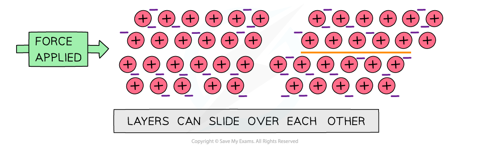

# Bonding & Structure

## How Bonding Affects Physical Properties

> **Spec point** — `spcpt_YvVs8rP9WBKRWmt8`

## How Bonding Affects Physical Properties

- Different types of **structure **and **bonding** have different effects on the **physical properties **of substances such as their **melting **and** boiling points**, **electrical conductivity **and **solubility**

### Ionic bonding & giant ionic lattice structures

- Ionic compounds are **strong**

  - The **strong electrostatic forces** in ionic compounds keep the ions strongly together
- They are **brittle **as ionic crystals can split apart
- Ionic compounds have **high melting **and **boiling **points

  - The strong electrostatic forces between the ions in the lattice act in all directions and keep them strongly together
  - Melting and boiling points increase with charge density of the ions due to the greater **electrostatic attraction **of charges
  - Mg2+O2- has a higher melting point than Na+Cl-
- Ionic compounds are **soluble **in water as they can form **ion - dipole bonds**
- Ionic compounds only** conduct** **electricity** when **molten **or in **solution**

  - When molten or in solution, the ions can freely move around and conduct electricity
  - In the solid state they’re in a fixed position and unable to move around

### Metallic bonding & giant metallic lattice structures

- Metallic compounds are **malleable**

  - When a force is applied, the metal layers can slide
  - The **attractive forces **between the metal ions and electrons act in all directions
  - So when the layers slide, the metallic bonds are re-formed
  - The lattice is not broken and has changed shape
- Metallic compounds are **strong **and **hard**

  - Due to the strong attractive forces between the metal ions and delocalised electrons
- Metals have **high melting **and **boiling points**

  - Due to the strong attractive forces between the metal ions and delocalised electrons
  - The greater the number of delocalised electrons and the smaller the cation, the greater the attractive force between them resulting in a higher melting / boiling point
- **Pure metals **are **insoluble **in water
- Metals can **conduct electricity **when in a **solid** or **liquid** state

  - As both in the solid and liquid state, there are **mobile electrons **which can freely move around and conduct electricity

#### Explaining the malleability of metals

*Metals are malleable as the layers can slide over each and reform*

### Covalent bonding & simple covalent lattice structures

- **Simple covalent lattices **have low **melting **and **boiling points**

  - These compounds have weak intermolecular forces between the molecules
  - Only little energy is required to break the lattice
- Most compounds are insoluble with water

  - Unless they are polar (such as HCl) or can form hydrogen bonds (such as NH3)
- They do not **conduct electricity **in the **solid** or **liquid **state as there are no charged particles

  - Some simple covalent compounds conduct electricity in solution such as HCl which forms H+ and Cl- ions

### Covalent bonding & giant covalent lattice structures

- **Giant covalent lattices **have **high melting **and **boiling points**

  - These compounds have a large number of **covalent bonds **linking the whole structure (there are no separate small molecules, so it is the strong covalent bonds that must be broken)
  - A lot of energy is required to break the lattice
- The compounds can be **hard **or **soft**

  - Graphite is **soft** as the forces between the carbon layers are weak
  - Diamond and silicon(IV) oxide are **hard** as it is difficult to break their 3D network of strong covalent bonds
- Most compounds are insoluble in water
- Most compounds do not **conduct electricity **however some do

  - Graphite has **delocalised **electrons between the carbon layers which can move along the layers when a voltage is applied
  - Diamond and silicon(IV) oxide do not conduct electricity as all the outer electrons of every atom are involved in **covalent bonds** so there are no free electrons available

#### Characteristics of different compound structure types table

|   | **Giant Ionic** | **Giant Metallic** | **Simple Covalent** | **Giant Covalent** |
|---|---|---|---|---|
| **Melting and Boiling Points** | High | Moderately high to high | Low | Very high |
| **Electrical Conductivity** | Only when molten or in solution | When solid or liquid | Do not conduct electricity | Do not conduct electricity (except for **graphite**) |
| **Solubility** | Generally soluble | Insoluble, but some may react | Usually insoluble unless they are polar | Insoluble |
| **Hardness** | Hard, brittle | Hard, malleable | Soft | Very hard (**diamond** or **SiO****2**) or soft (**graphite**) |
| **Physical State at Room Temperature** | Solid | Solid | Solid, liquid, gas | Solid |
| **Forces** | Electrostatic attraction between ions | Delocalised sea of electrons attracting positive ions | Weak intermolecular forces between molecules and covalent bonds within a molecule | Electrons in covalent bonds between atoms |
| **Particles** | Ions | Positive ions in a sea of electrons | Small molecules | Atoms |
| **Example** | NaCl | Copper | Br2 | Graphite, silicon(IV) oxide |

> **Worked Example**
> **Bonding & Structure**
> 
> The table below shows the physical properties of substances **X**, **Y **and **Z**.
> 
> | **Substance** | **Melting Point (°C)** | **Electrical Conductivity when Molten** | **Solubility in Water** |
> |---|---|---|---|
> | **X** | 839 | Good | Soluble |
> | **Y** | 95 | Very poor | Almost insoluble |
> | **Z** | 1389 | Good | Insoluble |
> 
> Which one of the following statements about **X**, **Y** and **Z** is completely true?
> 
> 1. **X** has a giant ionic structure, **Y **has a giant molecular structure, **Z** is a metal.
> 2. **X** is a metal, **Y** has a simple molecular structure, **Z** has a giant molecular structure.
> 3. **X** is a metal,** Y** has a simple molecular structure, **Z **has a giant ionic structure.
> 4. **X** has a giant ionic structure, **Y** has a simple molecular structure, **Z** is a metal.
> 
> **Answer**
> 
> - The correct answer is 4
> 
>   - The relatively high melting point, solubility in water and electrical conductivity when molten suggest that **X** is a **giant ionic structure**
>   - The low melting point of **Y **suggests that little energy is needed to break the lattice, which corresponds to a **simple molecular structure**. This is further supported by the low electrical conductivity and its being almost insoluble in water
>   - Compound **Z **has a very high melting point which is characteristic of either metallic or giant molecular lattices, however since it conducts electricity, compound Z must be a **giant metallic lattice**
