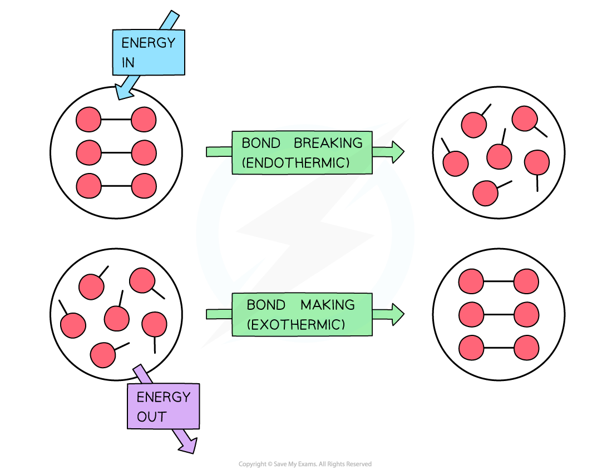
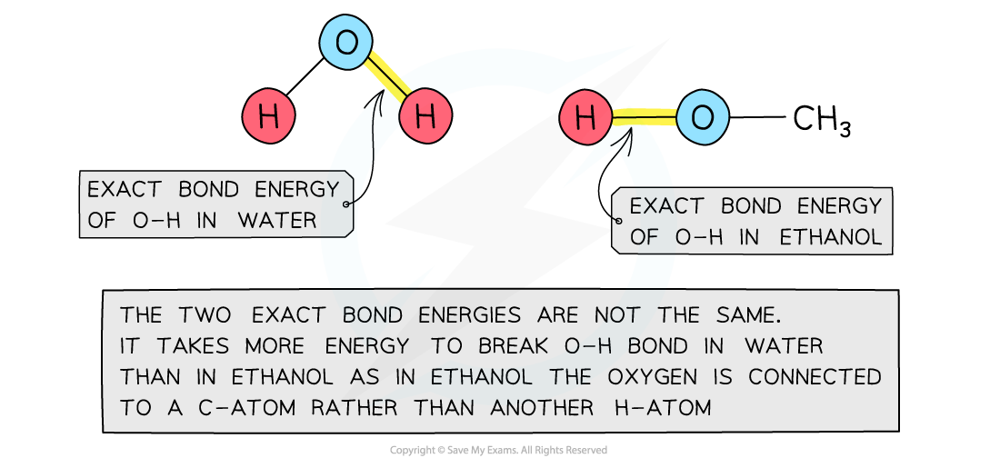
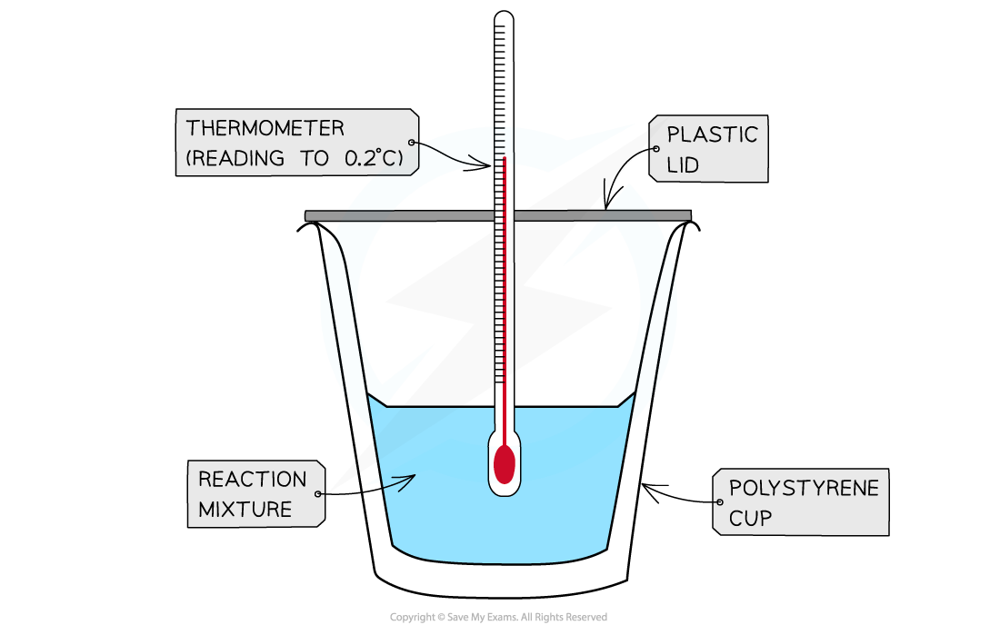

# Enthalpy & Bond Energies

## Enthalpy & Bond Energies

> **Spec point** — `spcpt_Y3yg6TK2DsBDYF9g`

## Enthalpy & Bond Energies

- During a reaction, enthalpy changes take place because bonds are being broken and formed
- Energy (in the form of heat) is needed to overcome attractive forces between atoms
- **Bond breaking** is therefore **endothermic**
- Energy is released from the reaction to the surroundings (in the form of heat) when new bonds are formed
- **Bond forming **is therefore **exothermic**

#### Making and breaking bonds

*Breaking bonds requires energy from the surroundings and making bonds releases energy to the surroundings*

- If more energy is required to break bonds than energy is released when new bonds are formed, the reaction is **endothermic**
- If more energy is released when new bonds are formed than energy is required to break bonds, the reaction is **exothermic**
- In reality, only some bonds in the reactants are broken and then new ones are formed

## Enthalpy Calculations

> **Spec point** — `spcpt_JGgWc2RK3Vc99QBw`

## Enthalpy Calculations

### Exact bond energy

- The amount of energy required to break one mole of a **specific **covalent bond in the gas phase is called the bond dissociation energy
- Bond dissociation energy (*E*) is also known as **exact bond energy **
- The type of bond broken is put in brackets after *E*

  - E.g.* EE*(H-H) is the bond energy of a mole of single bonds between two hydrogen atoms

### Average bond energy

- Bond energies are affected by other atoms in the molecule (the environment)
- Therefore, an average of a number of the **same type of bond **but in different environments is calculated
- This bond energy is known as the **average bond energy**
- Since bond energies cannot be determined directly, **enthalpy cycles **are used to calculate the average bond energy

#### How bond energies are affected by other atoms in the molecule

*Bond energies are affected by other atoms in the molecule*

### Calculating enthalpy change from bond energies

- Bond energies are used to find the Δ*H*rꝋ of a reaction when this cannot be done experimentally

  - E.g. the Haber Process
- The equation to calculate the standard enthalpy change of reaction using bond energies is:

Δ*H*θ*r** *= enthalpy change for bonds broken + enthalpy change for bonds formed

> **Worked Example**
> Calculate the enthalpy change of reaction the Haber process reaction.
> 
> The relevant bond energies are given in the table.
> 
> | **Bond** | **Average bond energy** **kJ mol****-1** |
> |---|---|
> | **N**$\equiv$**N** | 945 |
> | **H–H** | 436 |
> | **N–H** | 391 |
> 
> **Answer**
> 
> - **Step 1: **The chemical equation for the Haber process is:
> 
>   - **N****2**** (g) + 3H****2**** (g) ⇌ 2NH****3**** (g)**
> 
> - **Step 2: **Set out the calculation as a balance sheet:
> 
> | **Bonds broken** **kJ mol****-1** | **Bonds formed** **kJ mol****-1** |
> |---|---|
> | 1 x N$\equiv$N = 1 x 945 = 945  3 x H–H = 3 x 436 = 1308 | 6 x N–H = 6 x 391 = 2346 |
> | Total = **+2253** | Total = **–2346** |
> 
> - **Note:** Values for bonds broken are positive (endothermic) and values for bonds formed are negative (exothermic)
> - **Step 3: **Calculate the standard enthalpy of reaction:
> 
>   - Δ*H*θ*r** *= enthalpy change for bonds broken + enthalpy change for bonds formed
>   - Δ*H*θ*r** *= (+2253 kJ mol-1) + (–2346 kJ mol-1)
>   - Δ*H*θ*r* = –93 kJ mol-1

> **Worked Example**
> The complete combustion of ethyne, C2H2, is shown in the equation below:
> 
> 2H–C$\equiv$C–H + 5O=O → 2H–O–H + 4O=C=O
> 
> Calculate, using the average bond energies given in the table, the enthalpy of combustion of ethyne.
> 
> | **Bond** | **Average bond energy** **kJ mol****-1** |
> |---|---|
> | **C–H** | 414 |
> | **C**$\equiv$**C** | 839 |
> | **O=O** | 498 |
> | **C=O** | 804 |
> | **O–H** | 463 |
> | **O–C** | 358 |
> 
> **Answer**
> 
> - **Step 1:**
> 
>   - The enthalpy of combustion is the enthalpy change when **one mole** of a substance reacts in excess oxygen to produce water and carbon dioxide
>   - The chemical reaction should be therefore simplified such that only **one mole** of **ethyne** reacts in excess oxygen:
> 
> **H-C=C-H + 2 ½ O=O → H-O-H + 2O=C=O**
> 
> - **Step 2: **Set out the calculation as a balance sheet:
> 
> | **Bonds broken** **kJ mol****-1** | **Bonds formed** **kJ mol****-1** |
> |---|---|
> | 1 x C$\equiv$C = 1 x 839 = 839  2 x C–H = 2 x 414 = 828  2½ x O=O = 2½ x 498 = 1245 | 2 x O–H = 2 x 463 = 926  4 x C=O = 4 x 804 = 3216 |
> | Total = **+2912** | Total = **–4142** |
> 
> - **Note:** Values for bonds broken are positive (endothermic) and values for bonds formed are negative (exothermic)
> - **Step 3: **Calculate the standard enthalpy of reaction:
> 
>   - Δ*H*θ*r** *= enthalpy change for bonds broken + enthalpy change for bonds formed
>   - Δ*H*θ*r** *= (+2912 kJ mol-1) + (–4142kJ mol-1)
>   - Δ*H*θ*r* = –1230 kJ mol-1

### Measuring enthalpy changes

- **Calorimetry **is a technique used to measure changes in enthalpy of chemical reactions
- A **calorimeter** can be made up of a **polystyrene drinking cup**, a **vacuum flask** or **metal can**

#### Example calorimetry equipment

*A polystyrene cup can act as a calorimeter to find enthalpy changes in a chemical reaction*

- The energy needed to increase the temperature of 1 g of a substance by 1 oC is called the **specific heat capacity **(*c*) of the liquid
- The specific heat capacity of water is 4.18 J g-1 oC-1
- The energy transferred as heat can be calculated using the following equation:

*q* = *m *x *c* x Δ*T*

- *q* = the heat transferred, J

  - *m* = the mass of water, g
  - *c *= the specific heat capacity, J g-1 oC-1 or J g-1 K-1
  - *T *= the temperature change, oC

> **Worked Example**
> In a calorimetric experiment, 2.50 g of methane is burnt in excess oxygen.
> 
> 30% of the energy released during the combustion is absorbed by 500 g of water, causing the temperature to rise from 25 oC to 68 oC.
> 
> The specific heat capacity of water is 4.18 J g-1 K-1.
> 
> Calculate the total energy released per gram of methane burnt.
> 
> **Answer**
> 
> - **Step 1: **Gather the necessary values for the *q* = *m *x *c* x Δ*T *equation:
> 
>   - *m *(of water) = 500 g
>   - *c *(of water) = 4.18 J g-1 K-1
>   - Δ*T *(of water) = 68 oC - 25 oC = 43 oC = 43 K
>   
>     - The change in temperature in oC is equal to the change in temperature in K
> 
> - **Step 2: **Complete the calculation:
> 
>   - *q* = 500 x 4.18 x 43
>   - *q *= 89 870 J
> - **Step 3:**  Conversion from 30% to 100%
> 
>   - The value of *q* calculated is only 30% of the total energy released by 2.50 g of methane
>   - Total energy x 0.3 = 89 870 J
>   - Total energy = 299 567 J
> 
> - **Step 4:** Calculate the energy released by 1.00 g of methane
> 
>   - The energy calculated is released by 2.50 g of methane
>   - Energy released by 1.00 g of methane = $\frac{299567}{2.50}$
>   - Energy released by 1.00 g of methane = 119 827 J
> - **Step 5:** Convert the answer from J to kJ:
> 
>   - $\frac{119827}{1000}$ = 120 kJ (to 3 significant figures)

> **Exam Hint**
> - When new bonds are formed, the amount of energy released is equal to the amount of energy absorbed when the same bonds are broken
> - For example:
> 
> **O****2**** (g) → 2O (g)   *****E***** (O=O) = +498 kJ mol****-1**
> 
> **2O (g) → O****2**** (g)   *****E***** (O=O) –498 kJ mol****-1**
> 
> - Aqueous solutions of acid, alkalis and salts are assumed to be largely water so you can just use the *m *and *c* values of water when calculating the energy transferred
> - To then calculate any changes in enthalpy per mole of a reactant or product, the following relationship can be used:
> 
> Δ*H* = –*m* x *c* x Δ*T*
> 
> - When there is a rise in temperature, the value for Δ*H *becomes negative, suggesting that the reaction is exothermic
> - When there is a fall in temperature, the value for Δ*H* becomes positive, suggesting that the reaction is endothermic
> - Also, remember that Δ*T *is the same in oC and K!
