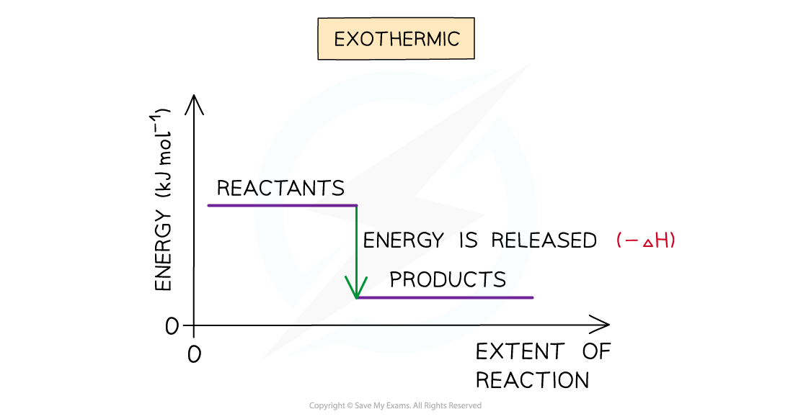
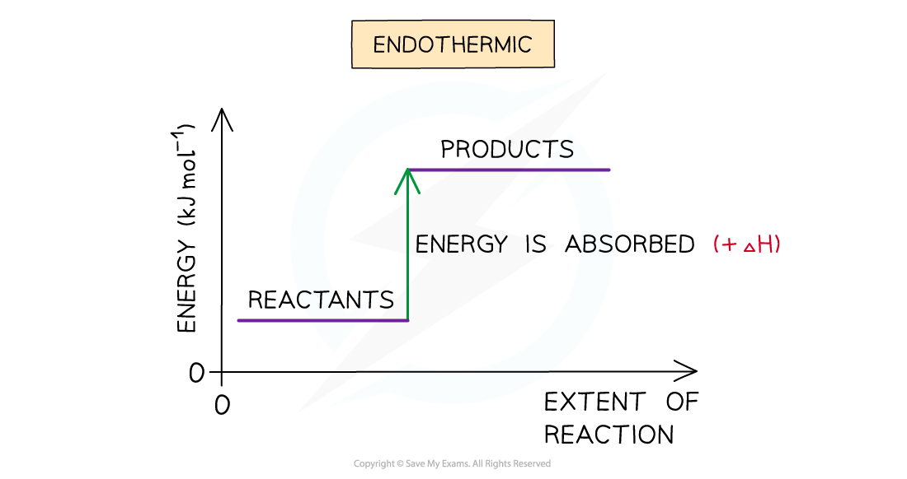

# Enthalpy Change, ΔH

## Enthalpy Changes

> **Spec point** — `spcpt_3G5VshJ2mzwT8ssc`

## Enthalpy Changes

- The total chemical energy inside a substance is called the enthalpy (or heat content)
- When chemical reactions take place, changes in chemical energy take place and therefore the enthalpy changes
- An enthalpy change is represented by the symbol Δ*H* (Δ= change; *H* = enthalpy)
- An enthalpy change can be positive or negative

### Exothermic reactions

- A reaction is exothermic when the products have less energy than the reactants
- Heat energy is **given off **by the reaction **to the** **surroundings**

  - The **temperature** of the **environment increases** - this can be measured on a thermometer
  - The **energy** of the **system decreases** as it loses heat to the surroundings
- There is an enthalpy decrease during the reaction, so Δ*H* is negative
- Exothermic reactions are more likely to be **thermodynamically **possible (because the enthalpy of the reactants is **higher** than that of the products), although feasibility also depends on the entropy change
- However, the rate may be too slow to observe any appreciable reaction

  - In this case, the reaction is **kinetically **controlled
  - This means the reaction could have a high activation energy which is preventing the reaction from taking place.

#### The enthalpy change during an exothermic reaction

*Exothermic reactions show a negative enthalpy change as energy is released*

### Endothermic reactions

- A reaction is endothermic when the products have more energy than the reactants
- Heat energy is **absorbed** **by **the reaction **from **the **surroundings**

  - The **temperature** of the **environment decreases** - this can be measured with a thermometer
  - The **temperature **of the **system increases**
- There is an enthalpy increase during the reaction, so Δ*H* is positive

#### The enthalpy change during an endothermic reaction

*Endothermic reactions show a positive enthalpy change as energy is absorbed*

> **Exam Hint**
> - It is important to specify the physical states of each species in an equation when dealing with enthalpy changes, as any changes in state can cause very large changes of enthalpy.
> - For example:
> 
> **Na****+****Cl****-**** (s) → Na****+**** (aq) + Cl****-**** (aq)   Δ*****H***** = +4 kJ mol****-1**
> 
> **Na****+****Cl****-**** (g) → Na****+**** (g) + Cl****-**** (g)   Δ*****H***** = + 500 kJ mol****-1**
> 
> - Also, remember that the **system** is the **molecules that are reacting** (i.e. the reaction itself) and the **surroundings are everything else** (e.g. the flask the reaction is taking place in).
