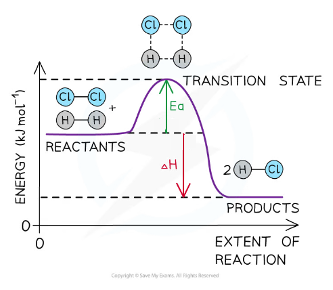
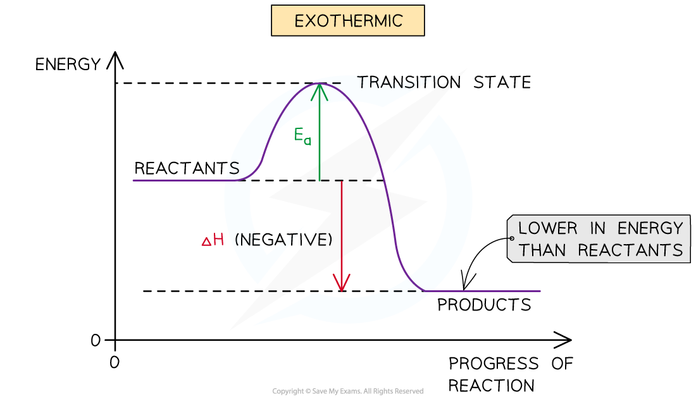

# Reaction Pathway Diagrams

## Reaction Pathway Diagrams

> **Spec point** — `spcpt_qD2VzcDXjsjC5k9j`

## Reaction Pathway Diagrams

- A reaction pathway diagram shows the energies of the reactants, the transition state(s) and the products of the reaction with time

  - They are sometimes called energy profile diagrams
- The **transition state** is a stage during the reaction at which chemical bonds are partially broken and formed
- The transition state is very unstable – it cannot be isolated and is higher in energy than the reactants and products
- The activation energy (*E**a*) is the energy needed to reach the transition state
- We can define the activation energy as ‘*the minimum amount of energy needed for reactant molecules to have a successful collision and start the reaction’*

#### Example reaction pathway diagram

*The reaction pathway diagram for the reaction of hydrogen with chlorine to form hydrogen chloride gas*

### Exothermic reaction

- In an exothermic reaction, the reactants are higher in energy than the products
- The reactants are therefore closer in energy to the transition state
- This means that exothermic reactions have a lower activation energy compared to endothermic reactions

#### The reaction pathway diagram for exothermic reactions

*Exothermic reaction pathway diagrams always have the products lower in energy than the reactants*

### Endothermic reaction

- In an endothermic reaction, the reactants are lower in energy than the products
- The reactants are therefore further away in energy to the transition state
- This means that endothermic reactions have a higher activation energy compared to exothermic reactions

#### The reaction pathway diagram for endothermic reactions

*Endothermic reaction pathway diagrams always have the products higher in energy than the reactants*

> **Worked Example**
> **Drawing energy level diagrams of the combustion of methane**
> 
> The *E*a and Δ*H* for the complete combustion of methane are +2653 kJ mol-1 and –890 kJ mol-1 respectively.
> 
> Draw the reaction pathway diagram for this reaction
> 
> **Answer**
> 
> - **Step 1: **The chemical equation for the complete combustion of methane is:
> 
> **CH****4**** (g) + 2O****2**** (g) → CO****2**** (g) + 2H****2****O (l)**
> 
> - **Step 2: **Combustion reactions are always exothermic (Δ*H* is negative) so the reactants should be drawn higher in energy than the products
> 
> 
> 
> - **Step 3: **Draw the curve in the energy level diagram, clearly showing the transition state
> 
> 
> 
> - **Step 4: **Draw arrows to show the *E**a** *and Δ*H* including their values
> 
> 

> **Worked Example**
> **Determining the activation energy**
> 
> Determine, using the reaction pathway diagram, the *E*a for the forward and reverse reaction. The diagram shows the products 70 kJ mol-1 above the reactants, and the transition state 20 kJ mol-1 above the products.
> 
> 
> 
> **Answer**
> 
> - The *E**a* is the energy difference from the energy level of the reactants to the top of the ‘hump’
> - *E**a* (forward reaction) = (+70 kJ mol-1) + (+ 20 kJ mol-1 ) = **+90 kJ mol****-1**
> - As the question is asking for the **reverse reaction, **the *E**a** * is the energy difference from the energy level of the products to the ‘hump’
> - ***E******a***** (reverse reaction) = +20 kJ mol****-1**

> **Exam Hint**
> - The activation energy is the energy difference from **reactants **to the **transition state.**
> - The enthalpy change of the reaction is the energy difference from **reactants **to **products.**
> - Remember to label the axis of the reaction pathway diagrams!
