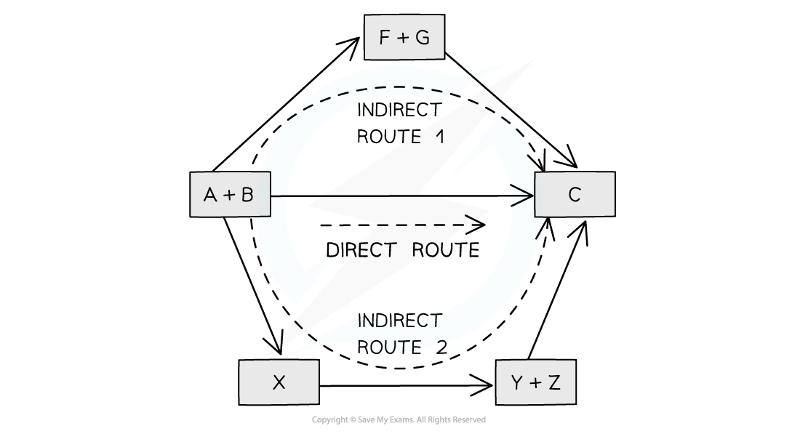
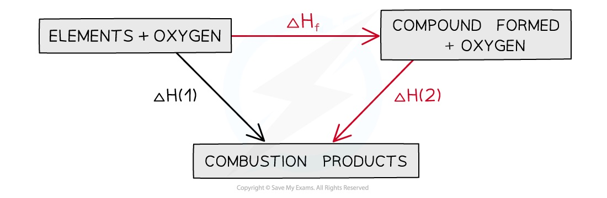

# Hess’s Law

## Hess Cycles

> **Spec point** — `spcpt_mqCCKGsGRn8qBZ3X`

## Hess Cycles

- **Hess’s Law **states that:

***"The total enthalpy change in a chemical reaction is independent of the route by which the chemical reaction takes place as long as the initial and final conditions are the same."***

- This means that whether the reaction takes place in one or two steps, the total enthalpy change of the reaction will still be the same

#### Illustration of Hess's Law

*According to Hess’ Law, the enthalpy change of the direct route, going from reactants (A+B) to product (C), is equal to the enthalpy change of the indirect routes*

- Hess’ Law is used to calculate enthalpy changes which can’t be found experimentally using **calorimetry**, e.g.:

**3C (s) + 4H****2 ****(g) → C****3****H****8****(g)**

- ΔHf (propane) can’t be found experimentally as hydrogen and carbon don’t react under standard conditions

### Calculating ΔHr from ΔHf using Hess’s Law energy cycles

- The products can be directly formed from the elements = **Δ*****H*****2** **OR **The products can be indirectly formed from the elements = **Δ*****H*****1**** + Δ*****H*****r**

#### Applying Hess's Law

*The enthalpy change from elements to products (direct route) is equal to the enthalpy change of elements forming reactants and then products (indirect route)*

- **Equation**

**Δ*****H*****2**** = Δ*****H*****1**** + Δ*****H*****r**

Therefore,

**Δ*****H*****r ****= Δ*****H*****2**** – Δ*****H*****1**** **

> **Worked Example**
> Calculate Δ*H**r** *for the following reaction:
> 
> 2NaHCO3 (s) → Na2CO3 (s) + CO2 (g) + H2O (l)
> 
> The table shows the standard enthalpy of formations, Δ*H**θ**f*, relevant to this reaction.
> 
> | **Molecule** | **Δ*****H******θ******f*** **kJ mol****-1**** ** |
> |---|---|
> | NaHCO3 (s) | –950.8 |
> | Na2CO3 (s) | –1130.7 |
> | CO2 (g) | –393.5 |
> | H2O (l) | –285.8 |
> 
> **Answer**
> 
> - **Step 1: **Write the balanced equation at the top
> 
> 
> 
> - **Step 2: **Draw the cycle with the elements at the bottom
> 
> 
> 
> - **Step 3: **Draw in all arrows, making sure they go in the correct directions. Write the standard enthalpy of formations
> 
> ![Completed Hess cycle: arrow from 2NaHCO3(s) to Na2CO3(s) + CO2(g) + H2O(l) is the enthalpy change of reaction; arrow from the elements 2Na(s) + 2C(graphite) + 3O2(g) + H2(g) up to 2NaHCO3(s) is ΔH1 = 2 x ΔHf[NaHCO3(s)]; arrow from the elements to the products is ΔH2 = ΔHf[Na2CO3(s)] + ΔHf[CO2(g)] + ΔHf[H2O(l)].](assets/55982c353dc9-1-5-chemical-energetics-step-3-calculating-the-e.png)
> 
> - **Step 4: **Apply Hess’s Law:
> 
>   - Δ*H**r**= ΔH**2**–* Δ*H**1*
>   - Δ*H**r**= (* Δ*H**f** *[Na2CO3 (s)] + Δ*H**f** *[CO2 (g)]*+* Δ*H**f** *[H2O (l)] ) – 2Δ*H**f** *[NaHCO3 (s)]
>   - Δ*H**r** *= ( (–1130.7) + (–393.5) + (–285.8) ) – ( 2 x –950.8)
>   - Δ*H**r** *= +91.6 kJ mol-1

### Calculating ΔHf  from ΔHc using Hess’s Law energy cycles

- The combustion products can be formed directly from elements to combustion products =** ΔH****1** **OR **The combustion products can be formed indirectly from elements to compounds to combustion products =** ΔH****f ****+ ΔH****2**

#### Hess's Law and combustion enthalpies

*The enthalpy change going from elements to products (direct route) is equal to the enthalpy change of elements forming reactants and then products (indirect route)*

- **Equation**

**Δ*****H*****1**** = Δ*****H*****f**** + Δ*****H*****2**

- Therefore,

**Δ*****H*****f  ****= Δ*****H*****1 ****– Δ*****H*****2**

> **Worked Example**
> Calculate, using the standard enthalpy change of combustion values given, the enthalpy of formation of ethane.
> 
> | **Reaction** | **Δ*****H******c*** **kJ mol****-1**** ** |
> |---|---|
> | **C (graphite) + O****2**** (g) → CO****2**** (g)** | –393.5 |
> | H2 (g) + ½O2 (g) → H2O (l) | –285.8 |
> | C2H6 (g) + 3½O2 (g) → 2CO2 (g) + 3H2O (l) | –1559.7 |
> 
> **Answer**
> 
> - **Step 1: **Write the equation for the enthalpy change of formation at the top and add oxygen on both sides
> 
> 
> 
> - **Step 2: **Draw the cycle with the combustion products at the bottom
> 
> 
> 
> - **Step 3: **Draw all arrows in the correct direction
> 
> ![Completed combustion cycle: ΔHf arrow from the elements plus oxygen to ethane plus oxygen; ΔH1 = 2ΔHc[C(graphite)] + 3ΔHc[H2(g)] from the elements plus oxygen down to 2CO2(g) + 3H2O(l); ΔH2 = ΔHc[C2H6(g)] from ethane plus oxygen down to the same products.](assets/f89fbd58b537-1-5-chemical-energetics-step-3-calculating-the-e.png)
> 
> - **Step 4: **Apply Hess’s Law:
> 
>   - Δ*H**f**= ΔH**1**–* Δ*H**2*
>   - Δ*H**f** *= ( (2 x –393.5) + (3 x –285.8) ) – ( –1559.7)
>   - Δ*H**f** *= –84.7 kJ mol-1

#### Calculating average bond energies using Hess's cycles

- Bond energies cannot be found directly so enthalpy cycles are used to find the **average bond energy**
- This can be done using enthalpy changes of **atomisation **and **combustion **or **formation**
- The **enthalpy change of** **atomisation **(Δ*H*θat ) is the enthalpy change when **one mole of gaseous **atoms is **formed **from its elements under standard conditions. *(A Level only)*

  - E.g.* *Δ*H*θ*at* [H2] relates to the equation:

**½H****2 ****(g) → H (g)**

> **Worked Example**
> Calculate the average bond energy of the C–H bond, using the relevant Δ*H*θ*f* and Δ*H*θ*at* values shown in the table.
> 
> |   | **Energy** **kJ mol****-1**** ** |
> |---|---|
> | Δ*H*θ*f*  [CH4 (g)] | –74.8 |
> | Δ*H*θ*at* [½H2 (g)] | +218 |
> | Δ*H*θ*at* [C (graphite)] | +717.7 |
> 
> **Answer**
> 
> - **Step 1: **Write down the equation for the dissociation of methane at the top
> 
> 
> 
> - **Step 2: **Write down the elements at the bottom
> 
> 
> 
> - **Step 3: **Draw all arrows in the correct direction
> 
> ![Completed bond energy cycle: ΔH from CH4(g) to C(g) + 4H(g); ΔHf[CH4(g)] from the elements C(graphite) + 2H2(g) up to CH4(g); ΔHat[C(graphite)] + 4 x ΔHat[½H2(g)] from the elements up to C(g) + 4H(g).](assets/054be44abe11-1-5-chemical-energetics-step-3-calculating-avera.png)
> 
> - **Step 4: **Apply Hess’s Law:
> 
>   - Δ*H =* Δ*H*θ*at**–* Δ*H**f*
>   - Δ*H* = ( (+717.7) + (4 x 218) ) – ( –74.8)
>   - Δ*H* = +1664.5 kJ mol-1
> 
> - **Step 5: **Calculate the bond energy for **one **C–H bond
> 
>   - There are 4 C-H bonds in methane
>   - Average bond enthalpy (C–H) = $\frac{+1664.5}{4}$
>   - Average bond energy (C–H) = +416 kJ mol-1 (to 3 significant figures)

> **Exam Hint**
> - Remember to take into account the number of moles of each reactant and product.
> - For example, there are two moles of NaHCO3 (s) so the Δ*H**f* value is multiplied by 2.
