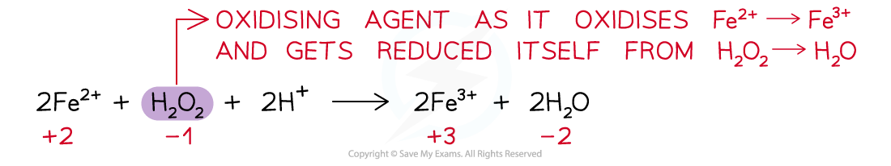
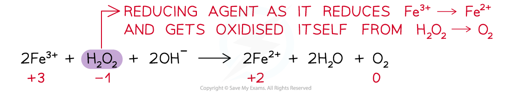

# Oxidising & Reducing Agents

## Oxidising & Reducing Agents

> **Spec point** — `spcpt_nd5pJqStQ2PDbW7v`

## Oxidising & Reducing Agents

### Oxidising agent

- **An oxidising agent** is a substance that **oxidises** another atom or ion by causing it to lose electrons
- An oxidising agent itself gets **reduced**

  - This means that an oxidising agent **gains electrons**
- Therefore, the **oxidation number **of the oxidising agent **decreases**
- For example:

### Reducing agent

- **A reducing agent **is a substance that **reduces** another atom or ion by causing it to gain electrons
- A reducing agent itself gets **oxidised**

  - This means that a reducing agent **loses / donates electrons**
- Therefore, the **oxidation number **of the reducing agent **increases**
- For example:

- For a reaction to be recognised as a redox reaction, there must be both an oxidising and reducing agent
- Some substances can act both as oxidising and reducing agents
- Their nature is dependent upon what they are reacting with and the reaction conditions

> **Worked Example**
> In which of the following reactions is the species in bold acting as an oxidising agent?
> 
> A. Cr2O72– + 8H+ +3**SO****3****2–** → 2Cr3+ + 4H2O +3SO42–
> 
> B. Mg + **Fe****2+** → Mg2+ + Fe
> 
> C. Cl2 + 2**Br****–**** **→ 2Cl– + Br2
> 
> D. Fe2O3 + 3**CO** → 2Fe + 3CO2
> 
> **Answer**
> 
> - Oxidising agents are substances that oxidise other species, gain electrons and are themselves reduced.
> 
> A. Cr2O72– + 8H+ +3**SO****3****2–** → 2Cr3+ + 4H2O +3SO42–
> 
> - The SO32– has an oxidation number of –2
> - This becomes SO42–, which still has an oxidation number of –2
> - There is no change in oxidation number so this equation cannot be the correct answer
> 
> B. Mg + **Fe****2+** → Mg2+ + Fe
> 
> - The Fe2+ has an oxidation number of +2
> - This becomes Fe, which has an oxidation number of 0
> - The oxidation number has decreased, which means that the** Fe****2+**** has acted as an oxidising agent and this equation is the correct answer**
> 
> C. Cl2 + 2**Br****–**** **→ 2Cl– + Br2
> 
> - The Br– has an oxidation number of –1
> - This becomes Br2, which has an oxidation number of 0
> - The oxidation number has increased, which means that Br– has acted as a reducing agent and this equation cannot be the correct answer
> 
> D. Fe2O3 + 3**CO** → 2Fe + 3CO2
> 
> - The CO has an oxidation number of 0
> - This becomes CO2, which still has an oxidation number of 0
> - There is no change in oxidation number so this equation cannot be the correct answer

### Roman numerals

- Roman numerals are used to show the **oxidation number of an element** that can have more than one oxidation number, such as **transition metals** and some non-metals (e.g. Cl and N)
- Iron can be both +2 and +3, so Roman numerals are used to distinguish between them

  - **Fe****2+** in FeO can be written as **iron(II) oxide**
  - **Fe****3+** in Fe2O3 can be written as **iron(III) oxide**

> **Worked Example**
> Give the full systematic names of the following compounds:
> 
> 1. FeCl2
> 2. HClO4
> 3. NO2
> 4. Mg(NO3)2
> 5. K2SO4
> 
> **Answer**
> 
> - **Answer 1: **FeCl2
> 
>   - The oxidation number of 2 Cl atoms = –2
>   - FeCl2 has no overall charge
>   - So, the oxidation number of Fe is +2
>   - Therefore, the systematic name is iron(II) chloride
> - **Answer 2: **HClO4
> 
>   - The oxidation number of the H atom = +1
>   - The oxidation number of 4 O atoms = –8
>   - HClO4 has no overall charge
>   - So, the oxidation number of Cl is +7
>   - Therefore, the systematic name is chloric(VII) acid
> - **Answer 3: **NO2
> 
>   - The oxidation number of 2 O atoms = –4
>   - NO2 has no overall charge
>   - So, the oxidation number of N is +4
>   - Therefore, the systematic name is nitrogen(IV) oxide
> - **Answer 4: **Mg(NO3)2
> 
>   - The systematic name is magnesium nitrate
>   - This is a salt of the common acid, which means that they are named without including the oxidation number of the non-metal
> - **Answer 5: **K2SO4
> 
>   - The systematic name is potassium sulfate
>   - Again, this is a salt of the common acid, so it is named without including the oxidation number of the non-metal
