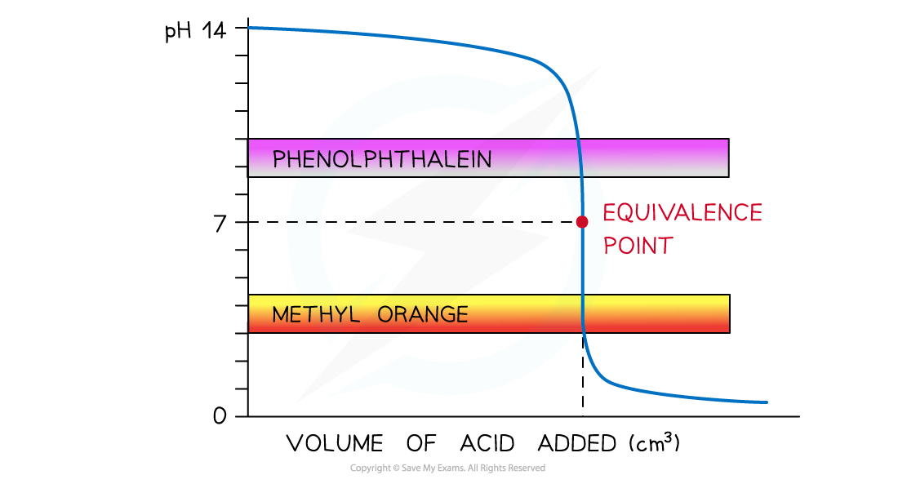
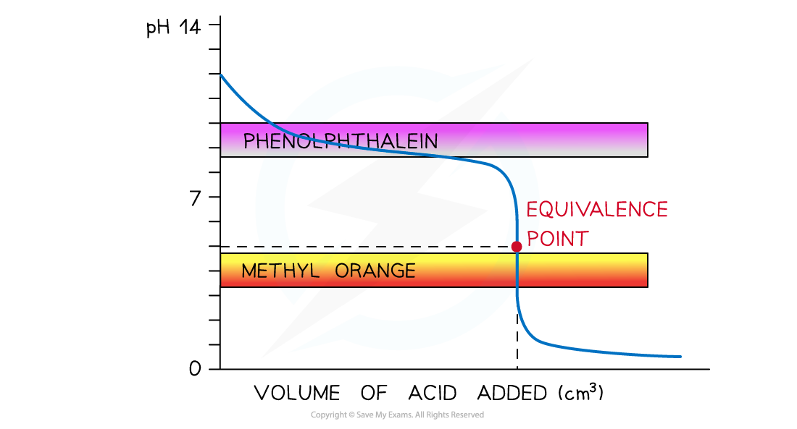
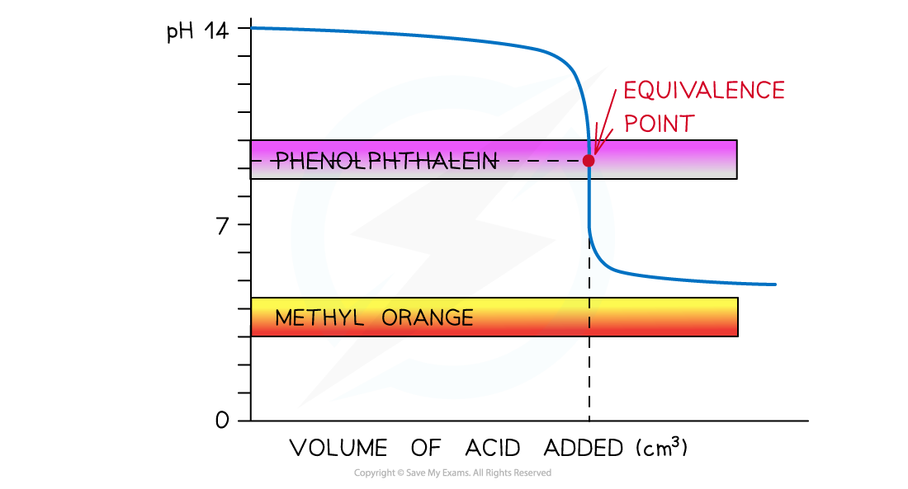
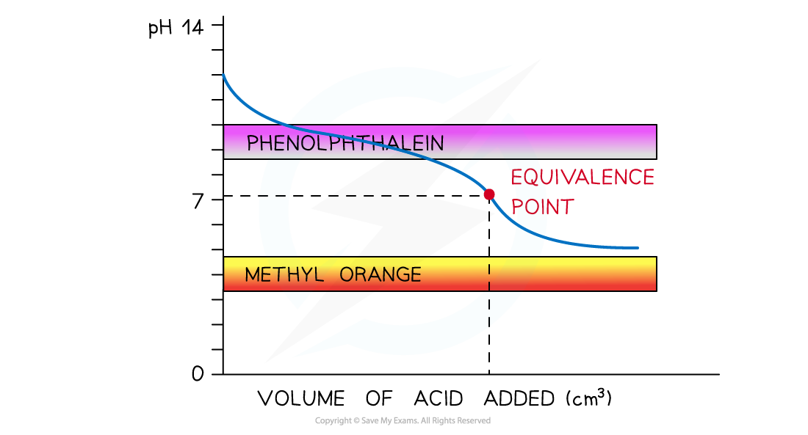

# Indicators used in Titration

## Indicators

> **Spec point** — `spcpt_8cNrtVG6kjCS6NYV`

## Indicators

- **Indicators **are substances that change colour when they are added to acidic or alkaline solutions
- When choosing the appropriate indicator, the pH of the equivalence point is very important
- The two most common indicators that are used in titrations are **methyl orange **and **phenolphthalein**

#### Indicator & pH range examples

- Both indicators change colour over a specific pH range

  - **Methyl orange **3.1 - 4.4
  - **Phenolphthalein **8.3 - 10.0

#### Diagram showing the colour changes for methyl orange and phenolphthalein

*Methyl orange changes from red to yellow over a pH range of 3.1 - 4.4, while phenolphthalein changes from colourless to pink over a pH range of 8.3 - 10.0*

### Choosing indicators for titrations

**Strong acid and strong alkali**

- The colour change for **both indicators** takes place at a pH range that falls within the vertical region of the curve
- Therefore, either indicator can be used

#### Methyl orange and phenolphthalein in a strong acid + strong alkali titration

*Both indicators can be used to determine the endpoint of the titration of a strong acid and strong alkali*

- **Strong acid and weak alkali**

  - Only **methyl orange** will change colour at a pH close to the equivalence point and within the vertical region of the curve

#### Methyl orange and phenolphthalein in a strong acid + weak alkali titration

*Only methyl orange can be used to determine the endpoint of the titration of a strong acid and weak alkali*

- **Weak acid and strong alkali**

  - Now, only **phenolphthalein** will change colour at a pH close to the equivalence point and within the vertical region of the curve
  - The pH range at which methyl orange changes colour falls below the curve

#### Methyl orange and phenolphthalein in a weak acid + strong alkali titration

*Only phenolphthalein can be used to determine the endpoint of the titration of a weak acid and strong alkali*

- **Weak acid and weak alkali**

  - Neither indicator is useful, and a different method should be considered

#### Methyl orange and phenolphthalein in a weak acid + weak alkali titration

*Neither indicator can be used to determine the endpoint of the titration of a weak acid and weak alkali*
