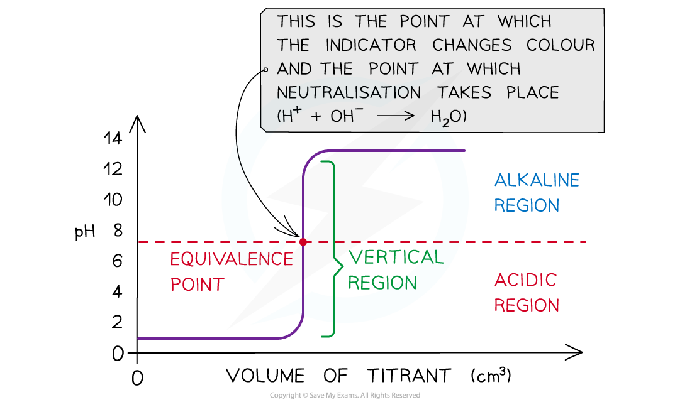
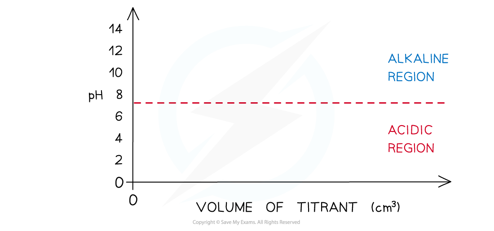
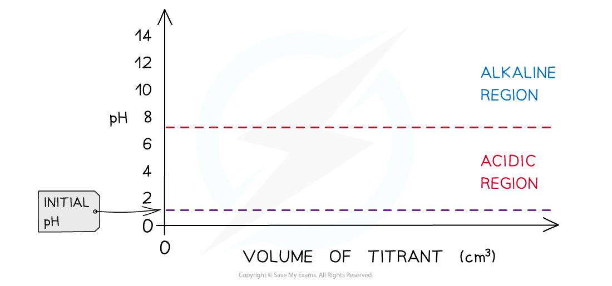
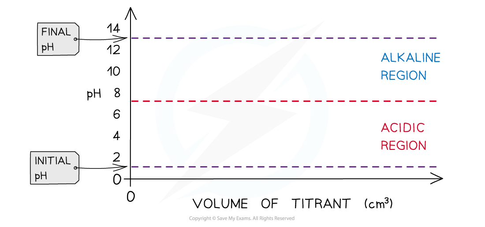
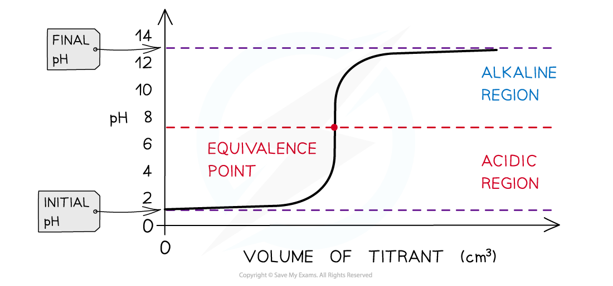
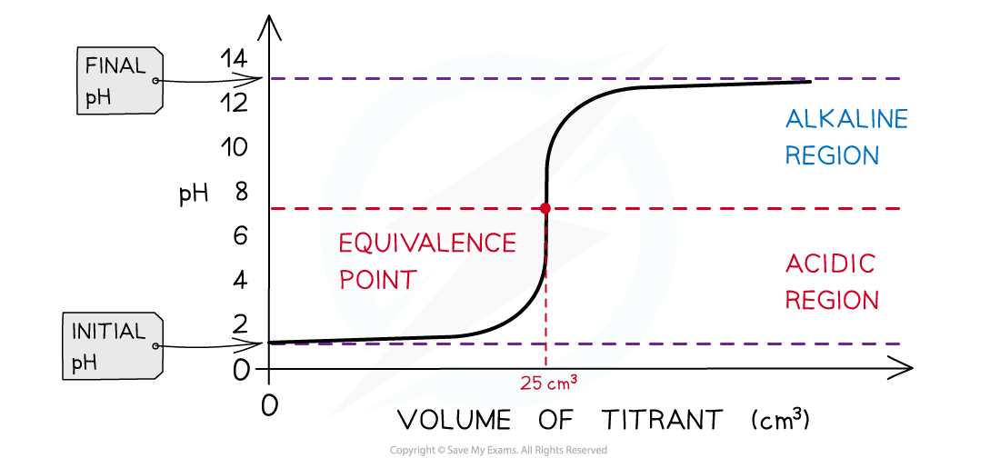
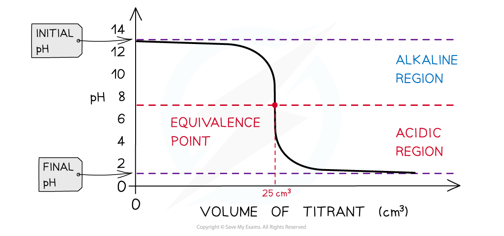
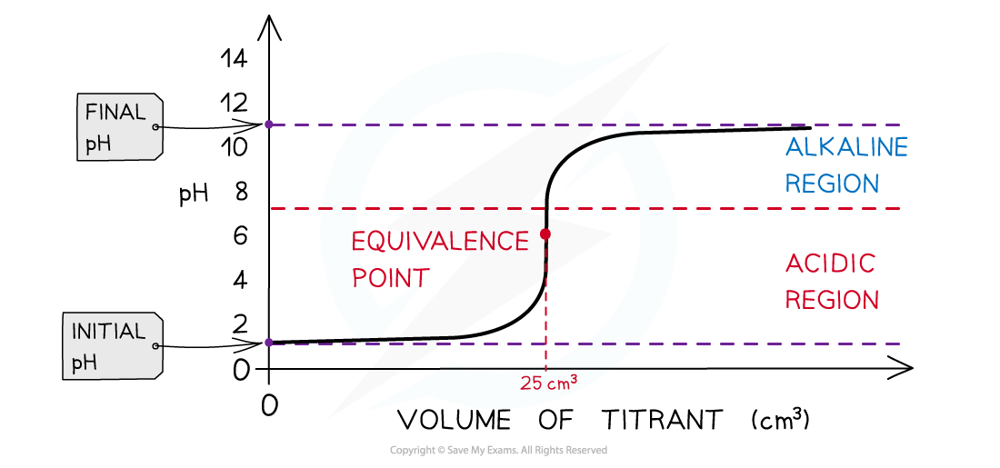
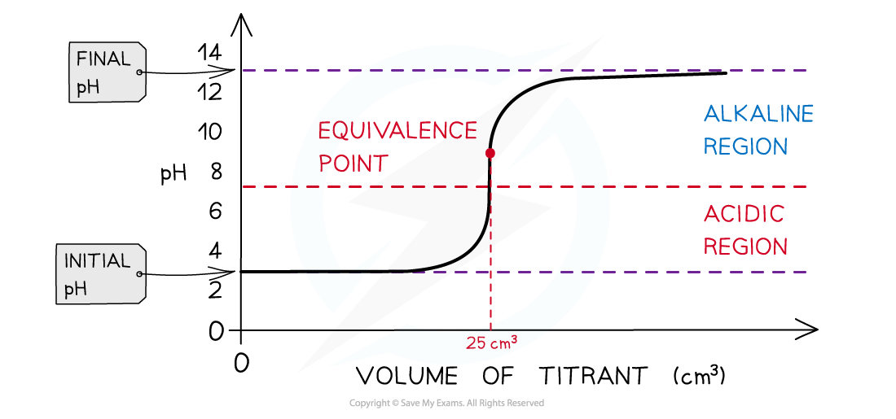
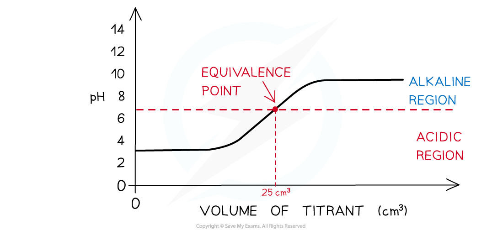

# pH Titration Curves

## pH Titration Curves

> **Spec point** — `spcpt_hp29KmkdFhKN6DZk`

## pH Titration Curves

### What are pH titration curves?

- Titration is a technique used in neutralisation reactions between acids and alkalis to determine the concentration of the unknown solution
- It involves adding **a titrant **of known concentration from a burette into a conical flask containing the **analyte** of unknown concentration
- An indicator is added which will change colour at the **endpoint** of the titration
- The endpoint is the point at which the indicator changes colour
- The equivalence point is halfway along the **vertical region** of the curve

**Equivalence point → moles of alkali = moles of acid**

- The **equivalence point** is the point at which equal numbers of moles of titrant and analyte have reacted, and is the point at which **neutralisation** takes place; a well-chosen indicator changes colour at the endpoint very close to it

#### Example pH titration curve

*The equivalence point is the point at which an equal number of moles of titrant and analyte have reacted*

### Sketching a pH titration curve

- Draw axes with volume added (cm3) on the x-axis and pH on the y-axis

- Draw a horizontal line running parallel to the x-axis at pH 7

  - Everything below this line will be in the acidic **region** and everything above it in the **alkaline** region

- Determine which substance is in the conical flask

  - If it is **a strong acid** the initial pH is about 1 or 2
  - If it is **a weak acid t**he initial pH is about 2-3
  - If it is **a strong alkali** the initial pH is about 13-14
  - If it is **a weak alkali **the initial pH is about 11

- Determine what type of acid and alkali are used:

  - Strong acid + strong alkali
  - Strong acid + weak alkali
  - Weak acid + strong alkali
  - Weak acid + weak alkali

- Draw the pH titration curve

### Strong acid + strong alkali pH titration curve

- Initially, there are only H+ ions present in the solution from the dissociation of the strong acid (HCl) (initial pH about 1-2)
- As the **volume of strong alkali (NaOH) added increases**, the pH of the HCl solution slightly increases too as more and more H+ ions react with the OH- from the NaOH to form water
- The change in pH is not that much until the volume added gets close to the equivalence point
- The pH surges upwards very steeply
- The **equivalence point** is the point at which all H+ ions have been neutralised

  - Therefore, the pH is 7 at the equivalence point
- Adding more NaOH will increase the pH as now there is an **excess in OH****-**** ions** (final pH about 13-14)

#### pH titration curve for a strong acid + strong alkali

*The diagram shows a pH titration curve of hydrochloric acid with sodium hydroxide*

- The pH titration curve for HCl added to a NaOH has the **same shape**
- The initial pH and final pH are the other way around
- The equivalence point is still 7

#### pH titration curve for a strong alkali + strong acid

*The diagram shows a pH titration curve of sodium hydroxide with hydrochloric acid *

### Strong acid + weak alkali pH titration curve

- Initially, there are **only H****+**** ions present** in the solution from the dissociation of the strong acid (HCl) (initial pH about 1-2)
- As the volume of weak alkali (NH3) added increases, the **pH of the analyte solution slightly increases too** as more and more H+ ions react with the NH3
- The change in pH is not that much until the volume added gets close to the equivalence point
- The **equivalence point is the point at which all H****+**** ions have been neutralised by the NH****3** however the equivalence point is not neutral, but the solution is still acidic (pH about 5.5)
- This is because all H+ have reacted with NH3 to form NH4+ which is a weak acid that partially dissociates to release H+, causing the solution to be acidic
- As more of the NH3 is added, the pH increases to above 7 but below that of a strong alkali as NH3 is a weak alkali

#### pH titration curve for a strong acid + weak alkali

*The diagram shows a pH titration curve of  hydrochloric acid  with ammonia*

- The pH titration curve for strong acid added to a weak alkali has the same shape
- The initial and final pH are the other way around
- The **equivalence point is still about 5.5**

### Weak acid + strong alkali pH titration curve

- Initially, there are **only H****+**** ions present in the solution** from the dissociation of the weak acid (CH3COOH, ethanoic acid) (initial pH about 2-3)
- As the volume of strong alkali (NaOH) added increases, the **pH of the ethanoic acid solution slightly increases too** as more and more H+ ions react with the OH- from the NaOH to form water
- The change in pH is not that much until the volume added gets close to the equivalence point
- The pH surges upwards very steeply
- The **equivalence point is the point at which all H****+**** ions have been neutralised by the OH****-**** ions** however the equivalence point is not neutral, but the solution is slightly basic (pH about 9)
- This is because all H+ in CH3COOH have reacted with OH- however, CH3COO- is a weak base that partially reacts with water to form OH-, causing the solution to be basic
- As more of the NaOH is added, the pH increases to about 13-14

#### pH titration curve for a weak acid + strong alkali

*The diagram shows a pH titration curve of a weak acid with a strong base*

- The pH titration curve for weak acid added to a strong alkali has the same shape
- The initial and final pH are the other way around
- The **equivalence point is still about 9**

### Weak acid + weak alkali pH titration curve

- Initially, the solution contains mostly undissociated weak acid, with a low concentration of H+ ions from its partial dissociation (CH3COOH, ethanoic acid) (initial pH about 2-3)
- In these pH titration curves, there is no vertical region
- There is a **‘point of inflexion’ **at the equivalence point
- The curve does not provide much other information

#### pH titration curve for a weak acid + weak alkali

*The diagram shows a pH titration curve of  weak acid with weak alkali*

> **Exam Hint**
> You should be able to read and sketch pH titration curves of titrations where the titrant is an acid or an alkali.

> **Worked Example**
> A 10.0 cm3 sample of 0.150 mol dm–3 aminoethanoic acid with a pH of 5.3 was titrated with 0.100 mol dm–3 NaOH. After 20.0 cm3 of NaOH, an excess, had been added, the pH was found to be 12.5.
> 
> Using the following axes, sketch a graph showing how the pH changes during this titration.
> 
> 
> 
> [3]
> 
> **Answer**
> 
> - The curve starts at pH 5.3
> 
>   - Mark on graph
> - The volume of NaOH added to reach the vertical section of the graph = 15.0 cm3
> 
>   - Vol acid x Concentration acid = Vol base x Concentration base
>   - 10 x 0.150 = Vol base x 0.100
>   - $\frac{( 10 \times 0.150 )}{0.100}$ = 15.0 cm3
>   - There is no mark for the height of the vertical section, but the equivalence point must be** above **pH 7 for a weak acid - strong base titration
> - The curve finishes at pH = 12.5 at 20 cm3.
> 
>   - Make sure the graph does not go above pH 12.5
>   
>     - This is the maximum pH value given in the question
>   - Make sure that the volume does not exceed 20 cm3
>   
>     - This is the maximum volume of base added given in the question
> 
> 
