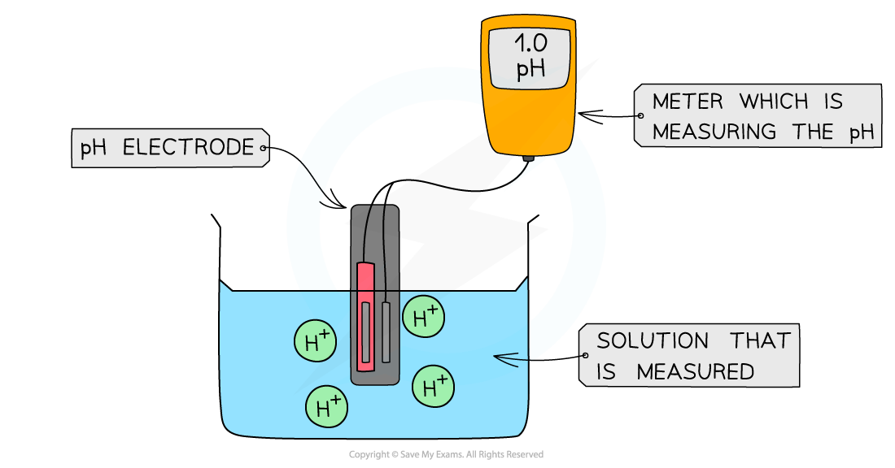
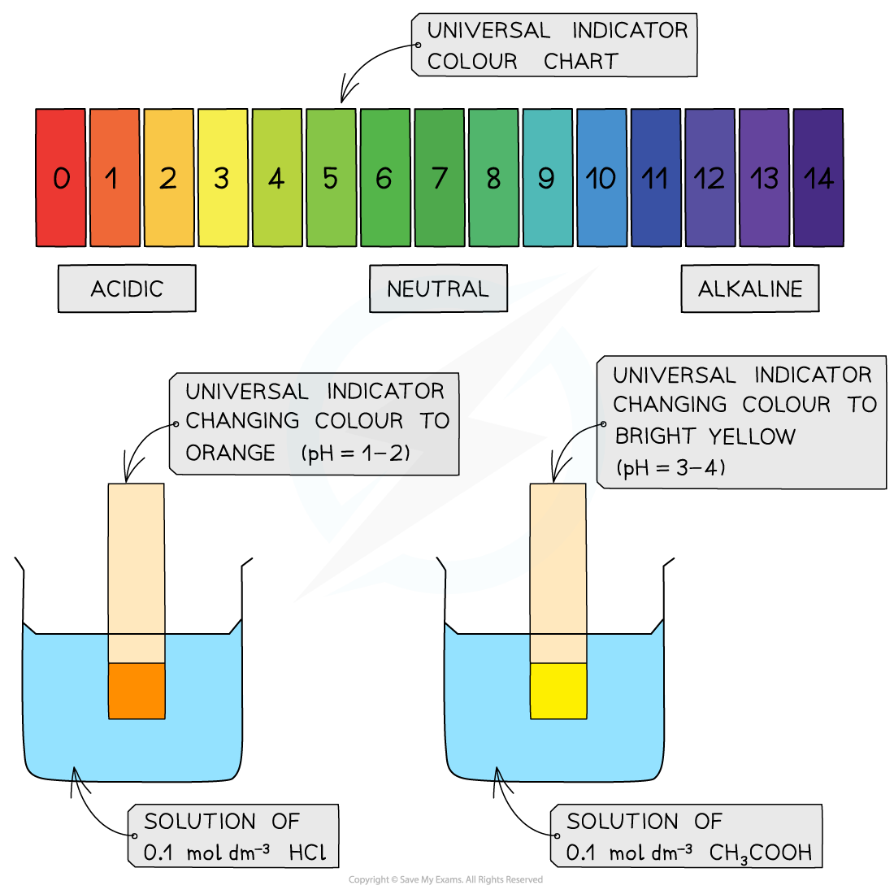
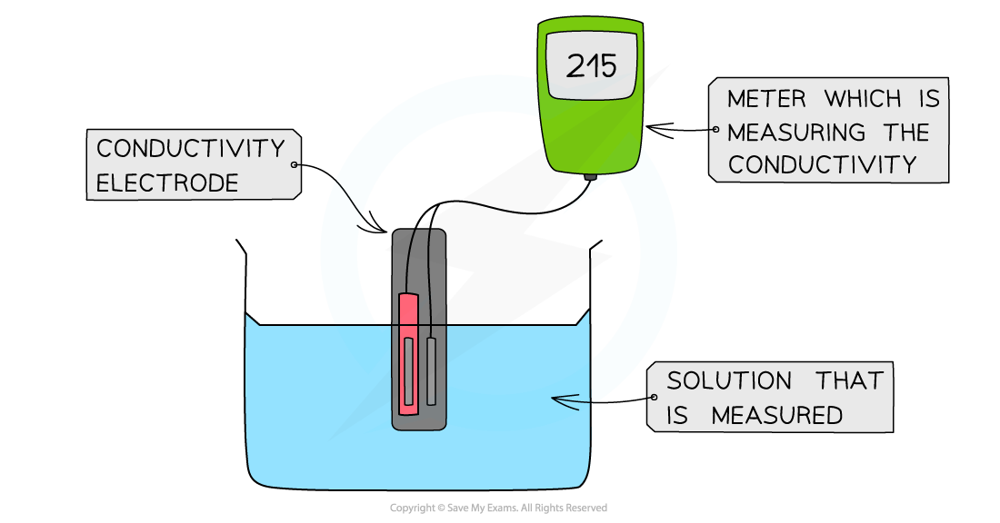
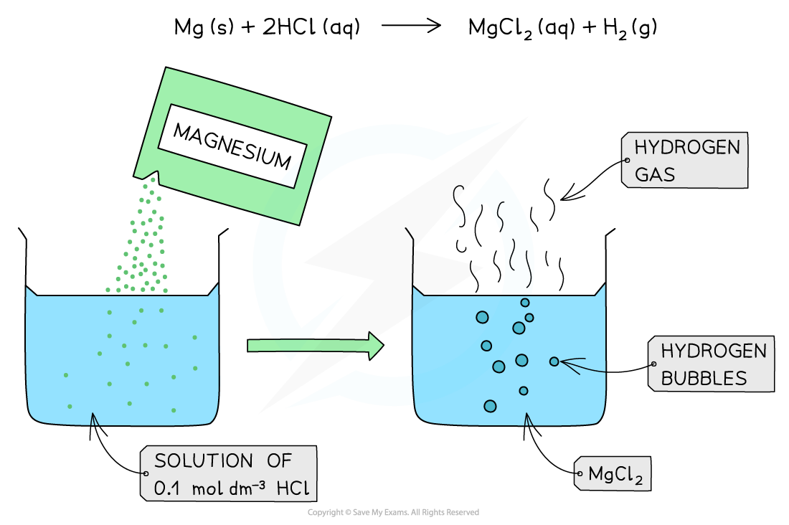
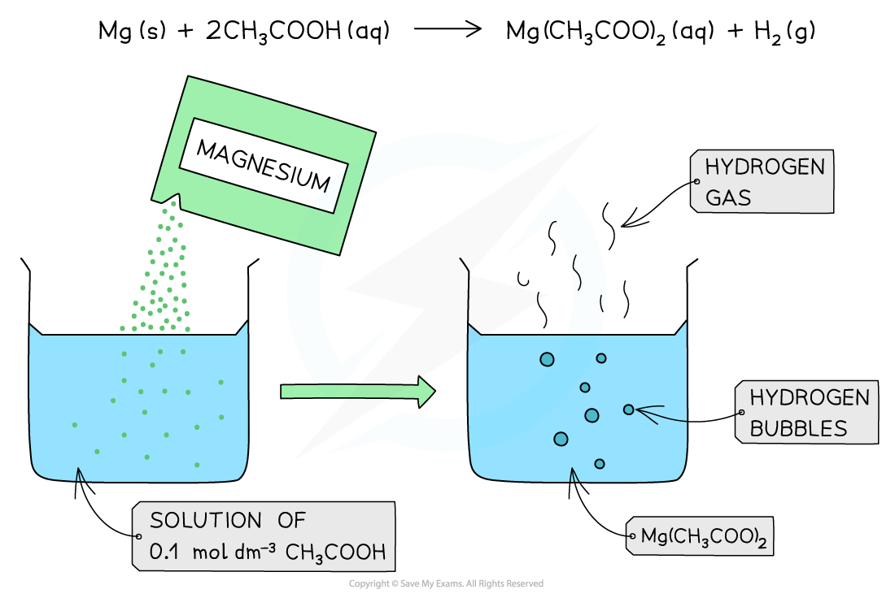

# Strength of Acids & Bases

## Strong & Weak Acids & Bases

> **Spec point** — `spcpt_7WXcDwskTqCS2cNn`

## Strong & Weak Acids & Bases

- Strong and weak acids can be distinguished from each other by their:

  - **pH value** (using a pH meter or universal indicator)
  - **Electrical conductivity**
  - **Reactivity**

### pH

- An acid **dissociates** into H+ in solution according to:

**HA → H****+**** + A****-**

- The **stronger** the acid, the **greater** the **concentration of H****+** and therefore the **lower** **the** **pH**

#### pH values of a strong & weak acids

- pH of 0.1 mol dm-3 solution:

  - HCl (strong); pH 1
  - CH3COOH (weak); pH about 3

- The most **accurate** way to determine the pH is by reading it off a **pH meter**
- The pH meter is connected to the **pH electrode** which shows the pH value of the solution

#### Using a digital pH meter

*The diagram shows a digital pH meter measures the pH of a solution using a pH electrode*

- A less accurate method is to measure the pH using universal indicator paper
- The universal indicator paper is dipped into a solution of acid, upon which the paper changes colour
- The colour is then compared to those on a chart which shows the colours corresponding to different pH values

#### How to use universal indicator paper

*The diagram shows the change in colour of the universal indicator paper when dipped in a strong and weak acid. The colour chart is used to read off the corresponding pH values which are between 1-2 for a strong acid and 3-4 for a weak acid*

### Electrical conductivity

- Since a **stronger acid **has a **higher concentration of H****+**** **it **conducts electricity **better
- Stronger acids therefore have a greater **electrical conductivity**
- The electrical conductivity can be determined by using a **conductivity meter**
- Like the pH meter, the conductivity meter is connected to an electrode
- The conductivity of the solution can be read off the meter

#### Using a digital conductivity meter

*The diagram shows a digital conductivity meter that measures the electrical conductivity of a solution using an electrode*

### Reactivity

- Strong and weak acids of the same concentrations react differently with reactive metals
- This is because the concentration of H+ is greater in strong acids compared to weak acids
- The greater H+ concentration means that H2 gas is produced faster (equal amounts of acid give the same total volume of H2 when the magnesium is in excess)

#### The reaction of 0.1 mol dm-3 of a strong acid, HCl, with Mg

*The reaction produces a lot of bubbles and hydrogen gas due to the high concentration of H+ present in the solution*

#### The reaction of 0.1 mol dm-3 of a weak acid, CH3COOH, with Mg

*The reaction produces fewer bubbles and hydrogen gas due to the lower concentration of H+ present in the solution*

> **Exam Hint**
> - The above-mentioned properties of strong and weak acids depend on their ability to dissociate and form H+ ions.
> - Stronger acids dissociate more, producing a greater concentration of H+ ions and therefore showing lower pH values, greater electrical conductivity and more vigorous reactions with reactive metals.

## Neutralisation Reactions

> **Spec point** — `spcpt_hhsQcFzVK8SK2Fpk`

## Neutralisation Reactions

- A neutralisation reaction is one in which an acid (pH <7) and a base/alkali (pH >7) react together to form water (pH = 7) and a salt:

**acid + base (alkali) → salt + water**

- The proton of the acid reacts with the hydroxide of the base to form water:

**H****+**** (aq) + OH****–**** (aq) → H****2****O (l)**

- The spectator ions which are not involved in the formation of water are Na+ (aq) + Cl– (aq)

  - These react to form the salt:

**Na****+**** (aq) + Cl****–**** (aq) → NaCl (aq)**

- The name of the salt produced can be predicted from the acid that has reacted

#### Salts produced from certain acids

- Hydrochloric acid forms **chloride **salts
- Sulfuric acid forms **sulfate** salts
- Nitric acid forms **nitrate** salts
- Ethanoic acid forms **ethanoate** salts

> **Exam Hint**
> Note that the reaction of an acid and metal carbonate also forms carbon dioxide:
> 
> **acid + metal carbonate → salt + water + carbon dioxide**
