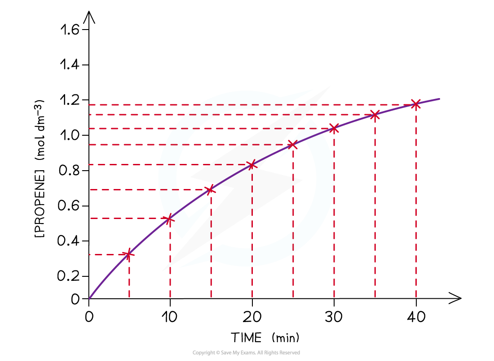
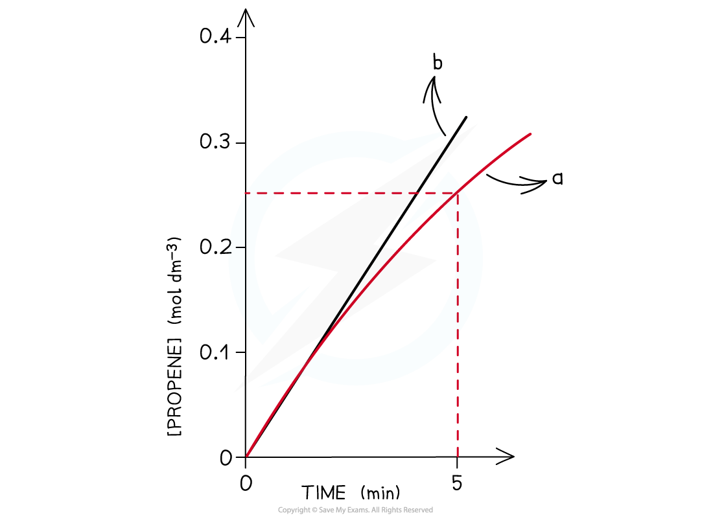
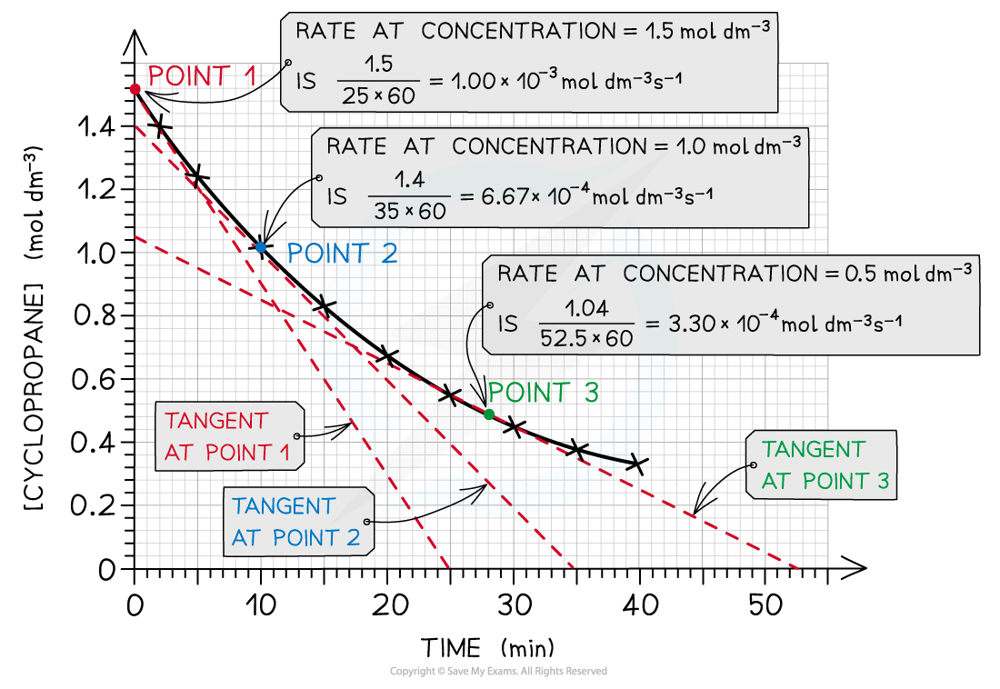
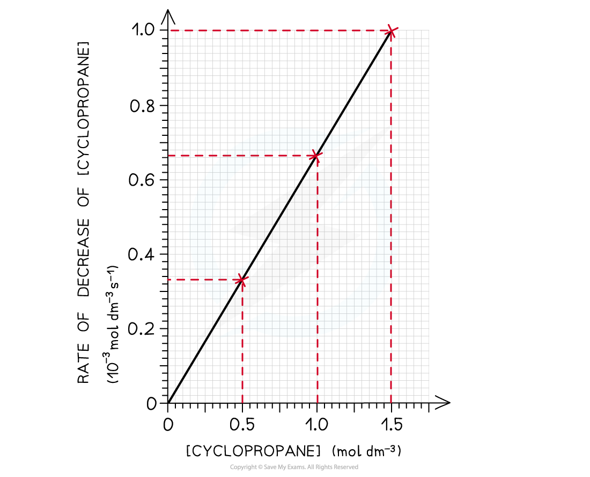

# Rate of Reaction Calculations

## Rate of Reaction Experimental Calculations

> **Spec point** — `spcpt_TGSKfd5J5wJTrCmx`

## Rate of Reaction Experimental Calculations

- During a reaction, the **reactants** are used up and changed into the **products**
- This means that as the reaction proceeds, the concentration of reactants **decreases **and the concentration of products **increases**
- Therefore, the **rate of the reaction** is not the same throughout the reaction but **changes**
- The rate of reaction during the reaction can be calculated from a **concentration-time graph.**
- The **isomerisation of cyclopropane** to propene will be taken as an example:

#### Isomerisation of cyclopropane

*The reactant cyclopropane isomerises to form propene*

- The concentrations of reactant (cyclopropane) and product (propene) over time can be experimentally obtained

#### Concentrations of cyclopropane & propene results table

| **Time** **(min)** | **[cyclopropane]** **(mol dm****-3****)** | **[propene]** **(mol dm****-3****)** |
|---|---|---|
| **0** | 1.50 | 0.00 |
| **5** | 1.23 | 0.27 |
| **10** | 1.00 | 0.50 |
| **15** | 0.82 | 0.68 |
| **20** | 0.67 | 0.83 |
| **25** | 0.55 | 0.95 |
| **30** | 0.45 | 1.05 |
| **35** | 0.37 | 1.13 |
| **40** | 0.33 | 1.17 |

- When taking the measurements, the **temperature** should be kept the same at all times as a **change** in temperature will change the **rate of reaction**
- A **concentration-time graph** for the **concentration of propene as well as cyclopropane** can be obtained from the above results

  - As an example, the concentration-time graph for propene is shown below:

#### Concentration-time graph for propene

*The graph shows that the concentration of propene increases with time*

### Calculating the rate at the start of a reaction

- At the start of the reaction, the concentration-time curve looks almost linear
- The rate at this point can therefore be found by treating the curve as a linear line and by using:

**Rate of reaction = **$\frac{\mathrm{change} \mathrm{in} \mathrm{the} \mathrm{amount} \mathrm{of} \mathrm{reactants} \mathrm{or} \mathrm{products}(\mathrm{mol} \mathrm{dm}^{-3})}{\mathrm{time}(s)}$

- Using the graph, the average rate of the reaction over the first 5 minutes for propene is:

#### Applying tangents to curves

*Line (a) shows the average rate over the first five minutes whereas line (b) shows the actual initial rate found by drawing a tangent at the start of the curve. The calculated rates are very similar for both methods.*

* *

- Rate of reaction = $\frac{\mathrm{change} \mathrm{in} \mathrm{the} \mathrm{amount} \mathrm{of} \mathrm{reactants} \mathrm{or} \mathrm{products}(\mathrm{mol} \mathrm{dm}^{-3})}{\mathrm{time}(s)}$

  - Rate of reaction =$\frac{0.27}{300}$
  - Rate of reaction = 0.0009 mol dm-3 s-1

### Calculating the rate as the reaction proceeds

- The curve becomes shallower with time which means that the rate decreases with time
- The rate of reaction can be calculated by taking short time intervals

  - For example, the rate of reaction from 15 to 20 mins
  - During this time, the concentration of propene increases from 0.68 to 0.83 mol dm-3:

- Rate of reaction = $\frac{\mathrm{change} \mathrm{in} \mathrm{the} \mathrm{amount} \mathrm{of} \mathrm{reactants} \mathrm{or} \mathrm{products}(\mathrm{mol} \mathrm{dm}^{-3})}{\mathrm{time}(s)}$

  - Rate of reaction =$\frac{( 0.83 ) - ( 0.68 )}{( 1200 ) - ( 900 )}$
  - Rate of reaction = $\frac{0.14}{300}$
  - Rate of reaction = 0.0005 mol dm-3 s-1

- The smaller the time intervals, the more accurate the reaction rate value is
- Even more accurate is to find the rate of reaction at **different concentrations **of reactant or product at **particular time** **points**
- This can be done by drawing **tangents **at several points on the graph

  - As an example, the rates of reaction at different concentrations of cyclopropane are calculated by drawing the appropriate tangents:

#### Calculating rate as a reaction progresses

*The rate of reaction at 3 different concentrations of cyclopropane is calculated by drawing tangents at those points in the graph*

#### Rate-concentration graph

- The calculated rates can then be summarised in a table to show how the rate of reaction changes with changing concentration of the reactants or products

#### Change in rate with decreasing concentration of cyclopropane table

| **[cyclopropane] (mol dm****-3****)** | **Rate (10****–3**** mol dm****-3**** s****-1****)** |
|---|---|
| **0.5** | 0.33 |
| **1.0** | 0.67 |
| **1.5** | 1.0 |

- This data can then be used to plot a rate-concentration graph
- The graph shows that the rate is directly proportional to the concentration of cyclopropane

  - If you double the concentration of cyclopropane the rate of reaction will double too

#### Rate-concentration graph

*The graph shows a directly proportional correlation between the concentration of cyclopropane and the rate of reaction*

> **Exam Hint**
> To calculate the rate of reaction you can either use the increase in concentration of products (like in the example above) or the decrease in concentration of reactants.
