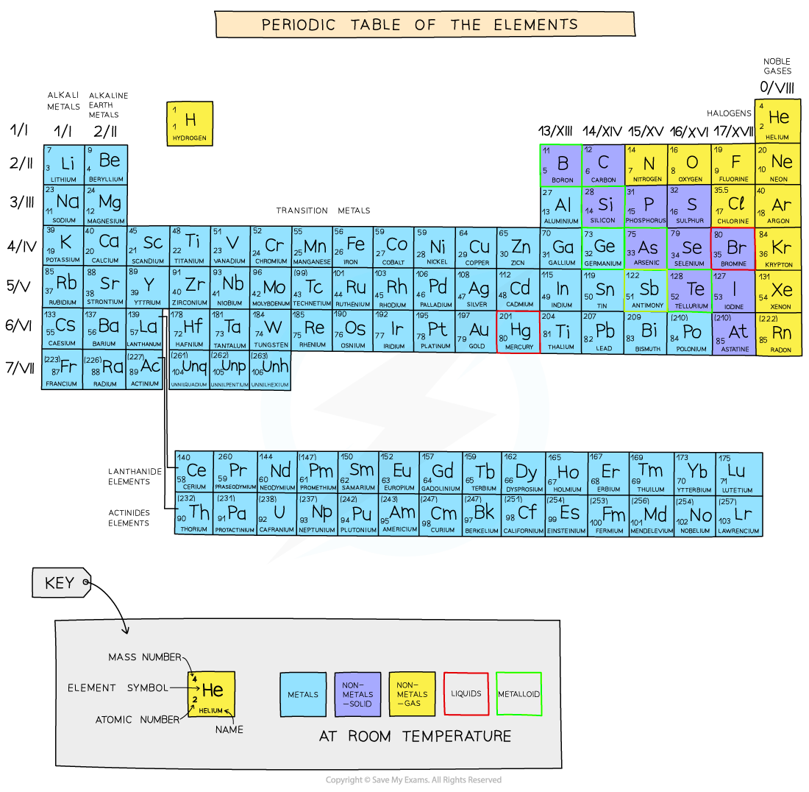
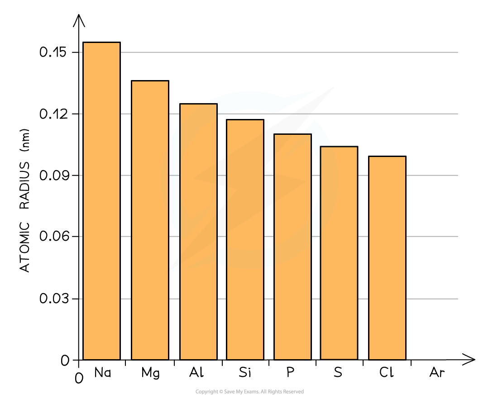
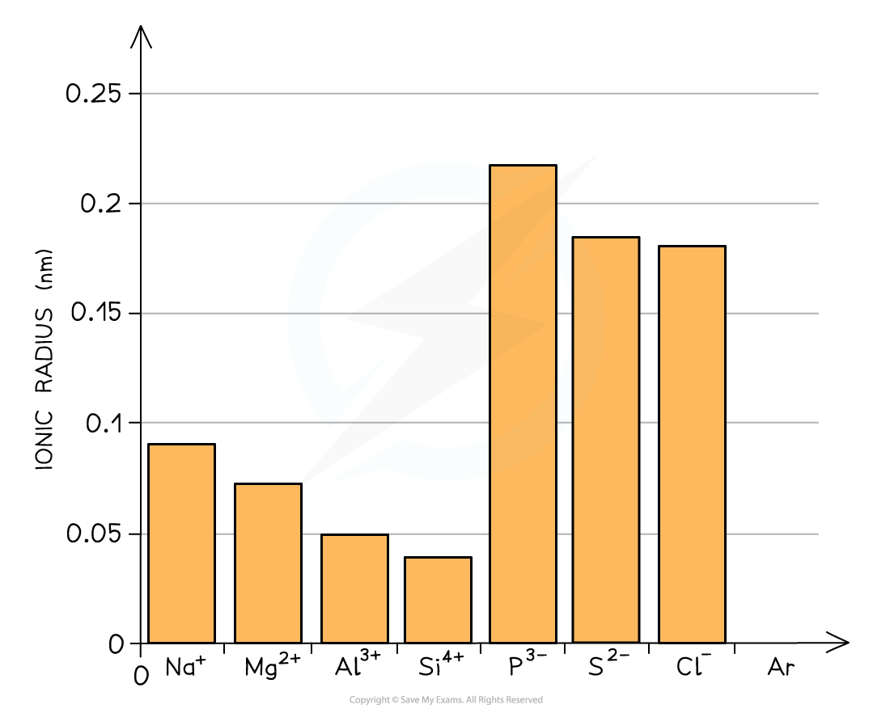
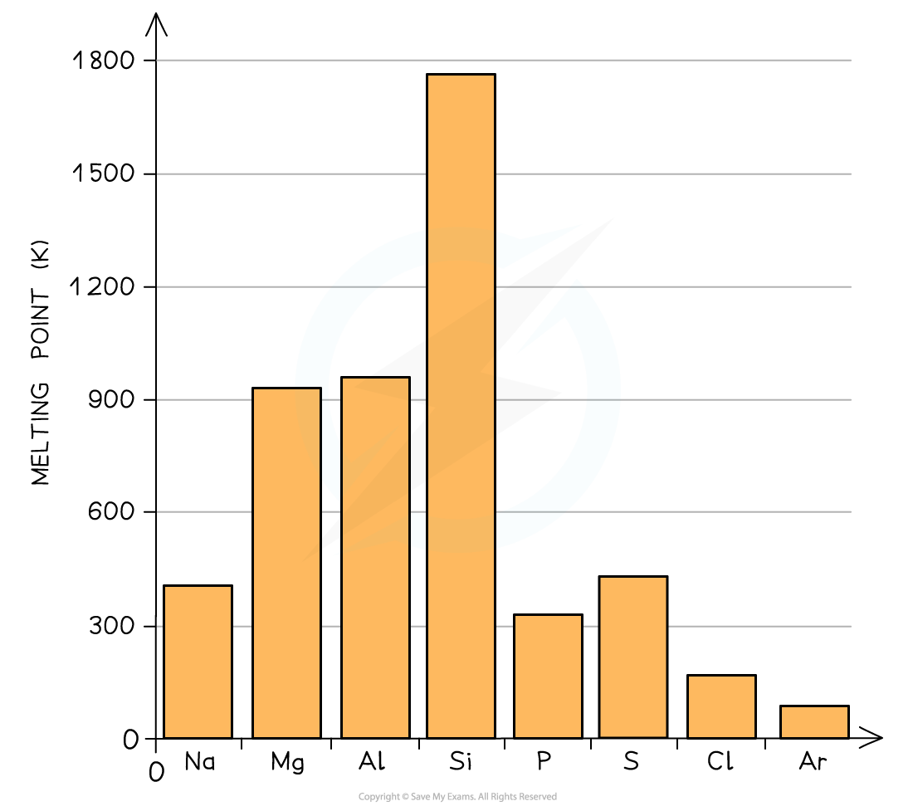

# Physical Properties of the Period 3 Elements

## Describing Physical Properties of the Period 3 Elements 

> **Spec point** — `spcpt_hXGsNB87dP7gcCSZ`

## Describing Physical Properties of the Period 3 Elements

- Elements in the periodic table are arranged in order of increasing atomic number and placed in vertical columns (**groups**) and horizontal rows (**periods)**
- The elements across the periods show **repeating patterns** in chemical and physical properties
- This is called **periodicity**

#### Arrangement of elements in the Periodic Table

*Elements are arranged by increasing atomic number from left to right*

### Atomic radius

- The **atomic radius **is the distance between the nucleus and the outermost electron of an atom
- The atomic radius is measured by taking two atoms of the same element, measuring the distance between their nuclei and then halving this distance
- In **metals, **this is also called the **metallic radius **and in **non-metals**, the **covalent radius**

#### Atomic radius

*The atomic radius gives a measure of the size of atoms*

#### Atomic radii of Period 3 elements table

| **Period 3 element** | **Na** | **Mg** | **Al** | **Si** | **P** | **S** | **Cl** | **Ar** |
|---|---|---|---|---|---|---|---|---|
| **Atomic radius** **(nm)** | 0.157 | 0.136 | 0.125 | 0.117 | 0.110 | 0.104 | 0.099 | - |

#### Graph of atomic radii across Period 3

*There is a decrease in atomic radii of Period 3 elements across the period*

- Across the period, the atomic radii decrease
- This is because the number of protons (**the nuclear charge**) and the number of **electrons** increases by one every time you go an element to the right
- The elements in a period all have the same number of shells (so the **shielding effect **is the same)
- This means that as you go across the period the nucleus attracts the electrons more **strongly pulling them closer** to the nucleus
- Because of this, the atomic radius (and thus the size of the atoms) **decreases** across the period

### Ionic radius

- The **ionic radius **is the distance between the nucleus and the outermost electron of an ion
- Metals produce positively charged ions (**cations**) whereas nonmetals produce negatively charged ions (**anions**)
- The **cations **have lost their valence electrons which causes them to be much **smaller **than their parent atoms

  - This is because there are less electrons, which also means that there is less **shielding **of the outer electrons
- Going across the period from Na+ to Si4+ the ions get **smaller** due to the **increasing** **nuclear charge** attracting the outer electrons in the **second principal quantum shell** more strongly (the nucleus has an increasing atomic number)
- The **anions **are larger than their original parent atoms because each atom has gained one or more electrons in their **third principal quantum shell**
- This increases the repulsion between electrons, while the **nuclear charge **is still the same, causing the electron cloud to spread out
- Going across P3- to Cl-, the ionic radii** decrease** as the nuclear charge increases across the period while the number of electrons stays the same (all three ions have 18 electrons, formed by P gaining 3, S gaining 2 and Cl gaining 1)

#### Ionic radii of ions of Period 3 elements table

| **Period 3 ion** | **Na****+** | **Mg****2+** | **Al****3+** | **Si****4+** | **P****3–** | **S****2–** | **Cl****–** | **Ar** |
|---|---|---|---|---|---|---|---|---|
| **Ionic radius** **(nm)** | 0.095 | 0.065 | 0.050 | 0.041 | 0.212 | 0.184 | 0.181 | No data |

#### Graph of ionic radii across Period 3 ions

*Ions of Period 3 elements with increasing positive charge (metals) and increasing outer electrons across the period*

#### Melting point

#### Melting points of the elements across Period 3 table

| **Period 3 element** | **Na** | **Mg** | **Al** | **Si** | **P** | **S** | **Cl** | **Ar** |
|---|---|---|---|---|---|---|---|---|
| **Melting point** **(K)** | 371 | 923 | 932 | 1683 | 317 | 392 | 172 | 84 |

#### Graph of melting points across Period 3

*There is a general increase in melting point from Na to Si, followed by a sharp drop to the lower melting points of P to Ar*

- A general increase in **melting point **for the Period 3 elements up to silicon is observed
- **Silicon **has the highest **melting point**
- After the Si element, the melting points of the elements **decrease **significantly

### Electrical conductivity

- **Electrical conductivity **refers to how well a substance can conduct **electricity**
- Unlike the melting points, the electrical conductivity of the Period 3 elements shows a clear trend
- Going across the period, the electrical conductivity of the elements **decreases **significantly

  - Initially there is an increase in the electrical conductivity from Na to Al and then this decreases across the remaining elements

#### Trends in electrical conductivity across Period 3 table

| **Period 3 element** | **Na** | **Mg** | **Al** | **Si** | **P** | **S** | **Cl** | **Ar** |
|---|---|---|---|---|---|---|---|---|
| **Electrical conductivity** **(S ****m-1)** | 0.218 | 0.224 | 0.382 | 2 x 10-10 | 10-17 | 10-23 | - | - |
