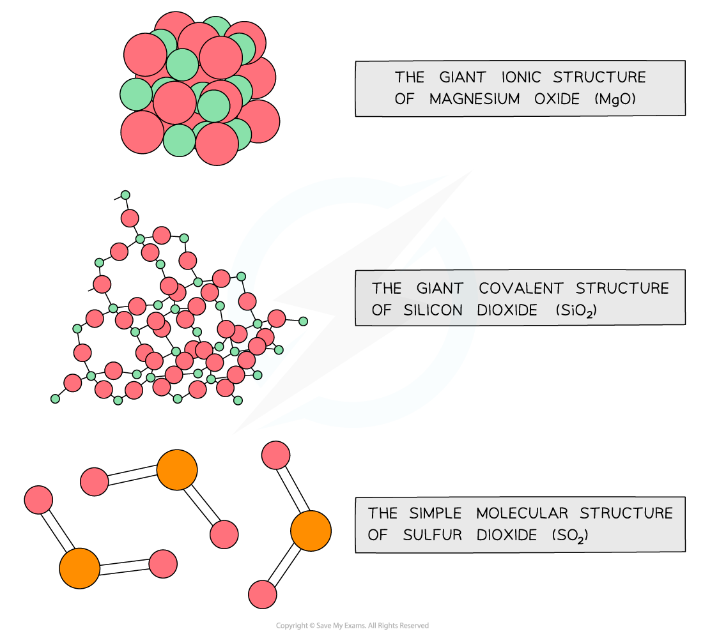

# Acid/Base Behaviour of the Period 3 Oxides & Hydroxides

## Acid / Base Behaviour of Period 3 Oxides & Hydroxides

> **Spec point** — `spcpt_DScNRQ6zgD52DhdD`

## Acid / Base Behaviour of Period 3 Oxides & Hydroxides

### Period 3 oxides

- Aluminium oxide is **amphoteric **which means that it can act both as a base (and react with an acid such as HCl) and an acid (and react with a base such as NaOH)

#### Acidic and basic nature of Period 3 oxides table

| **Period 3 oxide** | **Na****2****O** | **MgO** | **Al****2****O****3** | **SiO****2** | **P****4****O****10** | **SO****2 ****SO****3** |
|---|---|---|---|---|---|---|
| **Acid / base nature** | Basic | Basic | Amphoteric | Acidic | Acidic | Acidic |

#### Reaction of Period 3 oxides with acid / base table

| **Oxide** | **Chemical equation** | **Comment** |
|---|---|---|
| **Na****2****O** | Na2O (s) + 2HCl (aq) → 2NaCl (aq) + H2O (l) |   |
| **MgO** | MgO (s) + 2HCl (aq) → MgCl2 (aq) + H2O (l) | Used in indigestion remedies by neutralising excess acid in the stomach |
| **Al****2****O****3** | Al2O3 (s) + 3H2SO4 (aq) → Al2(SO4)3 (aq) + 3H2O (l) Al2O3 (s) + 2NaOH (aq) + 3H2O (l) → 2NaAl(OH)4 (aq) | Reacts with acid to form salt and water Reacts with hot, concentrated alkali to form salt |
| **SiO****2** | SiO2 (s) + 2NaOH (aq)  → Na2SiO3 (aq) + H2O (l) |   |
| **P****4****O****10** | P4O10 (s) + 12NaOH (aq)  → 4Na3PO4 (aq) + 6H2O (l) |   |
| **SO****2****  SO****3** | SO2 (g) + 2NaOH (aq)  → Na2SO3 (aq) + H2O (l) SO3 (g) + 2NaOH (aq)  → Na2SO4 (aq) + H2O (l) |   |

- The acidic and basic nature of the Period 3 elements can be explained by looking at their **structure**, **bonding** and the Period 3 elements’ **electronegativity**

#### Structure & bonding of the Period 3 oxides table

| **Period 3 oxide** | **Na****2****O** | **MgO** | **Al****2****O****3** | **SiO****2** | **P****4****O****10** | **SO****2 ****SO****3** |
|---|---|---|---|---|---|---|
| **Relative melting point** | High | High | Very high | Very high | Low | Low |
| **Chemical bonding** | Ionic | Ionic | Ionic (with some covalent character) | Covalent | Covalent | Covalent |
| **Structure** | Giant ionic | Giant ionic | Giant ionic | Giant covalent | Simple molecular | Simple molecular |

#### Electronegativity of Period 3 elements table

| **Period 3 element** | **Na** | **Mg** | **Al** | **Si** | **P** | **S** | **Cl** |
|---|---|---|---|---|---|---|---|
| **Electronegativity** | 0.9 | 1.2 | 1.5 | 1.8 | 2.1 | 2.5 | 3.0 |

- Oxygen has an electronegativity value of 3.5
- Therefore, the difference in electronegativity between oxygen and Na, Mg and Al is the largest
- So, electrons will be **transferred **to oxygen when forming oxides giving the oxide an **ionic bonding**
- The oxides of Si, P and S will **share **the electrons with the oxygen to form **covalently bonded** oxides
- The **giant ionic **and** giant covalent **structured oxides will have **high melting points** as it is difficult to break the structures apart

#### The structure of some Period 3 oxides

*Magnesium oxide is giant ionic, silicon dioxide is giant covalent and sulfur dioxide is simple molecular*

- The oxides of **Na and Mg** which show purely **ionic bonding** produce **alkaline **solutions with water as their **oxide **ions (O2-) become **hydroxide **ions (OH-):

**O****2- ****(aq) + H****2****O (l) → 2OH****- ****(aq)**

- The oxides of **P and S** which show purely **covalent bonding **produce **acidic **solutions with water because when these oxides react with water, they form an acid which donates **H****+**** **ions to water

  - Eg. SO3 reacts with water as follows:

**SO****3 ****(g) + H****2****O (l) → H****2****SO****4 ****(aq)**

- The H2SO4 is an acid which will donate a H+ to water:

**H****2****SO****4 ****(aq) + H****2****O (l) → H****3****O****+**** (aq) + HSO****4****- ****(aq)**

- The oxides of **Al** and **Si** (Al2O3 and SiO2) are insoluble and when they react with **hot, concentrated alkaline solution** they act as an acid and form a salt

  - This behaviour is very typical of a **covalently bonded oxide**
- **Al **can also react with **acidic solutions **to form a salt and water

  - This behaviour is very typical of an **ionic bonded metal oxide**
- This behaviour of **Al** proves that the chemical bonding in aluminium oxide is not purely **ionic** nor **covalent: it is amphoteric**

### Period 3 hydroxides

- NaOH is a strong base and will react with acids to form a salt and water:

**NaOH (aq) + HCl (aq) → NaCl (aq) + H****2****O (l)**

- Mg(OH)2 is also a basic compound which is often used in indigestion remedies by neutralising the excess acid in the stomach to relieve pain:

**Mg(OH)****2 ****(s) + 2HCl (aq) → MgCl****2 ****(aq) + 2H****2****O (l)**

- Al(OH)3 is **amphoteric **and can act both as an acid and base:

**Al(OH)****3 ****(s) + 3HCl (aq) → AlCl****3 ****(aq) + 3H****2****O (l)**

**Al(OH)****3 ****(s) + NaOH (aq) → NaAl(OH)****4 ****(aq)**

> **Exam Hint**
> - Electronegativity is the power of an element to draw the electrons towards itself in a covalent bond.
> - For example, in Na2O the oxygen will draw the electrons more strongly towards itself than sodium does.
