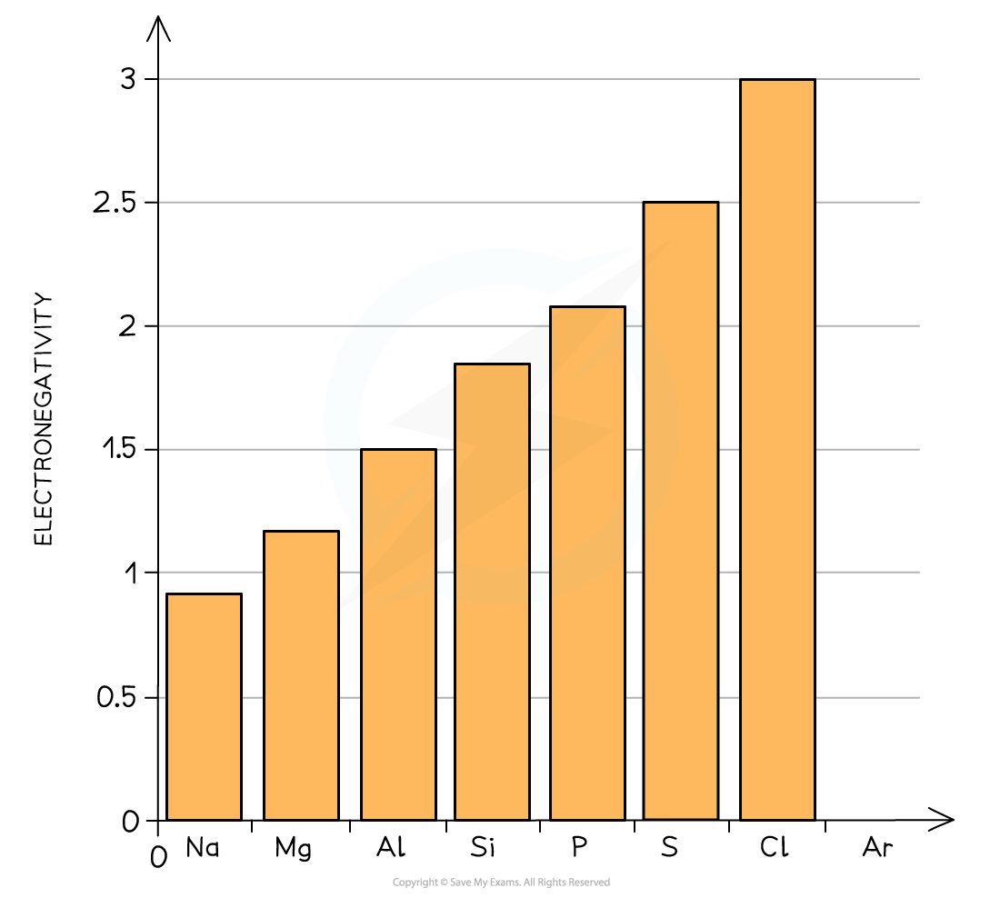
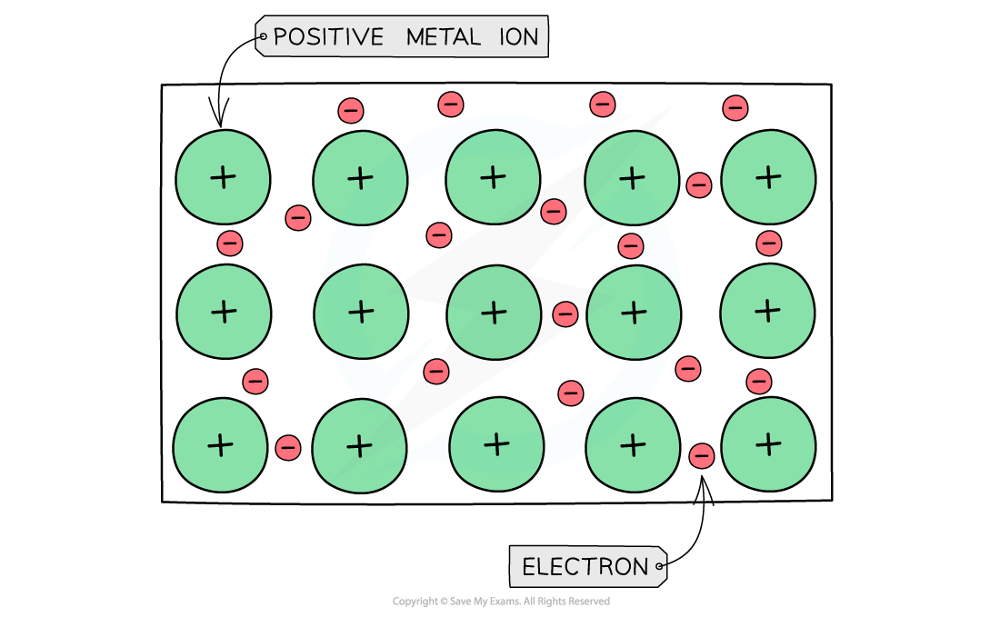
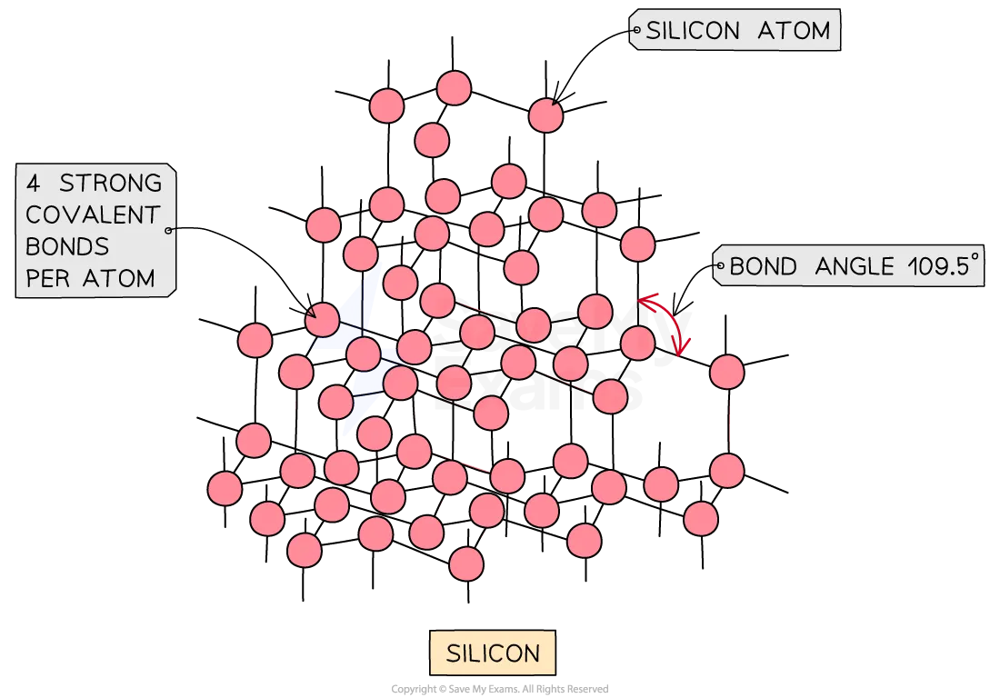
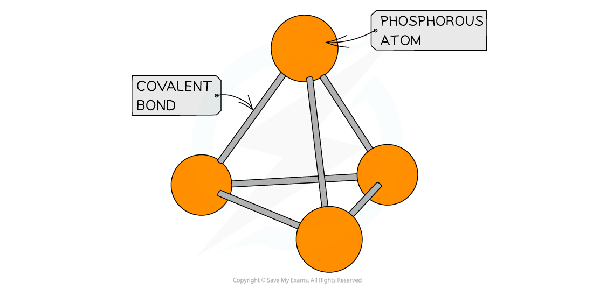
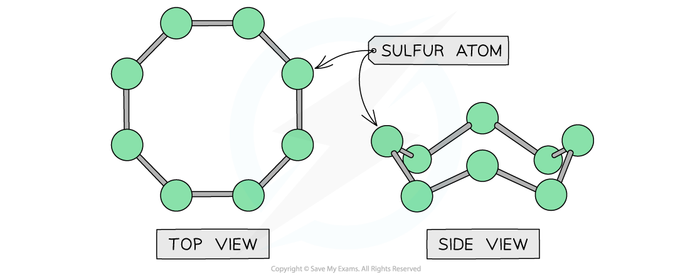

# Electronegativity & Bonding of the Period 3 Elements

## Trends in Period 3 Electronegativity & Bonding 

> **Spec point** — `spcpt_43qjgSZhjrKzVV7x`

## Trends in Period 3 Electronegativity & Bonding

### Electronegativity

- **Electronegativity** is the power of an element to draw the electrons towards itself in a covalent bond
- Going **across **the period, the **electronegativity **of the elements increases

#### Electronegativity across Period 3 table

| **Period 3 element** | **Na** | **Mg** | **Al** | **Si** | **P** | **S** | **Cl** | **Ar** |
|---|---|---|---|---|---|---|---|---|
| **Electronegativity** | 0.9 | 1.2 | 1.5 | 1.8 | 2.1 | 2.5 | 3.0 | - |

#### Graph of the electronegativity of the Period 3 elements

*Electronegativity of the Period 3 elements increases from Na to Cl*

- As the **atomic number **increases going across the period, there is an **increase **in **nuclear charge**
- Across the period, there is an increase in the number of **valence electrons **however the **shielding **is still the same as each extra electron enters the same shell
- As a result of this, electrons will be more strongly attracted to the nucleus causing an increase in electronegativity across the period

#### Bonding & structure of Period 3 elements table

| **Period 3 element** | **Na** | **Mg** | **Al** | **Si** | **P** | **S** | **Cl** | **Ar** |
|---|---|---|---|---|---|---|---|---|
| **Bonding** | Metallic | Metallic | Metallic | Covalent | Covalent | Covalent | Covalent | - |
| **Structure** | Giant metallic | Giant metallic | Giant metallic | Giant molecular | Simple molecular | Simple molecular | Simple molecular | Simple molecular |

#### Bonding and structure from Al to S

- As you move across the Periodic Table from aluminium (Al) to sulfur (S), both bonding and structure change:

  - Bonding changes from** metallic** (in Al) **to covalent** (in Si, P, S, etc.)
  - Structure changes from **giant lattices to simple molecular structures**
- Sodium (Na), magnesium (Mg), and aluminium (Al) are all metals
- They form a **giant metallic lattice**:

  - Positive metal ions are arranged in a regular lattice
  - They are surrounded by a ‘sea’ of delocalised electrons
  - These electrons come from the outer shell (valence shell) of each atom

#### Delocalised electrons and bond strength

- Na donates** 1** electron per atom
- Mg donates** 2** electrons per atom
- Al donates **3** electrons per atom
- As a result:

  - More **delocalised electrons = stronger electrostatic forces **between the metal ions and the electron cloud
  - Al³⁺ forms stronger metallic bonds than Na⁺, due to:
  
    - Higher ionic charge
    - Greater number of delocalised electrons

#### Electrical conductivity

- Because aluminium contributes more delocalised electrons, it has:

  - More **charge carriers**
  - Stronger **metallic bonding**
  - Therefore, aluminium is a **better conductor** of electricity than sodium or magnesium

#### A giant metallic lattice

*Metal cations form a giant lattice held together by electrons that can freely move around*

- Si is a non-metallic element and has a **giant molecular **structure in which each Si atom is held to its neighbouring Si atoms by **strong covalent bonds**
- There are no delocalised electrons in the structure of Si which is why silicon cannot conduct electricity and is classified as a **metalloid**

#### The giant molecular structure of silicon

*The diagram shows the giant molecular structure of silicon where silicon atoms are held together by strong covalent bonds*

#### Bonding from P to Ar

- **Phosphorus, sulfur, chlorine **and **argon **are non-metallic elements

  - Phosphorus, sulfur and chlorine exist as simple molecules (P4, S8, Cl2)
  - Argon exists as **single** atoms
- The **covalent bonds within** the molecules are strong, however, **between **the molecules there are only weak **instantaneous dipole-induced dipole forces**
- It doesn’t take much energy to break these **intermolecular** forces
- The lack of delocalised electrons means that these compounds cannot conduct electricity

#### The simple molecular structure of phosphorus

*The diagram shows the simple molecular structure of phosphorus with covalent bonds between the atoms*

#### The simple molecular structure of sulfur

*The diagram shows the simple molecular structure of sulfur with covalent bonds between the atoms*
