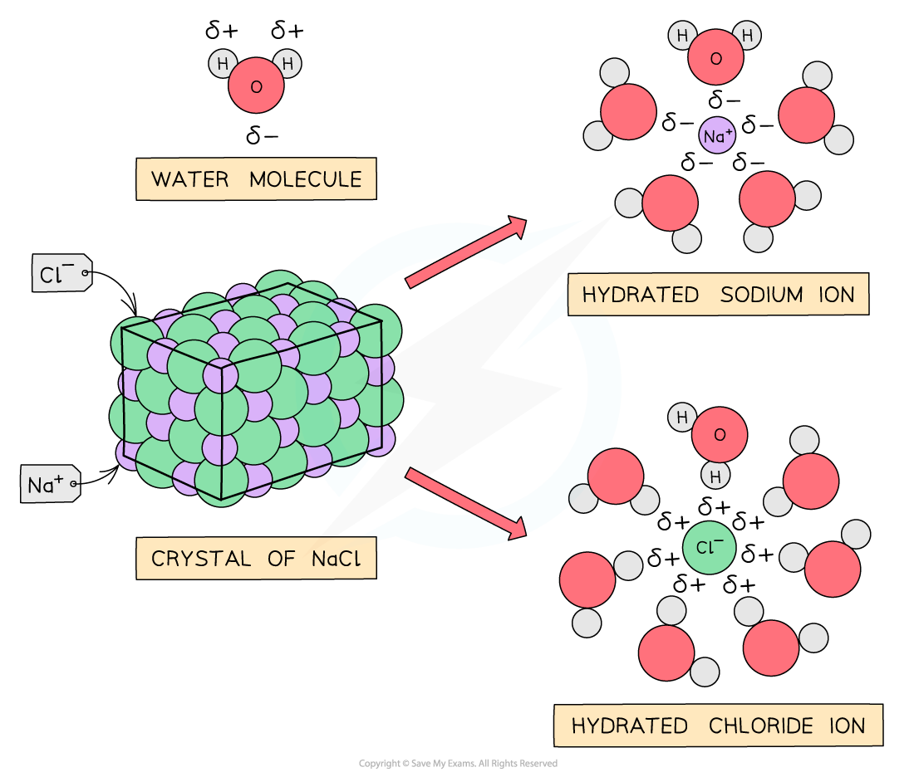
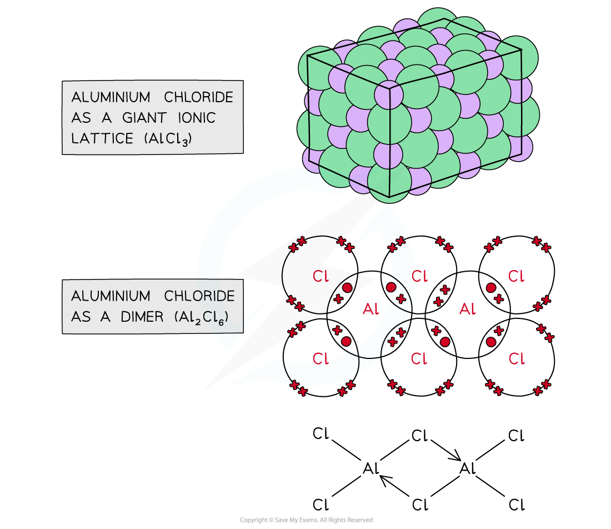
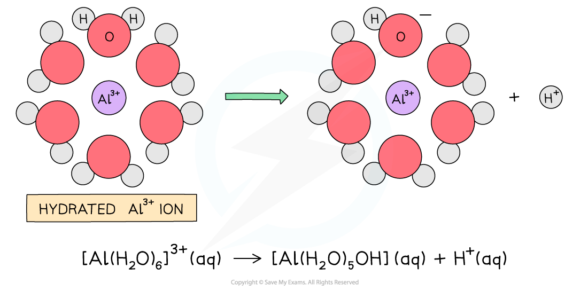

# Period 3 Chlorides

## Reaction of Period 3 Chlorides & Water

> **Spec point** — `spcpt_T8rWCG9RcM5Zwc4J`

## Reaction of Period 3 Chlorides & Water

- Chlorides of Period 3 elements show characteristic behaviour when added to water which can be explained by looking at their **chemical bonding **and **structure**

#### Chemical bonding & structure of Period 3 chlorides table

| **Period 3 chloride** | **NaCl** | **MgCl****2** | **Al****2****Cl****6** | **SiCl****4** | **PCl****5** | **SCl****2** |
|---|---|---|---|---|---|---|
| **Chemical bonding** | Ionic | Ionic | Covalent | Covalent | Covalent | Covalent |
| **Structure** | Giant ionic | Giant ionic | Simple molecular | Simple molecular | Simple molecular | Simple molecular |
| **Observations** | White solids dissolve to form colourless solutions | Chlorides react with water giving off white fumes of hydrogen chloride gas |   |   |   |   |
| **pH of solution formed** | 7.0 | 6.5 | 3.0 | 2.0 | 2.0 | 2.0 |

### Sodium & magnesium chloride

- NaCl and MgCl2 do not react with water as the **polar **water molecules are attracted to the ions **dissolving **the chlorides and breaking down the **giant ionic structures**: the metal and chloride ions become hydrated ions

*The diagram shows water molecules breaking down the giant ionic structure of NaCl to form hydrated ions*

### Aluminium chloride

- Aluminium chloride exists in two different forms depending on conditions: #### The two forms of aluminium chloride

  - **Anhydrous AlCl****3** is covalent and exists as a dimer, Al2Cl6
  - **In aqueous solution**, AlCl3 dissociates into Al3+ and Cl- ions and behaves ionically

*Aluminium chloride exists as a giant ionic lattice or a covalent dimer*

- When water is added to aluminium chloride the dimers are broken down and Al3+ and Cl- ions enter the solution
- The highly charged Al3+ ion becomes hydrated and causes a water molecule that is bonded to the Al3+ to lose an H+ ion which turns the solution **acidic**
- The H+ and the Cl- form **hydrogen chloride gas** which is given off as **white fumes**

#### How the Al3+ makes an acidic solution

*The hydrated aluminium causes a water molecule to lose a hydrogen ion turning the solution acidic*

### Silicon chloride

- SiCl4 is **hydrolysed** in water, releasing **white fumes of hydrogen chloride gas** in a **rapid **reaction

**SiCl****4 ****(l) + 2H****2****O (l) → SiO****2 ****(s) + 4HCl (g)**

- The SiO2 is seen as a **white precipitate **and some of the **hydrogen chloride gas **produced dissolves in water to form an **acidic **solution

### Phosphorus(V) chloride

- PCl5 also gets **hydrolysed **in water

**PCl****5 ****(s) + 4H****2****O (l) → H****3****PO****4 ****(aq) + 5HCl (g)**

- Both H3PO4 and dissolved HCl are highly **acidic**
