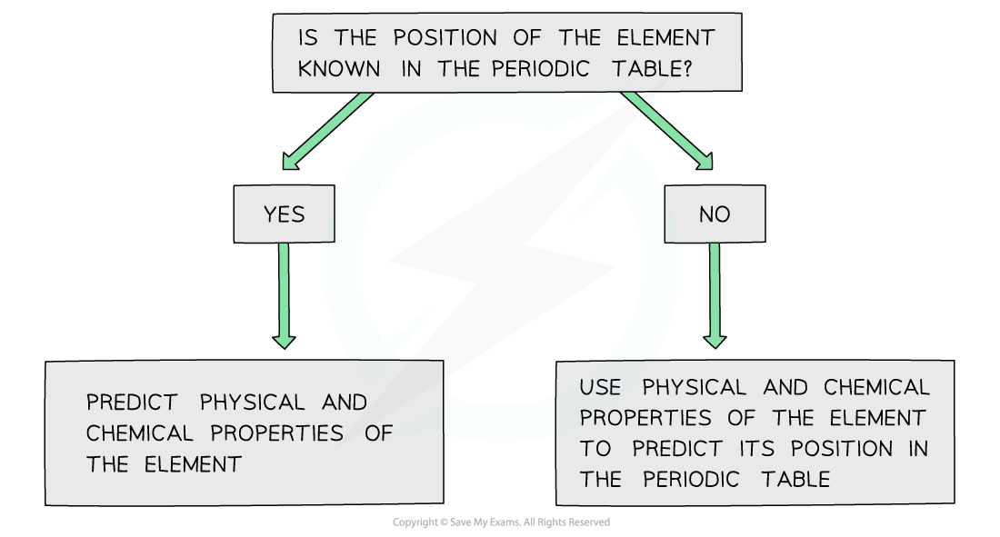

# Chemical Periodicity of Other Elements

## Periodicity: Predicting Position & Properties

> **Spec point** — `spcpt_mzpXwM7BhtqNryhr`

## Periodicity: Predicting Position & Properties

- If the **chemical** and **physical** **properties** of an element are known, the **position** of that element in the Periodic Table can be predicted
- Similarly, predictions can be made about the **physical** and **chemical** **properties** of elements if the **position** of the element in the Periodic Table is known

#### The diagram shows a flowchart to make predictions about an element's behaviour

*The flowchart shows how to use the position and / or properties of an element to make predictions about its behaviour*

> **Worked Example**
> **Deducing the position of an element in the Periodic Table**
> 
> Element **X** forms a chloride which reacts with water to form a solution of pH 1.0.
> 
> It forms an oxide which has a melting point of 1610 oC.
> 
> The oxide does not dissolve in or react with aqueous sodium hydroxide.
> 
> Deduce the possible position of element **X** in the Periodic Table.
> 
> **Answer**
> 
> - Break the question down and systematically approach the question
> - **Step 1: **‘Element **X** forms a chloride, which reacts with water to form a solution of pH 1’
> 
>   - The low pH of the solution formed suggests that the chloride is a non-metallic chloride (group 13 to 17)
> - **Step 2: **‘The oxide does not dissolve in or react with aqueous sodium hydroxide’
> 
>   - Since aluminium oxide does react with sodium hydroxide, element **X** cannot be Group 13
> - **Step 3: **'It forms an oxide which has a melting point of 1610 °C’
> 
>   - This suggests a giant molecular (covalent) structure which corresponds to Group 14
> 
> - **Step 4:**
> 
>   - Element **X **cannot be carbon (which is in Group 14) as carbon dioxide is a gas whereas the element X oxide is a solid (with a melting point of 1610 °C)
> 
> - **Step 5:**
> 
>   - Element **X** is therefore a Group 14 element in Period 3 or lower
> 
> - Note that this is an example of predicting the position of an element based on its physical and chemical properties

> **Worked Example**
> **Predicting physical and chemical properties of selenium**
> 
> Selenium is in Group 16 and Period 4 of the Periodic Table.
> 
> Predict some physical and chemical properties of selenium.
> 
> **Answer**
> 
> - **Step 1: **Selenium is a non-metal in Group 16
> 
>   - If compared to sulfur, its structure is predicted to be a **simple molecular structure**
> - **Step 2: Physical properties**
> 
>   - Simple molecular structures have **low melting points, do not conduct** **electricity** and are **insoluble** in water
> - **Step 3: Chemical properties **are:
> 
>   - Reaction with **water**
>   
>     - Sulfur does not react with water, so selenium is predicted not to react with water
>   - Reaction with **oxygen**
>   
>     - Simple molecules react with oxygen
>     - So, selenium could form an oxide of SeO2 (if compared with sulfur)
>   - Reaction with **chlorine**
>   
>     - Simple molecules react with chlorine
>     - So, selenium could form a simple molecule of SeCl2 which can react with the water vapour in the air to form hydrogen chloride (if compared with sulfur)
> - Note that this is an example of predicting the chemical and physical properties of an element based on its position in the Periodic Table

> **Worked Example**
> **Determining an unknown chloride compound**
> 
> The chloride of unknown element **Y** is a liquid at 20 oC.
> 
> This chloride reacts with water, releasing white fumes and leaving an acidic solution.
> 
> 1. Does element **Y** belong to Group 1, Group 2 or Group 15 of the Periodic Table?
> 2. What type of reaction takes place between the chloride of **Y** and water?
> 3. Identify the white fumes given off when the chloride of **Y** reacts with water.
> 
> **Answer**
> 
> - **Answer 1:**
> 
>   - Group 1 and Group 2 chlorides dissolve in water to form colourless solutions of pH 6.5 - 7.0
>   - Group 15 chlorides on the other hand react with water to form strong acidic solutions
>   - Element **Y** therefore belongs to Group 15 of the Periodic Table
> - **Answer 2:**
> 
>   - Group 15 chlorides get hydrolysed in water, therefore this is a hydrolysis reaction
> - **Answer 3:**
> 
>   - The white fumes that are given off during this reaction are hydrogen chloride gas
