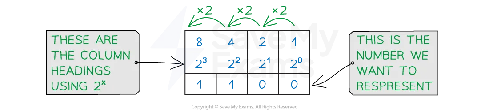
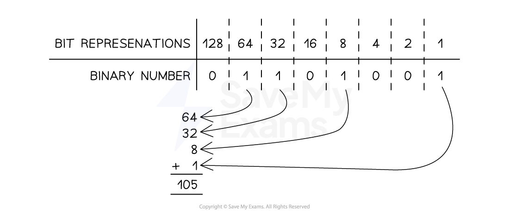

# Number systems

## Number bases

> **Spec point** — `spcpt_ZSfwmXYvdV7kmcfb`

## Number bases

### What is a number base?

- A number base is the number of **different digits or symbols** a number system uses to represent values
- Each place in a number represents a **power of the base**, starting from the right

### Denary

- Denary is a number system that is made up of **10 digits (0-9)**
- Denary is referred to as a **base-10** number system
- Each digit has a weight factor of **10 raised to a power**, the rightmost digit is 1s (100), the next digit to the left 10s (101) and so on
- Humans use the denary system for **counting**, **measuring **and **performing maths calculations**
- Using combinations of the 10 digits we can represent any number

- In this example, (3 x 1000) + (2 x 100) + (6 x 10) + (8 x 1) = 3268
- To represent a bigger number we **add more digits**

### Binary

- Binary is a number system that is made up of **two digits (1 and 0) **
- Binary is referred to as a **base-2** number system
- Each digit has a weight factor of **2 raised to a power**, the rightmost digit is 1s (20), the next digit to the left 2s (21) and so on
- Each time a new digit is added, the **column value is multiplied by 2**
- Using **combinations of the 2 digits** we can represent any number

- In this example, **Binary 1100** = **(1 x 8) + (1 x 4) = 12**
- To represent bigger numbers we add more **b**inary dig**its** (bits)

| **32,768** | **16,384** | **8,192** | **4,096** | **2,048** | **1,024** | **512** | **256** | **128** | **64** | **32** | **16** | **8** | **4** | **2** | **1** |
|---|---|---|---|---|---|---|---|---|---|---|---|---|---|---|---|
| 215 | 214 | 213 | 212 | 211 | 210 | 29 | 28 | 27 | 26 | 25 | 24 | 23 | 22 | 21 | 20 |

### Hexadecimal

- Hexadecimal is a number system that is made up of **16 digits**, 10 numbers (**0-9**) and 6 letters (**A-F**)

| **0** | **1** | **2** | **3** | **4** | **5** | **6** | **7** | **8** | **9** | **10** | **11** | **12** | **13** | **14** | **15** |
|---|---|---|---|---|---|---|---|---|---|---|---|---|---|---|---|
| 0 | 1 | 2 | 3 | 4 | 5 | 6 | 7 | 8 | 9 | A | B | C | D | E | F |

- Hexadecimal is referred to as a **base-16** number system
- Each digit has a weight factor of **16 raised to a power**, the rightmost digit is 1s (160), the next digit to the left 16s (161)

| **16s** | **1s** | ** ** |
|---|---|---|
| **1** | **3** |   |
| 1 x16 | 3 x 1 | = 19 |

- A quick comparison table demonstrates a **relationship **between **hexadecimal and a binary *****nibble***
- One hexadecimal digit can represent **four bits** of binary data

| **Denary** | **Binary** | **Hexadecimal** |
|---|---|---|
| 0 | ***0000*** | **0** |
| 1 | ***0001*** | **1** |
| 2 | ***0010*** | **2** |
| 3 | ***0011*** | **3** |
| 4 | ***0100*** | **4** |
| 5 | ***0101*** | **5** |
| 6 | ***0110*** | **6** |
| 7 | ***0111*** | **7** |
| 8 | ***1000*** | **8** |
| 9 | ***1001*** | **9** |
| 10 | ***1010*** | **A** |
| 11 | ***1011*** | **B** |
| 12 | ***1100*** | **C** |
| 13 | ***1101*** | **D** |
| 14 | ***1110*** | **E** |
| 15 | ***1111*** | **F** |

### Binary to denary & denary to binary

- Binary numbers can be converted into denary and vice-versa
- For example the 8-bit binary number ***01101001*** can be converted into denary using the following method:

*Binary to denary conversion*

- Therefore the 8-bit binary number ***01101001 ***is **105 **as a denary value
- To convert the denary number **101** to binary, we firstly write out binary number system

| **128** | **64** | **32** | **16** | **8** | **4** | **2** | **1** |
|---|---|---|---|---|---|---|---|
|   |   |   |   |   |   |   |   |

- Then we start at the left and look for the highest number that is less than or equal to **101 **and if so, place a 1 in that column
- Otherwise, place a 0 in the column
- **128** is bigger than **101** and therefore we place a 0 in that column
- **64** is smaller than **101 **so we place a 1 in that column

  - **101 - 64 = 37**
  - This now means we have **37 **left to find
- **32** is smaller than **37 **so we place a 1 in that column

  - **37 - 32 = 5**
  - This now means we have **5 **left to find
- **16** is bigger than **5** and therefore we place a 0 in that column
- **8** is bigger than **5** and therefore we place a 0 in that column
- **4** is smaller than **5** so we place a **1** in that column

  - **5 - 1 = 1**
  - This now means we have **1** left to find
- **2** is bigger than **1** and therefore we place a 0 in that column
- **1** is equal to the number we have left so we place a 1 in that column
- 64 + 32 + 4 + 1 = **101**

  - Therefore the denary number** 101** in binary is ***01100101***

| **128** | **64** | **32** | **16** | **8** | **4** | **2** | **1** |
|---|---|---|---|---|---|---|---|
| *0* | *1* | *1* | *0* | *0* | *1* | *0* | *1* |

### Hexadecimal to denary & denary to hexadecimal

- To convert the denary number **163 **to hexadecimal, start by **dividing the denary value by 16 **and recording the **whole times** the number goes in and the **remainder**
- 163 ➗16 = 10 remainder 3
- In hexadecimal the **whole number = digit 1** and the **remainder = digit 2**
- Digit 1 = 10 (A)
- Digit 2 = 3
- Denary **163 **is **A3** in hexadecimal

- To convert the hexadecimal number **79 **to denary, start by **multiplying the first hexadecimal digit by 16**
- 7 ✖ 16 = 112
- **Add digit 2** to the result
- 112 + 9 = 121
- Hexadecimal **79 **is **121 **in denary

### Binary to hexadecimal & hexadecimal to binary

- To convert the binary number ***10110111 ***to **hexadecimal**, first split the 8 bit number into 2 binary** *****nibbles***

| **8** | **4** | **2** | **1** | ** **  ** ** | **8** | **4** | **2** | **1** |
|---|---|---|---|---|---|---|---|---|
| ***1*** | ***0*** | ***1*** | ***1*** | ***0*** | ***1*** | ***1*** | ***1*** |   |

- For each nibble, convert the binary to it’s denary value
- (1 x 8) + (1 x 2) + (1 x 1) = **11 (B)**
- (1 x 4) + (1 x 2) + (1 x 1) = **7**
- Join them together to make a 2 digit hexadecimal number
- Binary ***10110111 ***is **B7 **in hexadecimal

- To convert the hexadecimal number **5F **to binary, first **split the digits apart** and convert each to a **binary nibble**

| **8** | **4** | **2** | **1** | ** ** |
|---|---|---|---|---|
| ***0*** | ***1*** | ***0*** | ***1*** | **= 5** |

| **8** | **4** | **2** | **1** | ** ** |
|---|---|---|---|---|
| ***1*** | ***1*** | ***1*** | ***1*** | **= 15 (F)** |

- Join the 2 binary nibbles together to create an 8 bit binary number

| **128** | **64** | **32** | **16** | **8** | **4** | **2** | **1** |
|---|---|---|---|---|---|---|---|
| ***0*** | ***1*** | ***0*** | ***1*** | ***1*** | ***1*** | ***1*** | ***1*** |

- Hexadecimal **5F **is ***01011111 ***in binary

> **Worked Example**
> Convert the positive binary integer 1010 0010 into hexadecimal. **[1]**
> 
> **Final answer:** **Answer**
> 
> - A2 **[1 mark]**

## Binary Coded Decimal (BCD)

> **Spec point** — `spcpt_sb47nFHwV4pHGHHy`

## Binary Coded Decimal (BCD)

### What is Binary Coded Decimal?

- Binary coded decimal is a number system that uses **4 bit codes to represent each denary digit** (0-9)

| BCD | Denary digit |
|---|---|
| *0000* | 0 |
| *0001* | 1 |
| *0010* | 2 |
| *0011* | 3 |
| *0100* | 4 |
| *0101* | 5 |
| *0110* | 6 |
| *0111* | 7 |
| *1000* | 8 |
| *1001* | 9 |

- To represent the denary number **2500 **in **BCD **format would be:

  - **2500 **= *0010 0101 0000 0000*
- BCD can be stored in a computer as **either half a byte** (4 bits) or as** two 4 bit codes** joined to from a byte (8 bits)

#### Four single bytes

| 0 | 0 | 0 | 0 | *0* | *0* | *1* | *0* | **= 2** |
|---|---|---|---|---|---|---|---|---|
| 0 | 0 | 0 | 0 | *0* | *1* | *0* | *1* | **= 5** |
| 0 | 0 | 0 | 0 | *0* | *0* | *0* | *0* | **= 0** |
| 0 | 0 | 0 | 0 | *0* | *0* | *0* | *0* | **= 0** |

#### Two bytes

| *0* | *0* | *1* | *0* | *0* | *1* | *0* | *1* | **= 2, 5** |
|---|---|---|---|---|---|---|---|---|
| *0* | *0* | *0* | *0* | *0* | *0* | *0* | *0* | **= 0, 0** |

## One's & two's complement

> **Spec point** — `spcpt_CzpJmK3GTyQDRnpk`

## One's & two's complement

### What is one's complement?

- One's complement is a method of representing **both positive and negative numbers**
- To turn a positive binary number in to a negative the** positive binary number is inverted** (0 becomes 1 and 1 becomes 0)

| *0* | *1* | *0* | *0* | *1* | *0* | *0* | *0* | **= 72** |
|---|---|---|---|---|---|---|---|---|
| *1* | *0* | *1* | *1* | *0* | *1* | *1* | *1* | **= -72** |

- The issue with one's complement is that it can have **two representations for 0 **(positive and negative)

> **Exam Hint**
> Be careful not to confuse one’s complement with two’s complement. In one’s complement, you just invert the bits to get the negative version, you don’t treat the MSB as negative like you would in two’s complement. That’s a different system!

### What is two's complement?

- Two's complement is another method of representing **both positive and negative numbers**
- To turn a positive binary number into a negative:

  - Positive binary number is **inverted**
  - **'1' is added** to the right most bit
- Using two's complement the** leftmost bit** is designated the **most significant bit** (**MSB**)
- To represent negative numbers this bit** must equal 1**, turning the column value into a **negative**
- Working with **8 bits**, the** 128** column becomes **-128**

| **-128** | **64** | **32** | **16** | **8** | **4** | **2** | **1** |   |
|---|---|---|---|---|---|---|---|---|
| *0* | *1* | *0* | *0* | *1* | *0* | *0* | *0* | **= 72** |
| **invert** |   |   |   |   |   |   |   |   |
| *1* | *0* | *1* | *1* | *0* | *1* | *1* | *1* |   |
| **add 1** |   |   |   |   |   |   |   |   |
|   |   |   |   |   |   |   | *1* | **+** |
| **result** |   |   |   |   |   |   |   |   |
| *1* | *0* | *1* | *1* | *1* | *0* | *0* | *0* | **= -72** |

- **8 bit two's complement** can represent values between *0111 1111* (**+127**) and *1000 0000* (**-128**)
- An alternative way of thinking about this is:

  - Starting from the right, keep all the bits the same **up to and including** the first 1
  - Flip the rest of the digits
  
    - *0101  1000* becomes...
    - *1010  1000*

#### Key reasons to use two's complement

- **Consistency**

  - You **don’t need** different rules for signed and unsigned numbers
  - Whether you're adding +37 and +58, or −37 and +58, or −37 and −58, the **binary addition process is the same**
  - Two’s complement works for **any combination** of positive and negative values
- **Hardware simplicity**

  - **CPUs** are built to do simple binary addition
  - Two’s complement means:
  
    - The same **adder circuit** can handle everything
    - No special logic is needed to detect signs or subtract manually
- **It still works, up to a point**

  - As long as the **sum doesn't exceed the max value (+127 in 8-bit)**, you can add two positive numbers with two’s complement without any issues

> **Worked Example**
> Convert the denary number 649 into Binary Coded Decimal (BCD) **[1]**
> 
> **Final answer:** **Answer**
> 
> - 0110 0100 1001 ** [1 mark]**
