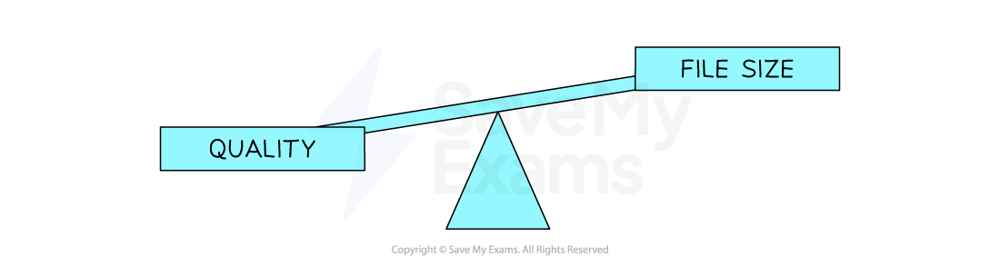

# Bitmap images

## Bitmap encoding

> **Spec point** — `spcpt_njs3DqJ4DBNZfMM5`

## Bitmap encoding

### What is a bitmap?

- A bitmap image is made up of squares called **pixels**
- A pixel is the **smallest element** of a bitmap image
- Each pixel is** stored as a binary code**
- Binary codes are **unique **to the **colour **in each pixel
- A typical example of a bitmap image is a photograph

*Humidity sensor bitmap image*

- The more colours and more detail in the image, the** higher the quality of the image** and the **more binary that needs to be stored**

### Image vs screen resolution

- **Image resolution** is the **total amount of pixels** that make up a bitmap image
- The image resolution is calculated by **multiplying the height and width** of the image (in pixels)
- In general, the **higher the resolution the more detail in the image** (higher quality)
- **Screen resolution** is the **number of pixels a screen can display horizontally and vertically**, given as width x height, e.g. 1920 x 1080, such as:

  - **Computer monitors** - a 1440p monitor is 2560 x 1440 pixels, compared to a 4K monitor at 3840 x 2160 pixels
  - **TVs** - HD (high definition) televisions are 1920 x 1080 pixels (1080p, where 1080 is the number of pixel rows), compared to newer 4K televisions at 3840 x 2160 pixels
  - **YouTube** - the quality button allows a user to change the video playback resolution from 144p (144 pixel rows) up to 4K
- If an image's resolution does not match the screen resolution, the image is **scaled up or down to fit** the screen, which can reduce its quality

### Colour/bit depth

- Colour depth is the **number of bits stored per pixel** in a bitmap image
- The colour depth is dependent on the** number of colours needed** in the image
- In general, the** higher the colour depth the more detail in the image** (higher quality)
- In a black & white image the **colour depth would be 1**, meaning 1 bit is enough to create a unique binary code for each colour in the image (1=white, 0=black)

- In an image with a **colour depth of 2**, you would have *00*, *01*, *10* & *11* available binary codes, so **4 colours**

- As **colour depth increases**, so does the **amount of colours available** in an image
- Colour depth **determines the number of colours** that can be represented in an image
- The number of colours is calculated using the formula:

  - **Number of colours = 2****n**** (where n = colour depth in bits)**

| **Colour/bit depth** | **Number of colours** | Example |
|---|---|---|
| **1 bit** | 21 = 2 | B&W |
| **2 bit** | 22 = 4 | Icons/logos |
| **4 bit** | 24 = 16 | Early computer graphics |
| **8 bit** | 28 = 256 | GIFs, retro games |
| **24 bit (True colour)** | 224 = 16 777 216 | High-quality images |

## Calculating the size of a bitmap file

> **Spec point** — `spcpt_MWjXCg8hDQwNBCQn`

## Calculating the size of a bitmap file

### How do you calculate the size of a bitmap image?

- Estimating the size of a bitmap image can be carried out with the following formula:

  - **Resolution x colour/bit depth**

#### Example

| **Image Files** |
|---|
| (Resolution) **x** (Colour Depth) |
| \| **Size of bitmap image = ** \|   \|   \| \|---\|---\|---\| \| Resolution \| **250,000** \| Resolution = width x height \| \| Colour depth \| **24 bits** \| 24 bits = 3 bytes \| \| **250,000 x 24** \| **=**  ***(bit to bytes) /8***  ***(bytes to KiB) /1024***  **or**  ***(bytes to KB) /1000*** \| **6,000,000 bits**  **750,000 bytes**  **Final answer:** **732 KiB**  **or**  **Final answer:** **750 KB** \| \| **250000 x 3** \| =  ***(bytes to KiB) /1024***  **or**  ***(bytes to KB) /1000*** \| **750,000 bytes**  **Final answer:** **732 KiB**  **or**  **Final answer:** **750 KB** \| |

- When bitmap images are saved,** a file header is created**
- This contains:

  - **File type (.bmp or .jpg)**
  - **File size**
  - **Image resolution**
  - **Colour depth**
  - **Any type of compression if used**

> **Worked Example**
> The following section of a bitmap image is 10 pixels wide and 5 pixels high. In this example, each colour is represented by a letter, e.g. O is orange.
> 
> The complete image can have up to 256 colours
> 
> 
> 
> a) Identify the smallest number of bits that can be used to represent each colour in the complete bitmap image. **[1]**
> 
> b) Calculate an estimate for the file size of the section of the bitmap image shown, giving your answer in bytes. Use your answer from **part a** and show your working.  **[2]**
> 
> **Final answer:** **Answer**
> 
> - 8 **[1 mark]**
> - 10 x 5 = 50(pixels), 50 x 8(bits) = 400   //   400 ÷ 8(bits) = 50 **[1 mark]**
> - 50 (bytes) **[1 mark]**

## Image quality & file size

> **Spec point** — `spcpt_Gwtm7fDtNzWtR75x`

## Image quality & file size

### What is the relationship between image quality and file size?

- As the **resolution and/or colour depth increases**, the **bigger the size of the file **becomes on secondary storage
- The **higher the resolution**, the** more pixels** are in the image, the more bits are stored
- The **higher the colour depth**, the **more bits per pixel** are stored
- Striking a **balance between quality and file size** is always a consideration
- **Compression** can be used on high quality images to help reduce the file size

