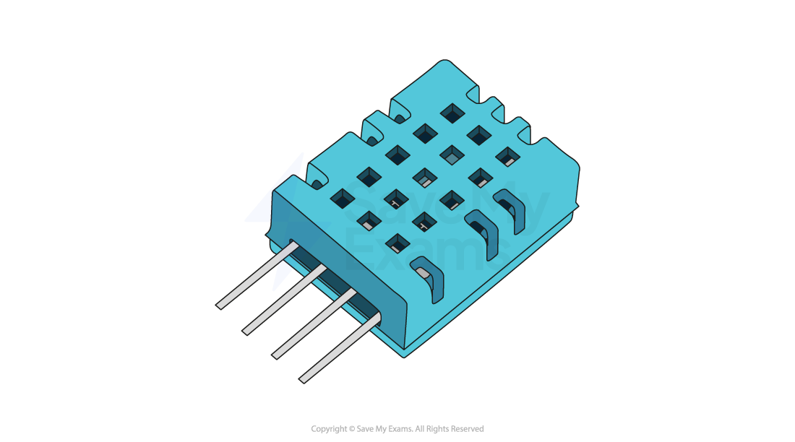

# Vector graphics

## Vector graphics

> **Spec point** — `spcpt_g479XG5RwhPpvbPn`

## Vector graphics

### What is a vector graphic?

- A vector graphic is created from **mathematical equations** and **points**
- Only the **mathematics used** to create the image are stored
- For example, to create a circle the data stored would be:

  - **Centre point (x, y coordinates)**
  - **Radius**
- Typical examples of vector images are **logos and clipart**

- Vector images are infinitely ***scalable***
- Ideal for situations where the same image** will be made bigger and smaller** and a **loss of quality is unacceptable**

  - For example, the same logo used on both a pencil and a billboard
- A vector graphic contains a **drawing list** (included in the file header)
- A typical drawing list will contain:

  - **Commands used to create each object in the image**
  - **Attributes that define the properties of each object**
  - **Relative position of each object**
- Dimensions of the image **are not defined**, meaning scaling up does not result in a loss of quality

## Bitmap vs vector

> **Spec point** — `spcpt_BFJrYVrQVzB43M36`

## Bitmap vs vector

| **Feature** | **Bitmap Images** | **Vector Images** |
|---|---|---|
| **Made from** | Pixels (tiny coloured squares) | Shapes and lines using maths (vectors) |
| **File size** | Larger (depends on resolution) | Smaller (uses formulas, not pixels) |
| **Scalability** | Loses quality when resized (pixelates) | Can be resized without losing quality |
| **Best for** | Photographs, detailed images | Logos, icons, text graphics |
| **Editable with** | Paint software (e.g. Photoshop, GIMP) | Drawing software (e.g. Illustrator, Inkscape) |
| **Common file types** | .jpg, .png, .bmp, .gif | .svg, .ai, .eps |

- When **choosing **to use a bitmap or vector based image, the following should be considered:

  - **Does the image need to be resized?**
  - **Does the image need to be drawn to scale?**
  - **Does the image need to look real?**
