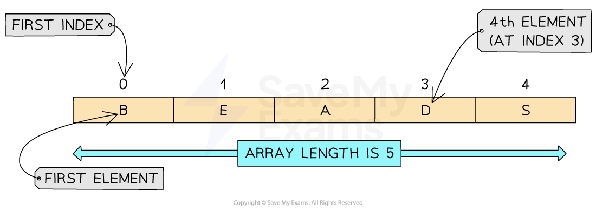
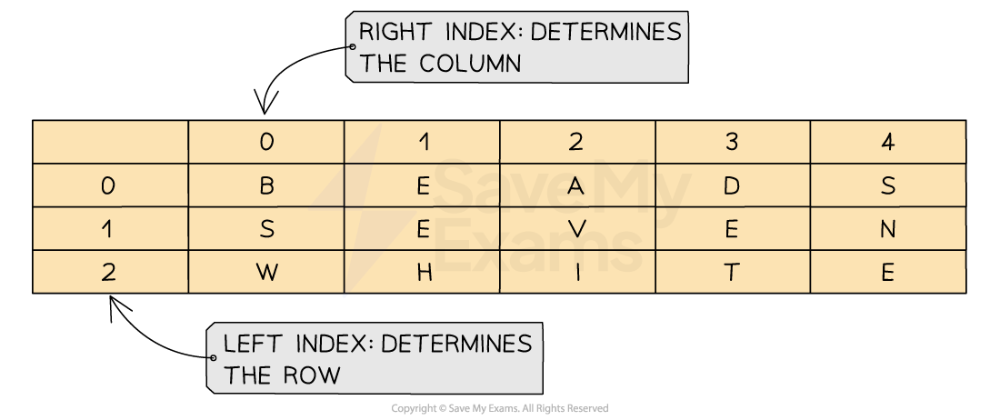

# Array basics

## Arrays

> **Spec point** — `spcpt_z595zm7HJjPQnskj`

## Arrays

### What is an array?

- An array is an** ordered, static set of elements**
- Can only store** 1 data type**
- The** position of each element** in an array is identified using the array's **index**
- The array's **first element** is the **lower bound (LB)**
- The array's** last element** is the **upper bound (UB)**
- The **lower bound of an array** is typically **0 or 1** depending on the language being used
- An array can be **one-dimensional** or **multi-dimensional**

#### One-dimensional (1D) arrays

- A 1D array is a **linear array**

- To declare a 1D array in pseudocode you **must include** the lower bound, upper bound and data types:

- In this example a 1D array of **five elements** each containing **single character** can be declared as:

- An example **complete program** could be:

- The array is declared with** indices** from `0` to `4`
- Each element stores a single character using the `CHAR` **data type**
- The** loop** outputs each letter in order

#### Two-dimensional (2D) arrays

- A 2D array can be **visualised as a table**
- When navigating through a 2D array you first have to go **down the rows** and then **across the columns** to find a position within the array

- In 2D arrays the following must be declared:

  - Lower bound for rows (**LBR**) & upper bound for rows (**UBR**)
  - Lower bound for columns (**LBC**) & upper bound for columns (**UBC**)

- In this example a** 2D array** can be declared as:

- An example **complete program** could be:

- `ARRAY[0:2, 0:4]` creates **3 rows** and **5 columns**
- First index is the **row**, second is the **column**: `Grid[Row, Column]`
- All elements are of type `CHAR`

> **Worked Example**
> A program reads data from a file and searches for specific data.
> 
> The main program needs to read 25 integer data items from the text file `Data.txt` into a local 1D array, `DataArray`
> 
> Write program code to declare the local array `DataArray `**[1]**
> 
> **Final answer:** **Answer**
> 
> - 1D array with name `DataArray` (with 25 elements of type Integer) **[1 mark]**
> 
> **Java**
> 
> `public static Integer[] DataArray = new Integer[25];`
> 
> **VB.NET**
> 
> `Dim DataArray(24) As Integer`
> 
> **Python**
> 
> `DataArray = [] #25 elements Integer`
