# ADT overview

## What is an abstract data type (ADT)?

- An abstract data type (ADT) is a **collection of data** and **a set of operations** on that data
- Three common ADT's are:

  - **Stacks**
  - **Queues**
  - **Linked lists**

## Stack operations

> **Spec point** — `spcpt_ywfgTSkKDNwWtyth`

## Stack operations

### What is a stack?

- A stack is an abstract data type that stores data using the **Last In, First Out (LIFO)** principle
- A stack is like **a pile of plates**, the last item you put on is the first one you take off

  - **PUSH**: Add an item to the top of the stack
  - **POP**: Remove the item from the top
- The** first item pushed** onto the stack will be the** last one popped** off
- A stack uses two pointers:

  - **A base pointer **- points to the first item in the stack
  - **A top pointer** - points to the last item in the stack

#### Main operations

| **Operation** | **Description** |
|---|---|
| **isEmpty()** | This checks is the stack is empty by checking the value of the top pointer |
| **push(value)** | This adds a new value to the end of the list, it will need to check the stack is not full before pushing to the stack. |
| **peek()** | This returns the top value of the stack. First check the stack is not empty by looking at the value of the top pointer. |
| **pop()** | This removes and returns the top value of the stack. This first checks if the stack is not empty by looking at the value of the top pointer. |
| **size()** | Returns the size of the stack |
| **isFull()** | Checks if the stack is full and returns the Boolean value, this compares the stack size to the top pointer. |

- Stacks use a **pointer** which points to the top of the stack, where the next piece of data will be added (pushed) or the current piece of data can be removed (popped)

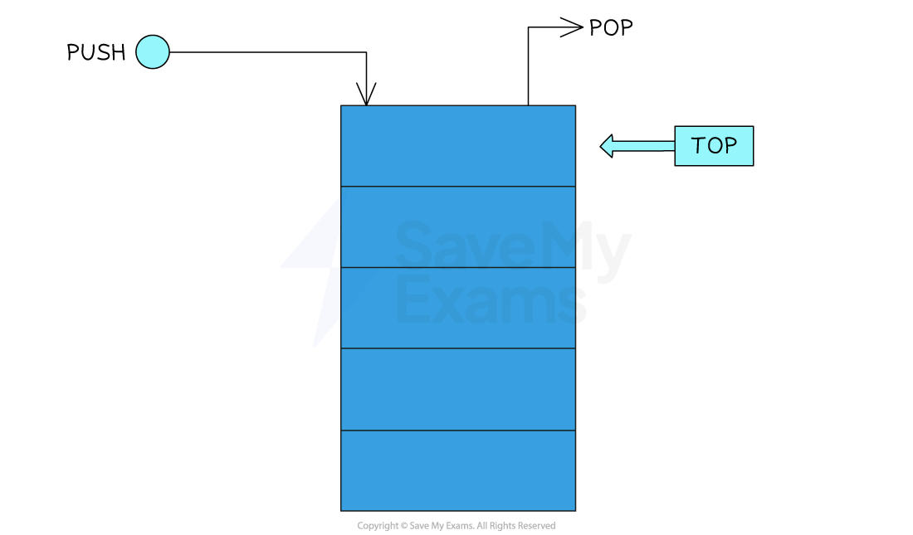

#### Pushing data to a stack

- When pushing (**adding**) data to a stack, the data is pushed to the position of the pointer
- Once pushed, the **pointer will increment by 1**, signifying the top of the stack
- Since the stack is a ***static data structure***, an attempt to push an item on to a full stack is called a **stack overflow**
- This would push 'Bunny' onto the empty stack 

- This would push 'Dog' to the top of the stack 
- This would push 'Ant' to the top of the stack 

#### Popping data from a stack

- When popping (**removing**) data from a stack, the data is popped from the position of the pointer
- Once popped, the **pointer will decrement by 1**, to point at the new top of the stack
- Since the stack is a static data structure, an attempt to pop an item from an empty stack is called a **stack underflow**
- This would pop 'Ant' from the top of the stack
- The new top of the stack would become 'Dog'

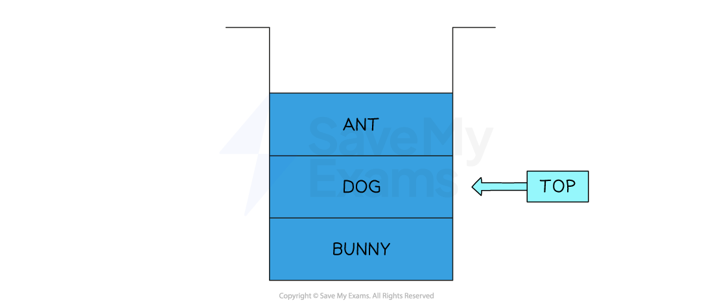

- Note that the data that is ‘popped’ isn’t necessarily erased
- The pointer 'top' moves to show that 'Ant' is no longer in the stack and depending on the implementation, 'Ant' can be deleted or replaced with a null value, or left to be overwritten

## Queue operations

> **Spec point** — `spcpt_RgSwb9JrytxxJ6Cv`

## Queue operations

### What is a queue?

- A queue is an abstract data type that **stores data in** **the order it arrives**, using the **First In, First Out (FIFO)** principle
- A queue works like **a line of people waiting at a shop**, the first one in is the first one served

  - **ENQUEUE**: Add an item to the back of the queue
  - **DEQUEUE**: Remove the item from the front
- The **first item added** to the queue is the **first one removed**

#### Main operations

| **Operation** | **Description** |
|---|---|
| **enQueue(value)** | Adding an element to the back of the queue |
| **deQueue()** | Returning an element from the front of the queue |
| **peek()** | Return the value of the item from the front of the queue without removing it from the queue |
| **isEmpty()** | Check whether the queue is empty |
| **isFull()** | Check whether the queue is full (if the size has a constraint) |

#### Linear queues

- A linear queue is a data structure that **consists of an array**
- Items are added to the **next available space** in the queue starting from the front
- Items are then **removed from the front** of the queue

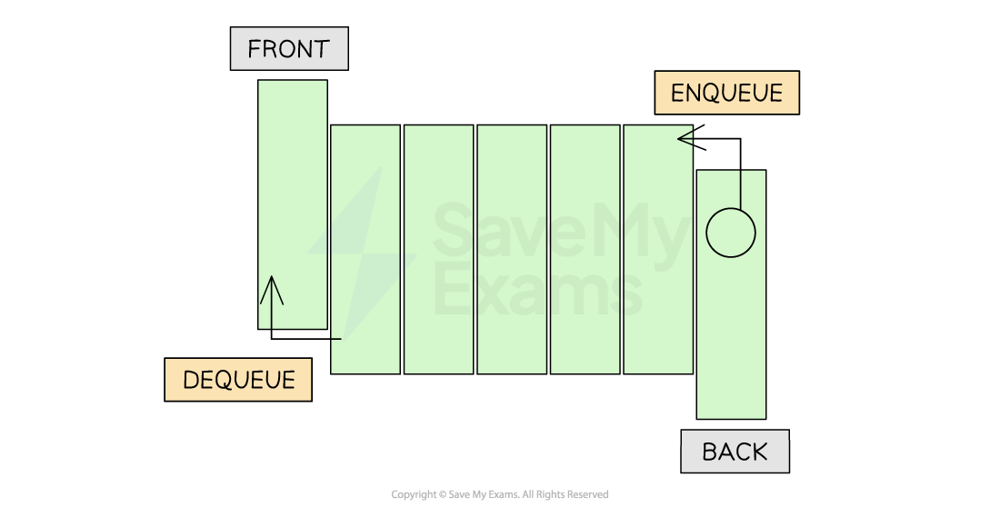

- Before **adding an item to the queue** you need to **check that the queue is not full**
- If the end of the array has not been reached, the rear **index pointer is incremented** and the new item is added to the queue
- In the example below, you can see the queue as the data Adam, Brian and Linda are enqueued.

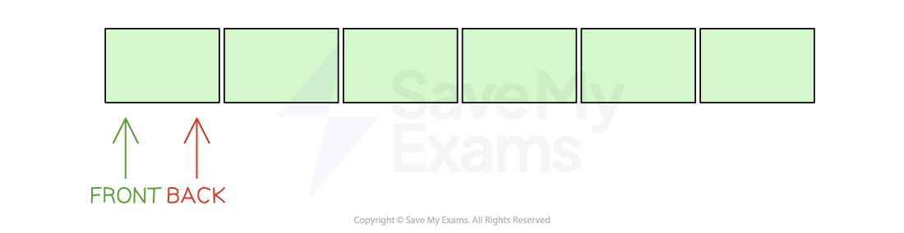

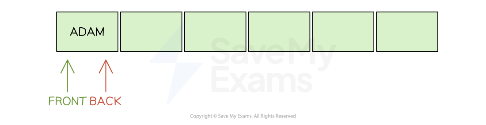

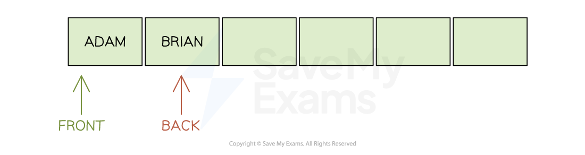

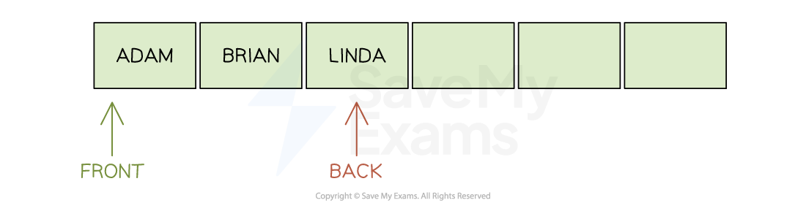

- Before **removing** an item from the queue, you need to make sure that the queue is not empty
- If the queue is not empty the item at the front of the queue is returned and **the front is incremented by 1**
- In the example below, you can see the queue as the data Adam is dequeued

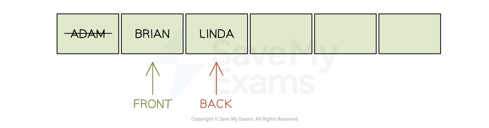

#### Circular queues

- A circular queue is **a static array** that has a **fixed capacity**
- It means that as you add items to the queue you will **eventually reach the end** of the array
- When items are dequeued, **space is freed up at the start of the array**
- It would** take time** to move items up to the start of the array to free up space at the end, so a Circular queue (or circular buffer) is implemented
- It **reuses empty slots **at the front of the array that are caused when items are dequeued
- As items are enqueued and the rear index pointer reaches the last position of the array, it wraps around to point to the start of the array as long as it isn’t full
- When items are dequeued the front index pointer will wrap around until it passes the rear index points which would show the queue is empty

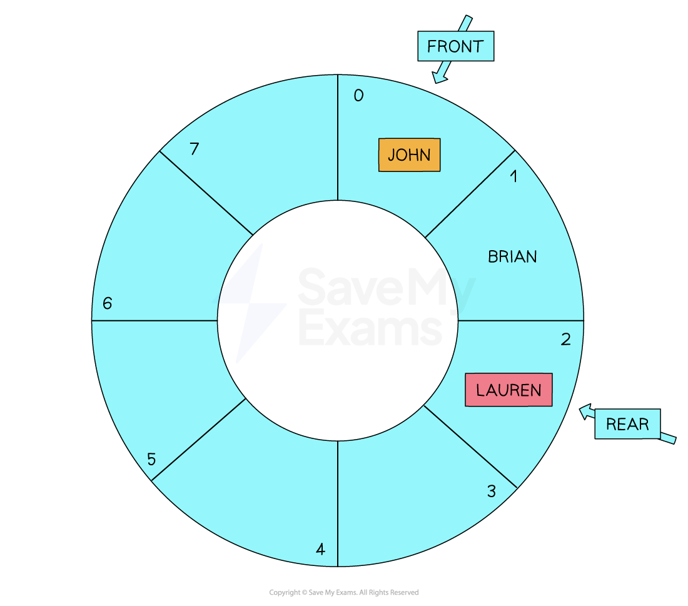

- Before **adding **an item to the circular queue you need to check that the **array is not full**
- It will be full if the next position to be used **is already occupied** by the item at the front of the queue
- If the queue is not full then the **rear index pointer must be adjusted** to reference the next free position so that the new item can be added
- In the example below, you can see the circular queue as the data Lauren is enqueued.

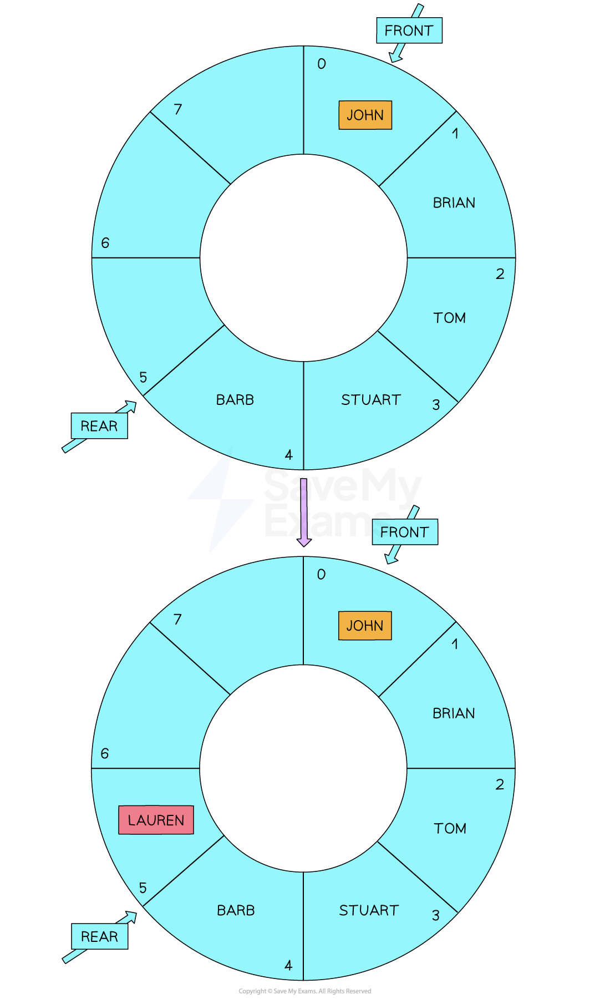

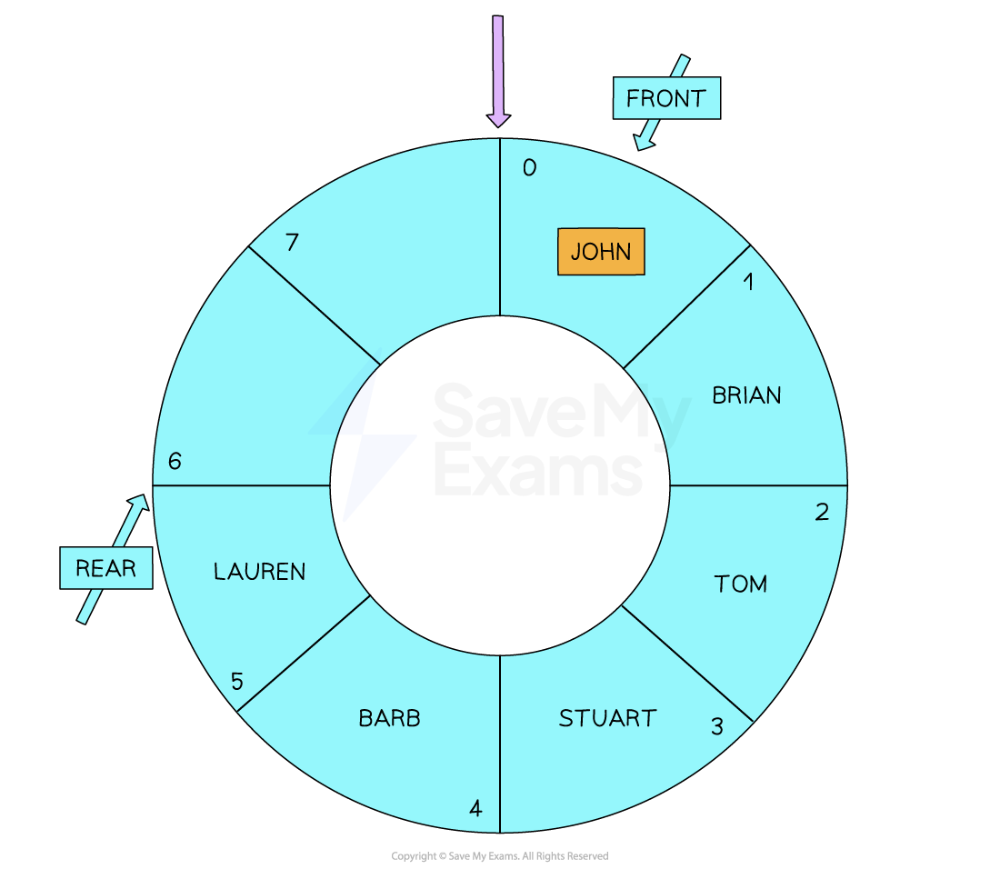

- Before **removing **an item from the queue, you need to make sure that the queue is not empty
- If the queue is not empty the **item at the front of the queue is returned**
- If this is the only item that was in the queue the **rear and front pointers are reset**, otherwise the pointer moves to reference the next item in the queue
- In the example below, you can see the queue as the data Adam is dequeued

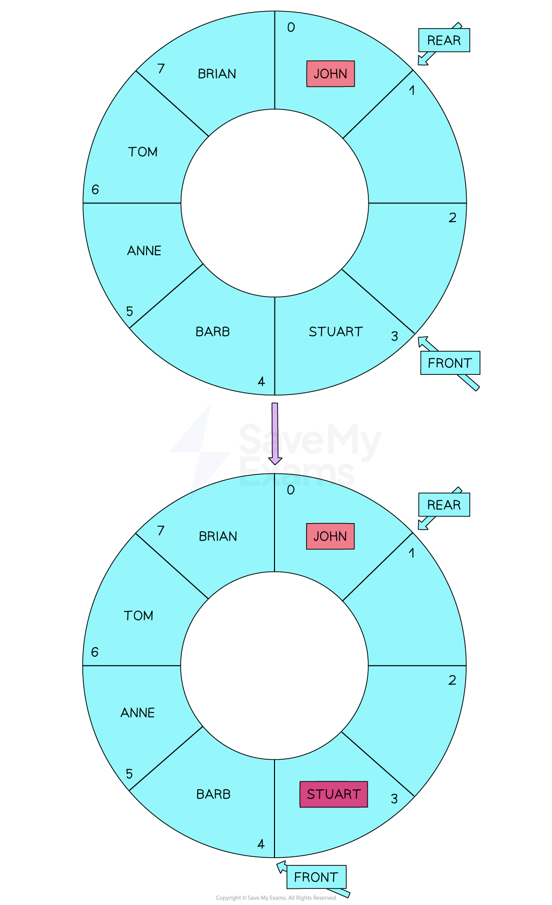

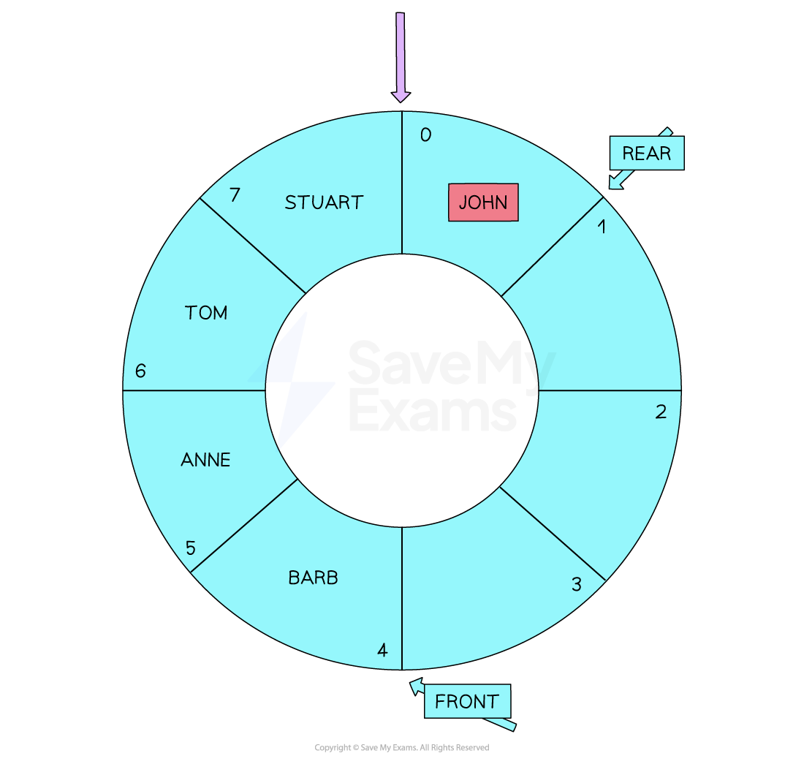

## Linked list operations

> **Spec point** — `spcpt_Y338wwMbry4QFs9p`

## Linked list operations

### What is a linked list?

- A linked list is an abstract data type where each item, or **node**, contains a **data field** and a **pointer to the next node** in the sequence
- A linked list is **a chain of items**, where each item stores **two things**:

  - The **actual data**
  - **A pointer** to the next item in the list
- New items are usually added to the **start** of the list, and each one **links** to the next
- Like a **scavenger hunt** where each clue tells you where to go next
- Each item is called a **node **and contains a data field alongside another address which is called a pointer
- For example:

| **Index** | **Data** | **Pointer** |
|---|---|---|
| 0 | 'Apple' | 2 |
| 1 | 'Pineapple' | 0 |
| 2 | 'Melon' | - |
| 3 |   |   |

**Start = 1        NextFree = 3**

- The data field contains the **value of the actual data **which is part of the list
- The pointer field contains the** address of the next item** in the list

> **Exam Hint**
> - Linked lists can only be traversed by following each item’s next pointer until the end of the list is located

#### Traverse a linked list

- Check if the linked list is empty
- Start at the node the pointer is pointing to (Start = 1)
- Output the item at the current node ('Pineapple')
- Follow the pointer to the next node repeating through each node until the end of the linked list.
- When the pointer field is empty/null it signals that the end of the linked list has been reached
- Traversing the example above would produce: ‘Pineapple’, ‘Apple’, ‘Melon’

#### Adding a node

- An advantage of using linked lists is that values can easily be added or removed by editing the points
- The following example will add the word ‘Orange’ after the word ‘Pineapple’

1. Check there is free memory to insert data into the node

2. Add the new value to the end of the linked list and update the ‘NextFree’ pointer

| 3 | 'Orange' |   |
|---|---|---|

Start = 1     NextFree = 4

3. The pointer field of the word ‘Pineapple’ is updated to point to ‘Orange’, at position 3

| 1 | 'Pineapple' | 3 |
|---|---|---|

4. The pointer field of the word ‘Orange’ is updated to point to ‘Apple’ at position 0

| 3 | 'Orange' | 0 |
|---|---|---|

4. When traversed this linked list will now output: ‘Pineapple’, ‘Orange’, ‘Apple’, ‘Melon’

#### Removing a node

- Removing a node also involves updating nodes, this time to bypass the deleted node
- The following example will remove the word ‘Apple’ from the original linked list

1. Update the pointer field of ‘Pineapple’ to point to ‘Melon’ at index 2

| **Index** | **Data** | **Pointer** |
|---|---|---|
| 0 | 'Apple' | 2 |
| 1 | 'Pineapple' | 2 |
| 2 | 'Melon' | - |

2. When traversed this linked list will now output: ‘Pineapple’, ‘Melon’

- The node is not truly removed from the list; it is only ignored
- Although this is easier it does waste memory
- Storing pointers themselves also means that more memory is required compared to an array
- Items in a linked list are also stored in a sequence, they can only be traversed within that order so an item cannot be directly accessed as is possible in an array
