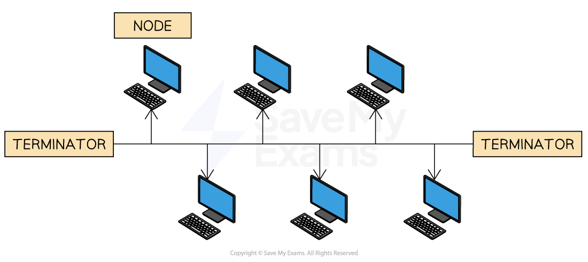
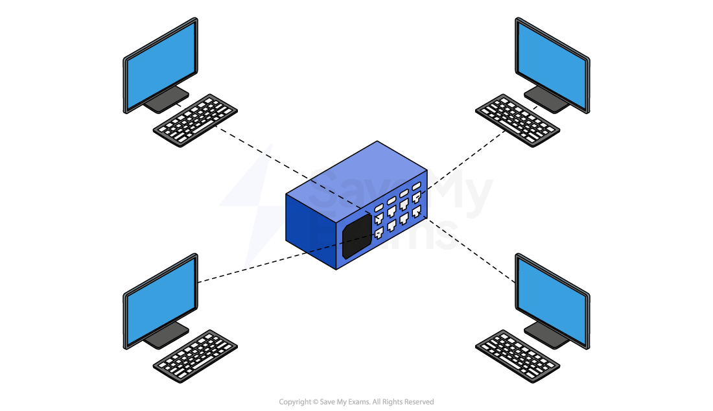
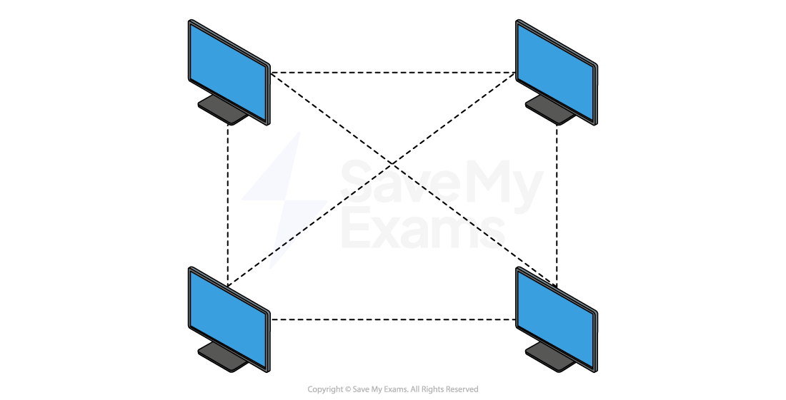

# Network topologies

### What is a network topology?

- A network topology is the **physical structure of the network**
- It defines **how the network hardware will be arranged** to create the network
- Topologies to understand for the exam are:

  - **Star topology**
  - **Bus topology**
  - **Mesh topology**
  - **Hybrid topology**

## Bus

> **Spec point** — `spcpt_VHypZnvZQn7CxhFg`

## Bus

### What is a bus topology?

- A bus topology is all** devices connected by one single ‘bus’ cable**, terminated at each end
- The terminators** stop the signal bouncing back** and **causing errors**
- A bus topology works by each device:

  - **‘Listening’ **to electrical signals
  - **Checking **data packets for their specific address
  - **Ignoring **data packets it does not recognise
- A bus topology has been replaced by much more **efficient network topologies** such as the **star topology**

#### Bus topology - advantages vs disadvantages

| **Advantages** | **Disadvantages** |
|---|---|
| **Easy and cheap** to set up – only one cable is needed | **Low security** – data is visible to all devices |
| **Does not rely** on other network hardware (e.g. central server or switch) | **Slow data transfer** – prone to data collisions |
|   | If the cable breaks, the **whole network is affected** (central point of failure) |

## Star

> **Spec point** — `spcpt_dtwd7cH4W9hw9JZj`

## Star

### What is a star topology?

- A star topology **has a central switch** which all other devices connect to
- A switch is an i**ntelligent devic**e which **ensures that traffic only goes to the intended device**
- A star topology is commonly seen in most **homes**, **businesses**, **organisations **and **schools**

- Traffic (packets) on a star topology is **handled differently depending on the device **used as the central node

  - A **hub **will send traffic to all devices on the network, if the address in the packet matches a device it will be accepted, otherwise it is ignored
  - A **switch **will only send traffic to devices on the network where the address in the packet is a match

#### Star topology - advantages vs disadvantages

| **Advantages** | **Disadvantages** |
|---|---|
| If **one cable fails**, the rest of the network still works | The **central switch is a single point of failure** |
| A problem with **one device** (e.g. a school computer) won’t affect others | If the **switch stops working**, **all devices lose connection** to the network and its resources |
| More **reliable** than other topologies like bus or ring | Can be **expensive** to install due to the switch and extra cabling (not mentioned but useful add-on) |

## Mesh

> **Spec point** — `spcpt_YNMv32YVRTphK4Cd`

## Mesh

### What is a mesh topology?

- A mesh topology allows **all computers to be connected to all other computers**
- This is known as a **full mesh** network topology
- LANs can make use of mesh networks however, they are **more commonly seen in ***IoT* devices such as **wearable technology** and** smart home** devices

- Traffic (packets) on a mesh topology can follow two different methods:

  - **Routing **- devices are given routing logic (act like a router) to ensure packets are sent to the correct device in the shortest route
  - **Flooding **- all packets are sent to all devices using no routing logic, this can lead to network flooding causing performance issues

#### Mesh topology - advantages vs disadvantages

| **Advantages** | **Disadvantages** |
|---|---|
| If **one cable fails**, the network still works – data can use an **alternate route** | Requires **lots of hardware, cables, and switches** |
| Provides **high fault tolerance** – multiple paths for data to travel | **High cost** to set up due to the amount of equipment needed |
| Very **reliable** – good for critical systems | **Hard to scale** – adding new devices is more complex than in a star topology |
|   | A **partial mesh topology** is often used as a more practical and cost-effective alternative |

## Hybrid

> **Spec point** — `spcpt_zgHfwBb7btTbZM3J`

## Hybrid

### What is a hybrid topology?

- A hybrid topology is a** mix of two of more different** network topologies
- For example, bus & star, star & mesh etc
- A typical use of a hybrid topology would be when there is a **need to join different networks** together
- Imagine a large education trust takes over three schools: **School A**, **School B**, and **School C**.

  - **School A** uses a **bus topology** to connect classroom computers with a simple shared cable
  - **School B** uses a **star topology** to link all devices to a central switch in the IT room
  - **School C** uses a **mesh topology** to make sure every building (e.g. science block, library) stays connected, even if one cable fails
- When the trust wants to connect all three schools into a single network, it uses a **hybrid topology**
- This allows:

  - Each school to **keep its own existing setup** (bus, star, or mesh)
  - The schools to be **linked together efficiently**
  - **Easy expansion**, such as adding a new school or admin office without changing everything
  - The network to be more **flexible and reliable**, using the strengths of each topology

#### Hybrid topology - advantages vs disadvantages

| **Advantages** | **Disadvantages** |
|---|---|
| **Combines** the strengths of multiple topologies (e.g. reliability of mesh, simplicity of bus) | **Complex to design** – needs careful planning to combine different topologies |
| **Flexible **– different parts of the network can be optimised for different needs | **Expensive **– more hardware and maintenance may be needed |
| **Scalable **– new segments (e.g. a new site or building) can be added without changing the whole setup | **Troubleshooting can be harder **– different parts use different systems and rules |
| **Reliable **– failures in one part don’t necessarily affect the rest of the network |   |
