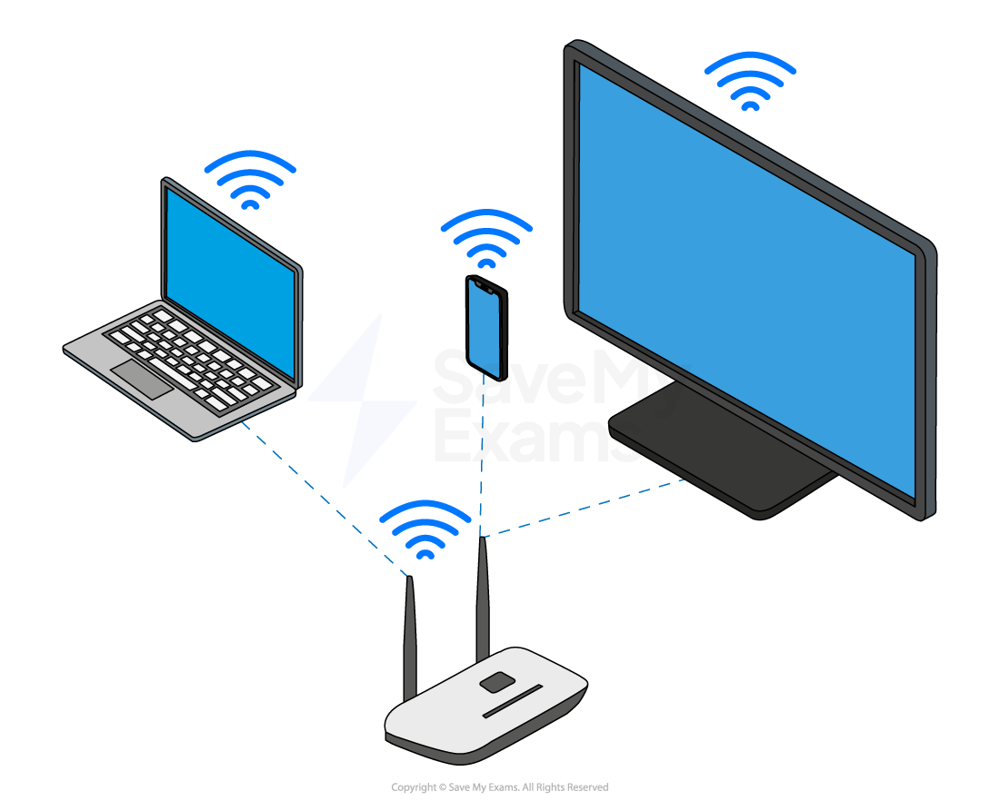
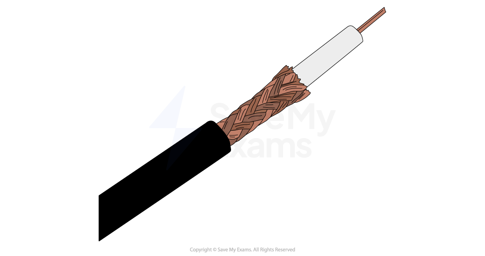
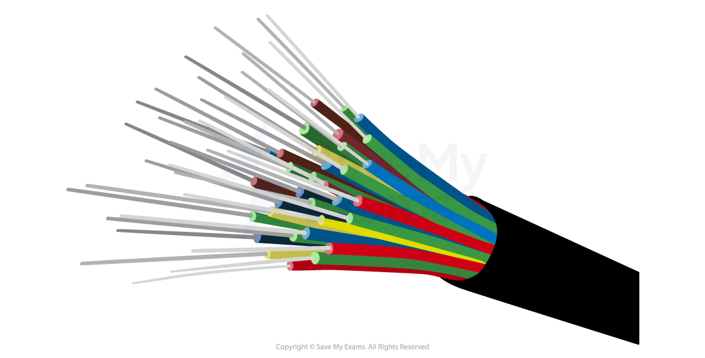

# Transmission media

## Wired vs wireless

> **Spec point** — `spcpt_WyDhfqxppgv4cQv8`

## Wired vs wireless

### What is a wired network?

- A wired network is a network where **physical cables** are used to join devices together and **transmit data**
- Computers can be connected to networks using many different types of wires to transmit data
- The most common types of cables in a wired network are:

  - **Ethernet**
  - **Fibre optic**
  - **Copper**

#### Advantages & disadvantages of wired networks

| **Advantages** | **Disadvantages** |
|---|---|
| **Speed **- Fast data transfer | **Portability **- Can't move easily, location is limited by physical cable |
| **Security **- Better physical security | **Cost **- Need more cables to add a new device |
| **Range **- High, less susceptible to interference | **Safety **- Cables can be trip hazards, need routing along walls, under floors |

### What is a wireless network?

- A wireless network is a network where connections are made **using radio waves** to transmit data **through the air**
- The most common types of wireless connections are:

  - **Wi-Fi**
  - **Bluetooth**

#### What is Wi-Fi?

- **Wi-Fi** is a common ***standard*** for wireless networks
- It is common in most homes and offices to connect devices such as **laptops**, **tablets **& **smart phones**
- Using Wi-Fi, devices communicate with a wireless access point (**WAP**), which can be a standalone device or built into a **router **or **switch **

#### What is Bluetooth?

- Bluetooth is another common ***standard*** for wireless networks
- Bluetooth is common in most homes and offices to connect devices such as **headphones**, **controllers**, **keyboards **& **mice**
- Bluetooth is used typically for a **direct connection** between **two devices **

### Advantages and disadvantages of wireless networks

| **Advantages** | **Disadvantages** |
|---|---|
| **Portability **- Easy to move around, location is only limited by range | **Speed **- Slower data transfer than wired |
| **Cost **- Less expensive to setup and add new devices | **Security **- Less secure than wired |
| **Compatibility **- Most devices are manufactured with a built in wireless adapter | **Range **- Relies on signal strength to the WAP, signals can be obstructed |

## Types of media

> **Spec point** — `spcpt_Mvtc2jy4WxyKmj9z`

## Types of media

### What is transmission media?

- Transmission media is the **type of cable** used in wired connections
- Wired connections offer a **higher bandwidth** than wireless connections
- The main options for transmission media are:

  - **Twisted pair**
  - **Coaxial**
  - **Fibre-optic**

#### Twisted pair

- Carries electrical signals between devices on a local area network (**LAN**)
- Common in **offices and homes** to connect devices such a **desktop computers** & **servers**
- Allow ***duplex*** communication
- Slower** transfer rate** compared to coaxial and fibre-optic
- Can suffer from **external interference** (electromagnetic radiation)
- **Low cost**

#### Coaxial

- **Used in telecommunication to transmit voice signals**, forming the traditional landline phone network
- Adapted to deliver **network traffic** on a wide area network (**WAN**) making the **internet possible**
- **Degrades over time** which **limits their range** compared to fibre optic
- **Suffers from interference** which can **disrupt data quality**
- Transmits data at a much **slower rate**, and has a much **lower bandwidth** compared to fibre optic

#### Fibre optic

- Uses **light to transmit data** on a wide area network (**WAN**)
- Transmits data at **high speed** and has a **higher bandwidth** compared to copper cables
- **Does not suffer from interference** which makes them the **most secure option** to send **sensitive data**
- Can **cover a long distance** without any ***degradation***, they can span cities and countries

#### Quick comparison

| **Feature** | **Twisted pair** | **Coaxial cable** | **Fibre optic** |
|---|---|---|---|
| **Used for** | LAN connections in homes/offices | Voice signals (telecoms), early WAN/internet | High-speed WANs, internet infrastructure |
| **Data transfer method** | Electrical signals | Electrical signals | Light signals |
| **Speed** | Slower than coaxial and fibre | Slower than fibre | **Fastest** |
| **Bandwidth** | Low to medium | **Lower than fibre** | **Highest** |
| **Signal degradation** | Moderate | Degrades over time | **Minimal degradation** – works over long distances |
| **Interference** | Prone to electromagnetic interference | Also suffers from interference | **No interference** – more secure |
| **Communication** | Allows **duplex communication** | Supports duplex (but lower quality) | Full duplex |
| **Cost** | **Cheap** | Medium cost | **Expensive** |
| **Typical use** | Desktop PCs, printers, servers in LANs | Traditional phone lines, early internet connections | Modern internet backbones, long-distance data transmission |
