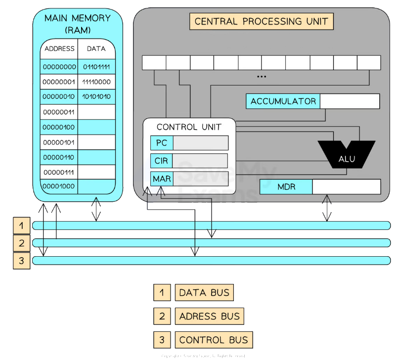

# Components of the CPU

## Components of the CPU

> **Spec point** — `spcpt_VWvqb7ST5nKbXx5F`

## Components of the CPU

### What is the CPU?

- The **CPU** is responsible for **processing all data** within the computer
- It is made up of a number of **components** including:

  - **Arithmetic and Logic Unit (ALU)**
  - **Control Unit (CU)**
  - **System clock**
  - **Immediate Access Store (IAS)**
  - **Buses**

| **Component** | **Full name** | **Purpose / function** |
|---|---|---|
| **ALU** | Arithmetic Logic Unit | Performs **calculations** (e.g. add, subtract) and **logic operations** (e.g. AND, OR) |
| **CU** | Control Unit | **Manages and controls** the execution of instructions and **directs data flow** |
| **System Clock** | – | Sends out **regular pulses** to **synchronise** all CPU operations |
| **IAS** | Immediate Access Store | **Main memory** where **instructions and data** needed by the CPU are **temporarily stored** |

#### Buses

- Components within the CPU and wider computer system are **connected by buses**
- A bus is **a set of parallel wires **through which **data/signals are transmitted** from one component to another
- There are 3 types of bus:

  - **Address **- ***unidirectional***, carries **location data** (addresses), data is written to/read from
  - **Data **- ***bidirectional***, carries** data or instructions**
  - **Control **- bidirectional, carries **commands **and **control signals** to tell components when they should be receiving reads or writes etc.**.**

