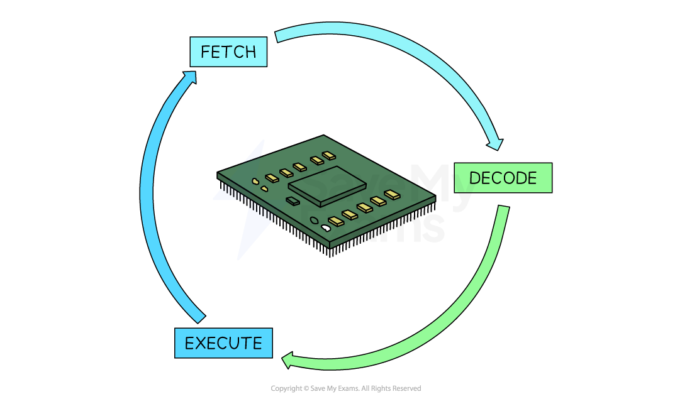

# Fetch-Execute Cycle

## F-E stages

> **Spec point** — `spcpt_rmcnBZJ4KpBrs933`

## F-E stages

### What is the fetch-execute cycle?

- The fetch-execute cycle is the **process **that the CPU goes through **repeatedly to process instructions**
- There are **3 stages**:

  - **Fetching** an instruction from memory - supplying the address and receiving the instruction from memory
  - **Decoding** the instruction - interpreting the instruction and then reading and retrieving the required data from their addresses
  - **Executing** the instruction - the CPU carries out the required action

#### How are registers used in the fetch-execute cycle?

- In the section below, registers and CPU components appear in **bold** and assembly language is in *italics*
- During the fetch-execute cycle, the following steps happen:
- **Fetch**

  - The **PC** is loaded with 0
  - The value from the **PC** (0) is copied to the **MAR**
  - The address in the **MAR** is sent via the **address bus**, and a **read** instruction is sent on the **control bus**
  - The data from that memory location is sent down the **data bus** to the **MDR**
  - The **PC** is incremented by 1, ready for the next instruction
- **Decode**

  - The data from the **MDR** is copied to the **CIR**
  - The **CIR** splits the instruction into **opcode** and **operand**
  - The instruction is sent to the **CU**, which decodes what to do next
- **Execute**

  - The registers used will depend on the instruction:
  
    - *INP* – value from input device is stored in the **ACC**
    - *OUT* – value currently in the **ACC** is sent to the output
    - *LDA* – loads value from RAM into the **MDR**, then to the **ACC**
    - *STA* – takes the value from the **ACC**, moves it to the **MDR**, then stores it in RAM (location in **MAR**)
    - *ADD/SUB* – value in RAM is loaded into the **MDR**, then the calculation happens in the **ALU**, result stored in the **ACC**
    - *BRA/BRZ/BRP* – branching instructions are handled by the **ALU** to check if conditions are met, and the **PC** is updated accordingly

#### Register Transfer Notation (RTN)

- Register Transfer Notation (RTN) is a way of describing how **data moves between registers** in a CPU during the **fetch–execute cycle**
- It uses **symbols** to represent **registers**, and the arrow symbol **←** to show **data being transferred** from one place to another
- It is a shorthand way to show what's happening inside the CPU

| **Symbol** | **Meaning** |
|---|---|
| **←** | Data is transferred into a register |
| **PC** | Program Counter |
| **MAR** | Memory Address Register |
| **MDR** | Memory Data Register |
| **CIR** | Current Instruction Register |
| **ACC** | Accumulator |
| **[  ]** | Contents of a register |
| **[[  ]]** | Contents of the memory location addressed by the register |

**Fetch**

`MAR ← [PC]           ; Copy address from Program Counter to MAR  `

`MDR ← [[MAR]]     ; Read instruction from memory into MDR  `

`PC ← [PC] + 1        ; Increment PC for the next instruction  `

`CIR ← [MDR]          ; Copy instruction from MDR to CIR `

**Decode **

- No specific register transfer, the **CU **decodes the instruction in the **CIR**

**Execute examples**

- **LDA X** (Load value from memory location **X **into **ACC**):

`MAR ← [operand]       ; Load address X into MAR  `

`MDR ← [[MAR]]      ; Load data from RAM into MDR  `

`ACC ← [MDR]           ; Copy data into ACC  `

- **STA X** (Store value from **ACC **into memory location **X**):

`MAR ← [operand]       ; Load address X into MAR  `

`MDR ← [ACC]           ; Copy data from ACC to MDR  `

`[[MAR]] ← [MDR]     ; Store MDR value into memory`

- **ADD X** (Add value from memory location **X **to **ACC**):

`MAR ← [operand]  `

`MDR ← [[MAR]] `

`ACC ← [ACC] + [MDR] `

- **BRZ X** (Branch to **X **if** ACC** = 0):

`If [ACC] = 0 then PC ← [operand]  `
