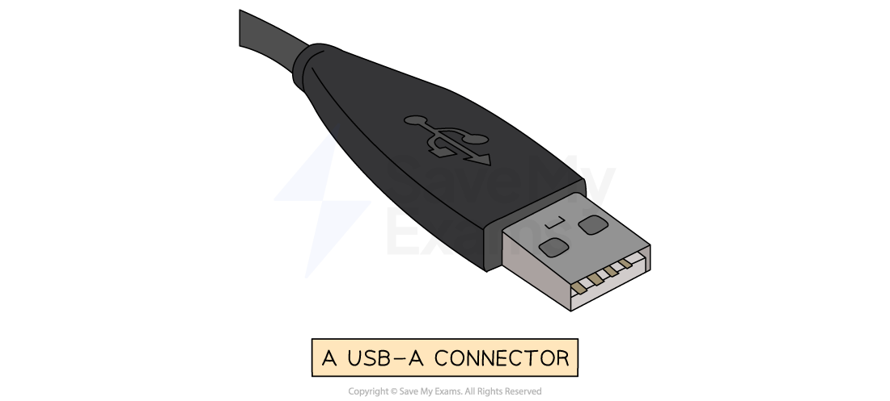

# Ports & interfaces

## USB

> **Spec point** — `spcpt_3jfBCFWwyPC7VNtG`

## USB

### What is USB?

- The **Universal Serial Bus** (**USB**) is a widely used **standard for transmitting data** between devices
- It is a ***serial*** communication method (1 bit is transferred at a time), and it can be ***synchronous***** or *****asynchronous***
- Many devices use USB such as:

  - **Keyboards**
  - **Mice**
  - **Video cameras**
  - **Printers**
  - **Portable media players**
  - **Mobile phone**
  - **Disk drives**
  - **Network adapters**
- Different USB **connector types** exist for different devices
- The letters refer to the **physical shape and design** of the USB connector:

  - **USB-A** - Commonly used for flash drives, mice, keyboards, external HDD
  - **USB-B** - Found in printers, scanners, and older external storage devices
  - **USB-C **- Latest standard, known for it's **small size**, **transfer speeds**, and it's **ability to carry power**
- The term USB can also be **followed by numbers** (**USB 2.0, 3.0, 4 etc**.)
- The numbers refer to the **generation of USB technology**, which determines the **speed and performance**:

  - **USB 1.1** - 12 Mbps (very slow)
  - **USB 2.0** - 480 Mbps (very common but slower compared to modern versions)
  - **USB 3.0/3.1/3.2** - 5 Gbps to 20 Gbps (much faster, used for external HDDs and gaming devices)
  - **USB4/ USB4 2.0** - Up to 80 Gbps (the latest and fastest, used for high speed data transfer)
- When a device is connected to a USB port the computer:

  - **Automatically detects** that the device has been **connected**
  - **Looks for the correct driver:**
  
    - If the driver is already installed, the **appropriate device driver is loaded** so that the **device can communicate with the computer**
    - If the device is **new**, the computer will** look for a compatible device driver**
    - If one cannot be found, the **user must download and install** an appropriate driver **manually**

#### Advantages and disadvantages of USB

| **Advantages** | **Disadvantages** |
|---|---|
| Devices are** automatically detected** and **drivers are automatically loaded** for communication | The **maximum** cable length is** roughly 5 metres** meaning it cannot be used over long distances,** limiting its use** |
| USB-A and USB-B connectors fit in only one way (USB-C can be inserted either way up). This prevents incorrect connections and **ensures compatible data transmission** | Older versions of USB have** limited transmission rates** for example** USB 2.0** has **480Mbps** |
| As USB usage is standardised, there is a lot of support available online and from retailers | **Very old USB standards** **may not be supported** in the near future (USB 1.1, USB 2.0, etc) |
| Several different **data transmission rates** are supported. The newest transmission rate as of 2022 is **USB4 2.0** with **80 Gbps** (80,000 Mbps, about 167 times faster than USB 2.0) |   |
| **Newer USB standards** are **backwards compatible** with older USB standards |   |

## HDMI

> **Spec point** — `spcpt_tNJPwB3kcrYK7ghk`

## HDMI

### What is HDMI?

- HDMI is a **digital port** that sends both **video and audio output** from a computer to HDMI-enabled devices (e.g. TVs, monitors)
- Replaces older **VGA** analogue systems
- Modern HD TVs and displays require more data because they support:

  - **Widescreen format** (16:9 aspect ratio)
  - **Higher resolution** (e.g. 1920 × 1080 pixels)
  - **Faster refresh rates** (e.g. 120 Hz)
  - **Wider colour range** (millions of colour variations)
- These features need **faster data transfer rates**, which **HDMI provides**
- HDMI is a **digital** interface, so the signal does not need converting to analogue and back, and it is **less prone to interference** than VGA
- HDMI carries **video and audio on the same cable**, so no separate sound cable is needed

## VGA

> **Spec point** — `spcpt_35XGDBgFXDK2HZTH`

## VGA

#### What is VGA?

- VGA (Video Graphics Array) is an **analogue** video port, introduced in the late 1980s, used to connect a computer to a monitor or projector
- It is now considered **outdated** and is being **replaced by HDMI**
- VGA carries **video only**, so a **separate cable is needed for sound**
- VGA has **lower data transfer rates** than HDMI, so it is less suited to **high-resolution** monitors
- VGA is an **analogue signal**, which means:
- The computer's digital data must be **converted to analogue** and back, so some data can be lost
- **Lower image quality over long cables**
- **More likely to experience signal loss or interference**
