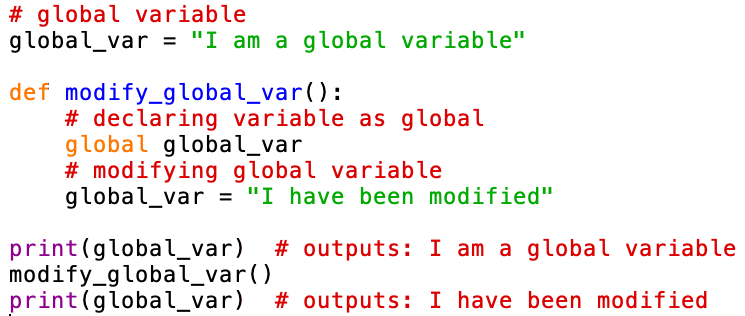
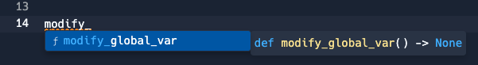
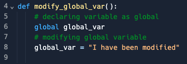

# Development tools

## What is an IDE?

- An **Integrated Development Environment (IDE)** is a software tool that provides programmers with a comprehensive and integrated platform to **write**, **edit**, ***compile***, ***debug***, and **manage **their code efficiently
- IDEs are designed to **streamline the software development process** by offering a wide range of features and tools that can help programmers
- IDEs can be an** app to download** or can be **web-based**

## IDE features

> **Spec point** — `spcpt_67PDQnXVdWtKXMxv`

## IDE features

#### Syntax highlighting (pretty printing)

- IDEs use syntax highlighting to **visually distinguish** different elements of code based on their syntax
- The IDE assigns **distinct colours or styles** to keywords, strings, comments, variables, functions, and other language constructs
- Syntax highlighting helps programmers **quickly identify and differentiate code** components, reducing the chance of syntax errors and improving code comprehension
- In this example Python code, you can see that the code comments are displayed in red, the strings are displayed in green and the print commands are displayed in purple

Syntax highlighting in an IDE

#### Autocomplete

- Autocomplete will **suggest code completions** as programmers type
- For example, as developers start typing a variable, function, or method name, the IDE displays a list of available options
- Another example is when programmers use opening brackets and the autocomplete facility will automatically add closing brackets
- Code completion **improves productivity** by reducing typing effort and preventing typing errors and naming inconsistencies
- IDEs can automatically correct common mistakes or typing errors made during coding. When an error-prone sequence is detected, **the IDE can suggest a correction**, helping developers fix minor errors as they type their code

Code completion in an IDE

#### Auto indent

- Auto indent will **automatically indent the programming code** when you start a new line of code within a code block
- They are commonly used in **selection **and **iteration **programming constructs
- In the example below, the indentation is automatic after starting to define the code block on line 04 and is clearly marked to show which lines of code are included within the block.

Code formatting with automatic indentation

#### Code comments

- Comments are **lines of text within the code that are not executed** but serve as documentation and explanations for programmers
- IDEs enable developers to add single-line or multi-line **comments to describe the code's purpose**, algorithmic steps, and any relevant information that will be useful to the maintenance of the program
- Comments enhance code understanding, making it easier for developers to revisit and modify code at a later stage
- Comments are in green on the image above

#### Syntax error highlighting

- IDEs can automatically highlight **syntax errors in the code editor **as developers type
- This feature **helps catch mistakes instantly**, allowing programmers to address syntax-related issues promptly
- Syntax errors are highlighted with distinct colours, making them easily noticeable, even before executing the code

#### Variable watch window

- The watch window is a debugging tool that allows developers to **monitor the values of specific variables** during ***runtime***
- Developers can add variables to the watch window and observe their values change as the program executes
- This tool is particularly valuable for understanding how variables evolve throughout the program's execution and diagnosing issues related to variable values

#### Breakpoints

- Breakpoints are **markers **that developers can** **set at specific lines of code to** halt program execution** during ***runtime***
- When the program reaches a breakpoint, it pauses, allowing developers to inspect the program's state and variable values and identify the cause of potential bugs
- Breakpoints provide a controlled way to analyse code step-by-step

#### Error message list

- The error message list **displays a collection of errors**, **warnings**, and **messages **generated during the compilation and execution of the program
- IDEs present detailed error descriptions and relevant code locations, enabling programmers to address and correct issues systematically

#### Stepping mode

- Stepping mode is a debugging mode that allows developers to **execute the program one line at a time**
- Developers can choose between different step options, such as step into, step over, and step out, to examine function calls and control flow
- Step mode offers a granular view of the program's execution, making it easier to identify the exact location of potential bugs

#### Crash dump/post-mortem report

- When a program crashes, IDEs can **generate **a crash dump or post-mortem report
- This report **captures the program's state **and ***memory*** contents **at the time of the crash**, helping developers diagnose the root cause of the crash after the program has terminated unexpectedly

#### Stack contents

- The stack contents tool allows developers to **inspect the contents of the program's call stack** during debugging
- It shows the order in which functions were called and the parameters and local variables of each function
- Understanding the call stack, aids in understanding the program's flow and diagnosing issues related to function calls

> **Worked Example**
> Identify two debugging tools that a typical IDE can provide.**[2]**
> 
> **Final answer:** **Answer**
> 
> e.g.
> 
> - Breakpoints **[1 mark]**
> - Single stepping **[1 mark]**
> - Report windows **[1 mark]**
