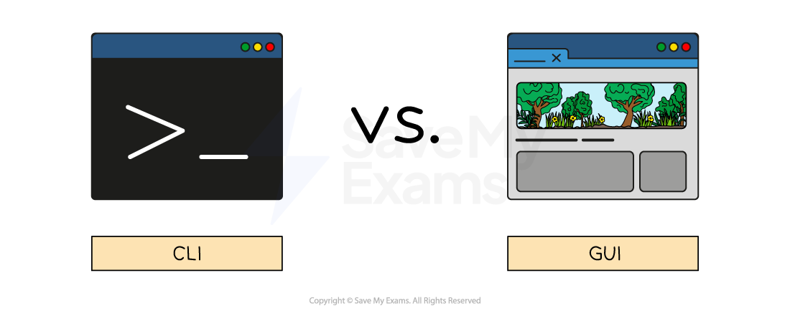

# Operating System fundamentals

## Purpose of an OS

> **Spec point** — `spcpt_Qvb42C5bb4FRt58W`

## Purpose of an OS

### What is an operating system (OS)?

- An operating system (**OS**) is software that **provides an interface between the user and the hardware** in a computer system
- An operating system **hides the complexities of the hardware** from the user, for example:

  - A user **does not need to know** 'where' on secondary storage data is kept, just that it is saved for when they want it again
- To help achieve this an OS provides a **user interface**

#### User interface

- A user interface is **how the user interacts with the operating system**
- Examples of user interfaces include:

  - **Command Line Interface (CLI)**
  - **Graphical User Interface (GUI)**
  - **Menu**
  - **Natural language (NLI)**

#### What is a command line interface (CLI)?

- A Command Line Interface (**CLI**) requires users to interact with the operating system using** text-based commands**
- CLIs are more commonly used by** advanced users**
- Examples of CLIs are MS-DOS (Microsoft Disk Operating System) and Raspbian (for Raspberry Pi)

#### What is a graphical user interface (GUI)?

- A Graphical User Interface (**GUI**) requires users to interact with the operating system using **visual elements** such as windows, icons, menus & pointers (**WIMP**)
- GUIs are **optimised for mouse and touch gesture input**
- Examples of GUIs are Windows, Android and macOS

#### What is a menu interface?

- A menu interface is **successive menus **presented to a user with a** single option at each stage**
- Often performed with **buttons** or a **keypad**
- Examples include:

  - **Chip and pin machines**
  - **Vending machines**
  - **Entertainment streaming services**

#### What is a natural language interface (NLI)?

- A natural language interface (**NLI**) uses the spoken word to respond to spoken or textual inputs from a user
- Examples include:

  - **Virtual assistants **- Amazon Alexa, Google Assistant, Siri
  - **Search engines**
  - **Smart home devices**

## OS management tasks

> **Spec point** — `spcpt_jkYK6w8Q6sPrtB2v`

## OS management tasks

An operating system has five key **management tasks**:

- **Memory management**
- **File management**
- **Security management**
- **Hardware management**
- **Process management**

### Memory management

- Memory management is a process carried out by the operating system **allocating main memory (RAM) between different programs** that are **open at the same time**
- The OS is responsible for **copying programs and data from secondary to primary storage** as it is needed
- **Programs and data require different amounts of RAM** to operate efficiently and the OS manages this process
- **RAM is allocated** based on **priority and fairness**, for example, system applications (essential) may have a higher priority than user applications
- The OS **dynamically manages the memory**, adjusting allocation as needed to maintain optimal system performance
- Memory management makes **multitasking **possible

  - Prevents data from different programs overwriting each other in RAM
  - Decides which processes and data should be kept in main memory at any given time

### File management

- File management is a process carried out by the operating system** creating, organising, manipulating and accessing files and folders on a computer system**
- The OS **manages where data is stored** in both** main memory **and** secondary** **storage**
- File management gives the user the ability to:

  - **Create files/folders**
  - **Name files/folders**
  - **Rename files/folders**
  - **Copy files/folders**
  - **Move files/folders**
  - **Delete files/folders**
- The OS allows users to control who can access, modify and delete files/folders (**permissions**)
- The OS provides a **search facility** to find specific files based on various criteria

### Security management

- Operating systems provide various security features such as **password-protected system accounts**, a ***firewall***, virus scanning and ***file encryption***
- Password-protected system accounts are a very common feature in operating systems
- A system administrator is able to **allocate **different ***access rights*** for different users on a network
- The OS is able to **maintain settings** for individual users, such as desktop backgrounds, icons and colour schemes
- The OS **audits **(keeps a log of) files created by users, accesses, edits and deletes

### Hardware management

- Peripheral management is a process carried out by the operating system **managing the way** ***peripherals*** **(hardware) interact with software**
- The OS **allocates system resources** to peripherals to ensure** efficient operation**
- Peripheral management makes** plug-and-play** (**PnP**) functionality possible, **automatically detecting and configuring new peripherals** without the need for manually installing device drivers or power cycling the system
- A device driver is **a piece of software used to control a piece of hardware**
- Input/output devices **require device drivers** in order to be used by the operating system
- The OS has** generic device drivers built in** which makes **basic compatibilit**y possible
- In order for hardware to be used to its **maximum capacity**, often **a separate device driver must be downloaded** from the manufacturer
- Device drivers are** OS specific** and are **regularly updated**

### Process management

- Process management is a process carried out by the operating system **dividing time** (**time slicing**) into small chunks and **allocating them to different *****processes***
- The CPU executes **one instruction at a time**, but rapid context switching allows **multiple processes** to share processor time
- The OS uses a **scheduling algorithm** to **prioritise **processes
- Processes are** placed in queue** whilst waiting to be carried out, they return to the back of the queue when their time is up
- The goal of process management is to **share resources** (**CPU & main memory**)
- Allows processes to be **paused and resumed** using context switching
- Decides **which process is executed next** using a scheduling algorithm

> **Worked Example**
> Identify four key management tasks that the Operating System will perform. **[4]**
> 
> **Final answer:** **Answer**
> 
> - Memory management **[1 mark]**
> - File management **[1 mark]**
> - Security management **[1 mark] **
> - Hardware / device / peripheral / resources management **[1 mark]**
> - Input/output management **[1 mark]**
> - Process management **[1 mark]**
> - Error checking and recovery **[1 mark]**
> - Provision of a platform for software **[1 mark]**
> - Provision of a user interface **[1 mark]**
