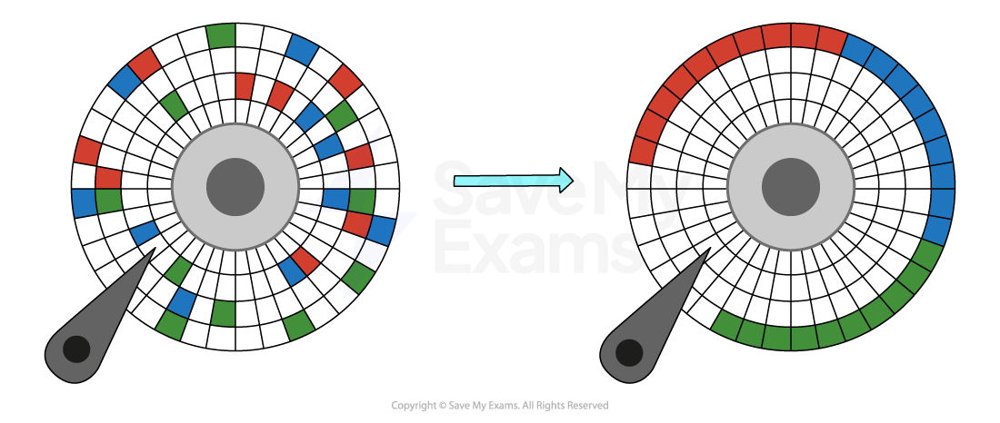

# Utility software

## Utility software

> **Spec point** — `spcpt_nvxrKjs25gBy5rv5`

## Utility software

### What is utility software?

- Utility software is a **collection of tools** designed to help **maintain** a computer system
- Utility software is designed to **perform a limited number of tasks**
- Utility software** interacts with the computers hardware**, for example, secondary storage devices
- Some utility software comes **installed with the operating system**
- Examples of utility software include:

  - **Disk formatter**
  - **Virus checker**
  - **Defragmentation software**
  - **Disk contents analysis/disk repair software**
  - **File compression**
  - **Back-up software**

### Disk formatter

- A disk formatter **prepares a storage device** (like a hard drive or USB stick) for use by **creating a file system** and **organising the space into sectors and tracks**
- It is needed:

  - To **wipe** and **re-initialise** a disk before use
  - To change the **file system format** (e.g. FAT32, NTFS)
  - To **remove all data** and errors before installing a new OS or reusing the drive
- For example:

  - **Formatting **a new external drive before saving files
  - **Reformatting **a corrupted USB stick to make it usable again

### Virus checker

- Virus checking software is a **combination of different software to prevent **computers from being susceptible to **viruses** and other **malicious software**
- It typically includes:

  - **Anti-virus**
  - **Anti-spam**
  - **Anti-spyware **

- A virus checker **scans** through **email** attachments, **websites** and downloaded **files** to search for issues
- Two ways virus checkers can approach the task are:

  - Use a list of known **unique malware fingerprints** (**signatures**) to block immediately if they try to access your device in any way
  - **Monitor **the **behaviour **of programs to identify suspicious activities that might indicate malware such as;
  
    - **Rapid deletion/modification of files**
    - **Attempts to access sensitive data/resources**
    - **Communicating with known malicious servers**
- Virus checkers will also perform **checks for updates** to ensure the database of signatures is **up to date**

### Defragmentation software

- Defragmentation software **groups fragmented files back together** in order to** improve the access speed **of a hard disk drive **(HDD)**
- As programs and data are added to a new hard disk drive, it is added in order,** over time as files are deleted this leaves gaps**
- As programs and data are added over time, **these gaps get filled and data becomes fragmented**
- Defragmentation can only be used on **magnetic storage**

### Disk contents analysis/disk repair software

- This utility checks the **structure and health** of a disk, including **files, folders, sectors**, and the **file allocation table**
- It is needed:

  - To **diagnose and fix errors** on the disk (e.g. bad sectors, file system corruption)
  - To **recover lost or damaged files**
  - To improve system performance by identifying and repairing issues
- For example:

  - Running **Check Disk (chkdsk)** on Windows to repair file system errors
  - Using a **disk utility** on macOS to verify and repair drive problems

### File compression

- Compression **reduces the amount of secondary storage** required by performing an algorithm on the original data
- **Lossy compression** physically **removes data** from the original data to reduce its size, **the original file can not be re-created**
- **Lossless compression** uses mathematics to **order data** more efficiently reducing its size, **the original files can be re-created as no data is lost**

### Back-up software

- Back-up software is used to** create copies of personal data** in order to keep it safe in the event of:

  - **Accidental loss**
  - **Data theft**
- Backups can be **automated **and **scheduled **to happen at less busy periods of the day, to not take up valuable system resources (e.g. overnight etc.)
- Backups can be made in two ways:

  - **Full **- all files are backed up (saftest, slow)
  - **Incremental **- only files that have been added/modified since the last backup are backed up (faster, less secure)
- Backups can be stored **locally **(secondary storage) or **remotely** (cloud)
- Backup software can be **purchased **or come as a standalone application **bundled **with an **operating system**

> **Worked Example**
> Draw one line from each utility software to its correct description.
> 
> **                   Utility software                                                                    Description**
> 
> 
> 
> **[4]**
> 
> **Final answer:** **Answer**
> 
> 
