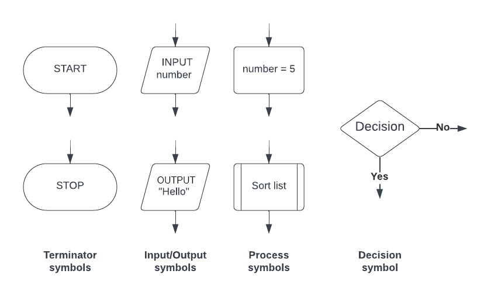

# Algorithm basics

## Definition of algorithm

> **Spec point** — `spcpt_N8XKYrJwZSkNn4CF`

## Definition of algorithm

## What is an algorithm?

- An algorithm is a **solution to a problem** expressed as a **sequence of defined steps**
- Methods of writing an algorithm before attempting to program a solution include:

  - **Structured English**
  - **Pseudocode**
  - **Flowcharts**

#### Structured English

- Structured English is a **human-readable method** for describing algorithms using a combination of **natural English language** and **programming logic**

  - It uses clear English phrases to describe each step
  - Logic structures like **IF...THEN**, **REPEAT**, and **WHILE** may appear, but without strict syntax rules
  - Often used in the early planning stages before converting to pseudocode

#### Pseudocode

- Pseudocode is a **precise, structured, and language-independent way** of describing an algorithm that resembles a programming language
- It **follows specific exam-board-defined syntax**

  - It includes formal elements like `IF`, `THEN`, `ELSE`, `WHILE`, `REPEAT`, `DECLARE`, and `←` for assignment
  - Students must follow **CIE’s pseudocode format** in exams

#### Flowcharts

- Flowcharts are a **visual tool** that uses **shapes to represent different functions** to **describe an algorithm**
- Used to **visualise the flow of control** in a system
- Standard symbols include:

  - **Oval** for Start/End
  - **Parallelogram** for Input/Output
  - **Rectangle** for Processes
  - **Diamond** for Decisions
- Arrows show the **sequence of operations**

## Identifier tables

> **Spec point** — `spcpt_K5x493txHdkbQvJt`

## Identifier tables

### What is an identifier table?

- An identifier table is used when writing **pseudocode** to keep track of all the **identifier names** used in an algorithm
- An **identifier** is the **name given to a variable, constant, array, procedure**, or any other named element in the pseudocode

#### Why use an identifier table?

- It helps you stay **organised** when designing an algorithm
- Ensures **consistent naming**
- Makes it easier to understand what each identifier stores or does
- Useful in **exam questions** when you are asked to declare variables clearly

#### Identifier naming rules

- Must start with a **letter** (A–Z or a–z)
- Can include **letters**, **digits (0–9)**, and **underscores (_)**
- **Accented characters** and **symbols** are not allowed
- Identifiers are **case sensitive** (e.g. `Total` and `total` are **NOT** treated the same)

| **Identifier** | **Description** |
|---|---|
| `StudentName` | Stores a student’s full name |
| `TestScore` | Holds a test score value |
| `MAX_SCORE` | Maximum score allowed |
| `FormList` | Stores names in a form group |
