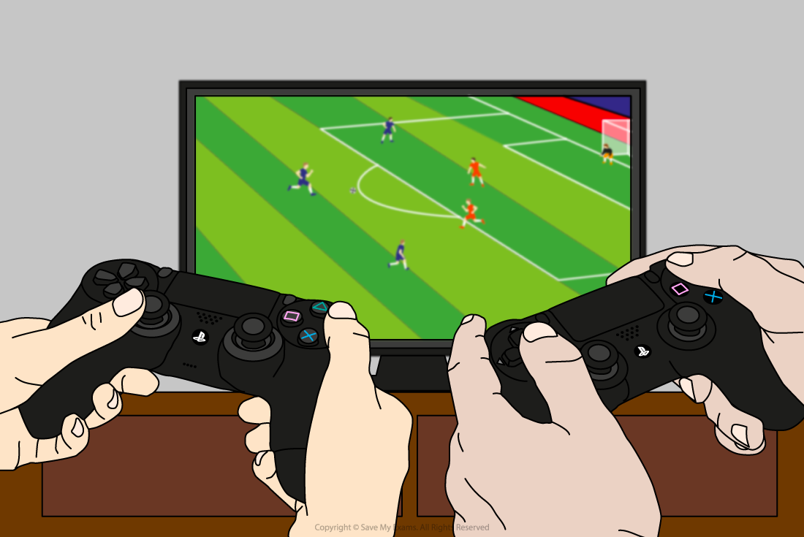
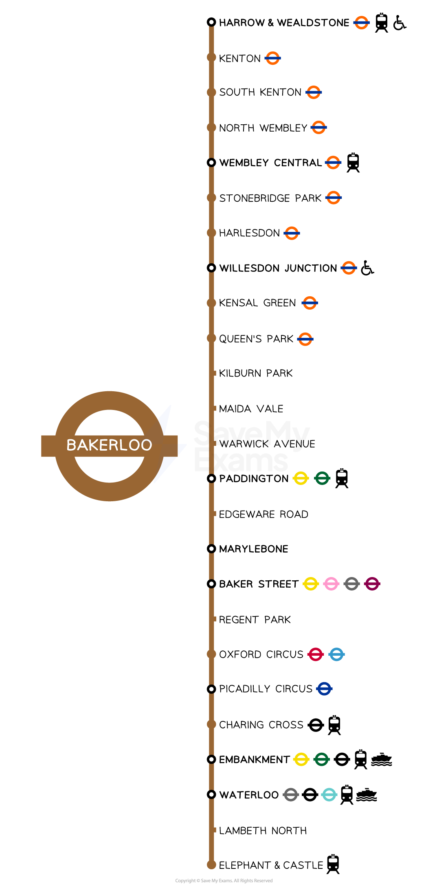
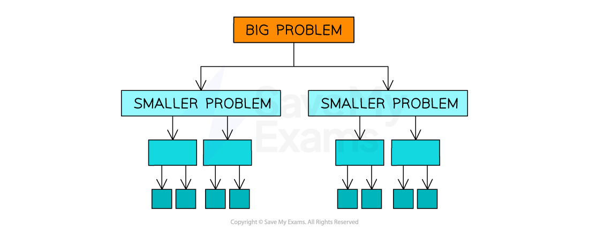

# Computational Thinking Skills

## Abstraction

> **Spec point** — `spcpt_jMSSWQwbp23xmKMM`

## Abstraction

### What is abstraction?

- Abstraction is the process of** removing unnecessary details **from a problem to **focus on the important features **for implementing a solution
- Examples of abstraction include modelling a:

  - **real-life object**
  - **environment**
  - **action**
  - **sequence of actions**
  - **concept**
- Implementations of these include:

  - **a computer game that simulates playing a sport**
  - **a simulator such as a car or flight simulator,**
  - **a map of a bus or train route in a city**
- When creating a program, developers must **identify important features** that will contribute to solving the problem or have a role to play in the solution

#### Computer games

- Computer games use a large amount of abstraction, **removing the elements that a user does not need to consider** in order to enjoy playing the game
- When using abstraction in computer games which are designed to simulate real life, the aim is to make the game realistic and visually appealing whilst keeping the game fun to play
- In a game that simulates a sport, it is important to the user that visually they recognise the environment and when they perform an action, they see a response
- However, users do not need to know the complex algorithms used to control the non player characters (NPCs)

#### Train map

- Another specific example of abstraction would be the London underground train route map; travellers **do not need to know the geographical layout** of the routes, only that getting on at stop A will eventually transport you to stop B

## Decomposition

> **Spec point** — `spcpt_BT28pP7VkkWZYZbM`

## Decomposition

### What is decomposition?

- Decomposition is **breaking down a big problem** into smaller problems so that they can be **solved independently**
- Programmers use decomposition to:

  - **Break **problems down
  - **Identify **the steps, parts or processes involved in a problem
  - **Identify **reusable components
  - **Split **tasks between programmers
- In the case of slow appointment booking, you could **decompose **the problem into issues such as server limitations during peak hours, inefficient backend algorithms, and user interface delays

*Process of decomposition to break problems down*

### Using abstraction to design a solution

- Before we start to break problems down, it is often useful to **apply the rules of abstraction** to the problem
- Applying abstraction will remove **non-essential elements** and that programmers can **focus on critical aspects** for problem-solving
- When addressing a slow booking system, a programmer could ignore elements like the system's colour scheme or graphics and focus on critical performance metrics such as server response time and database query efficiency

### Decomposing slow response times problem

1. **Big problem**: Slow response times during the online appointment booking process
2. **Decompose **into sub-problems:

  - Server limitations causing **bottlenecks **during peak hours
  - Inefficient algorithms leading to **delayed confirmation** screens
  - Poor user interface contributing to an overall **bad user experience**
3. **Prioritise **sub-problems:

  1. Address **server limitations**, as solving this could have a broad impact on system performance
  2. Look into **optimising algorithms** to speed up the booking and confirmation process
  3. Lastly, make **user interface improvements** to enhance user experience, possibly mitigating some of the frustration caused by slow response times
