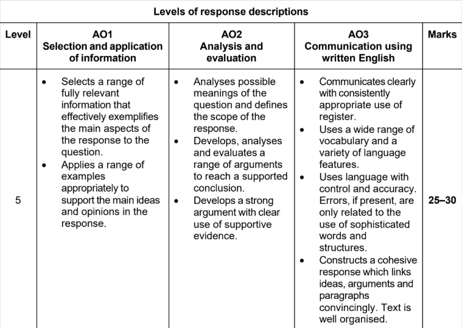
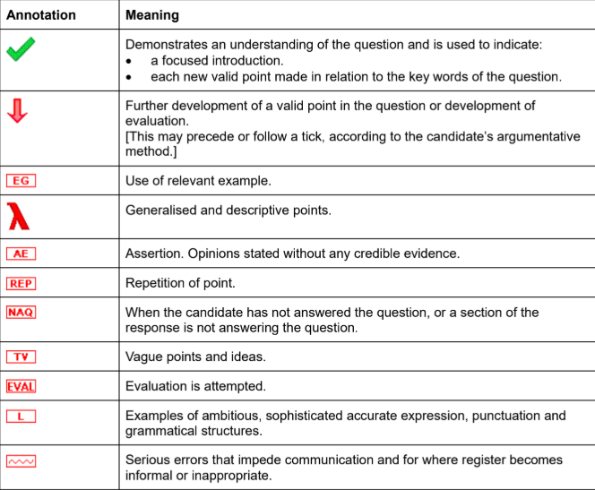

# How your Paper 1 Essay is Marked

Preparing for the CIE AS English General Paper Paper 1 essay means understanding not just what to write, but **how your essay is marked**. This guide explains the marking process, Assessment Objectives (AO1, AO2, AO3), and Generic Level Descriptions (GLDs), helping you aim for a Level 5 essay (25–30 marks).

In this guide you will find:

- Understanding how Paper 1 is marked
- Assessment Objectives and weighting
- The five marking levels from 1 to 5
- What a level 5 essay looks like (25-30 marks)
- Common mistakes that lower marks
- How Paper 1 marking works in practice

## Understanding how Paper 1 is marked

> **Spec point** — `spcpt_kkDV7XTzYJbNzj9y`

## Understanding how Paper 1 is marked

Paper 1 uses **criterion-referenced marking**, which means your essay is judged against clear performance criteria, not compared with other candidates.

Examiners will:

- Place your essay into a **Level (1–5)** using the **Generic Level Descriptions**
- **Fine-tune** your mark within that level, depending on how strongly you meet the descriptors

The higher your level, the stronger your:

- Use of examples and information (**AO1**)
- Analytical and evaluative thinking (**AO2**)
- Communication and structure (**AO3**)

The top level of the mark scheme looks like this:

*CIE AS English General Paper mark scheme*

## Assessment Objectives (AOs) and weighting

> **Spec point** — `spcpt_cK6qbQnyZdgSpXjs`

## Assessment Objectives (AOs) and weighting

| **AO** | **What it tests** | **Weighting** |
|---|---|---|
| **AO1** | Selection and application of information | 20% |
| **AO2** | Analysis and evaluation | 35% |
| **AO3** | Communication using written English | 45% |

As you can see, **AO3 (communication)** has the highest weighting, so clarity, organisation and control of language are key.

> **Exam Hint**
> If you are taking your exam from 2028 onwards, both AO1 and AO2 will be weighted equally at 25%, with AO3 still having the highest weighting at 50%. The total marks available for the essay will also increase from 30 to 40.

## The five marking levels from 1 to 5

> **Spec point** — `spcpt_PYqkGk4djRD2yCN4`

## The five marking levels from 1 to 5

Your essay is placed in one of **five levels**, each representing a performance band.

### Level-to-mark range table

| **Level** | **Mark range** | **Descriptor summary** |
|---|---|---|
| **Level 5** | 25-30 | - Excellent, well-focused, fully developed argument - Highly effective communication |
| **Level 4** | 19-24 | - Good, clear argument with minor lapses in structure or precision |
| **Level 3** | 13-18 | - Adequate, relevant but uneven discussion - Some weaknesses in reasoning or expression |
| **Level 2** | 7-12 | - Limited, generalised or descriptive response - Weak argument development |
| **Level 1** | 1-6 | - Very limited, unclear, incomplete or largely irrelevant response |

## What a level 5 essay looks like (25–30 marks)

> **Spec point** — `spcpt_TjmctVcJk3KzwfF7`

## What a level 5 essay looks like (25–30 marks)

### AO1: selection and application of information

- Selects **fully relevant, accurate examples**
- Applies evidence precisely to support each main point
- Avoids irrelevant or superficial material
- Demonstrates sound judgement supported by well-chosen examples

### AO2: analysis and evaluation

- Clearly defines the scope of the question in the introduction
- Develops **balanced, logical arguments** that explore different perspectives
- Evaluates evidence and ideas before reaching a supported conclusion
- Ends with a **reasoned, evaluative judgement** that links back to the question

### AO3: communication in written English

- Uses **accurate, controlled, and varied language**
- Maintains a **formal, academic tone** appropriate for an international audience
- Links ideas smoothly and logically across paragraphs
- Demonstrates command of structure and coherence; errors are rare and minor

## Common mistakes that lower marks

> **Spec point** — `spcpt_V9ZMkd3H8dSzwSBW`

## Common mistakes that lower marks

- **Descriptive writing:** listing facts without evaluation or analysis
- **Ignoring key terms:** missing qualifiers like “to what extent” or “evaluate”
- **Too few examples:** relying on general assertions instead of evidence
- **Informal tone:** using colloquial or conversational language
- **Language errors:** repeated grammatical mistakes affecting clarity
- [Repetition](https://www.savemyexams.com/glossary/gcse/english-language/repetition-definition/): restating ideas without adding new insight

Remember, the examiners are assessing **your thinking as well as your writing**. Show that you can reason critically and communicate effectively.

## How Paper 1 marking works in practice

> **Spec point** — `spcpt_Wt4f9qkhrDv3sY8b`

## How Paper 1 marking works in practice

Examiners **assess** your **essay as a whole**, not by awarding marks separately for each AO. They consider how well you meet all three Assessment Objectives together. The level sets your mark range, and then finer adjustments are made within that range. Remember, to reach Level 5, all three AOs (knowledge, evaluation and communication) must be consistently strong. Weakness in one can limit your final level.

When the examiners mark your essay (or script), they will annotate it using the following symbols:

*CIE AS English General Paper marking annotations*

Examiners will award the **highest marks** to candidates who **demonstrate** a **well-organised and focused** management of the **discussion the question provokes**, and use **clear and accurate communication**. They want to see the **careful selection and application of information** (evidence) and **effective analysis and evaluation**, rather than a list of points with vague or brief evidence. Any explanation or judgement you make is made **stronger** by **supporting** it with the use of **relevant examples**.

## Frequently asked questions

> **Spec point** — `spcpt_BptpxSXFPHVFVChS`

## Frequently asked questions

**Q. How long should my essay be?**
**A**. Aim for **600–700 words** — quality of argument matters more than word count.

**Q. Do I lose marks for short essays or for going over the suggested word limit?**
**A**. Not directly, but shorter responses usually lack analysis and supporting evidence. Answers that are too long wander off topic and lack focus.

**Q. Are spelling and grammar marked separately?**
**A**. No, they are part of **AO3 (communication)**. Frequent errors will lower your mark.

**Q. Can I use personal examples?**
**A**. Yes, if relevant and well explained. Link them clearly to your argument.

**Q. How do I show evaluation?**
**A**. By weighing up different perspectives, questioning assumptions and drawing reasoned conclusions.

### Final thought

Success in CIE AS English General Paper, Paper 1, depends on combining strong ideas with clear communication. A Level 5 essay demonstrates balance, insight and control, showing the examiner that you understand the question, think critically and express yourself with precision.
