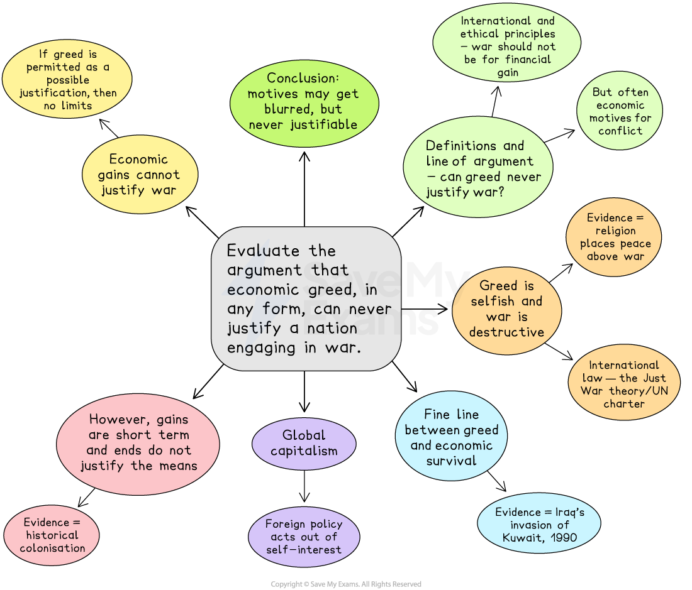

# Paper 1 Topics: Conflict and Justice Model Answer

- Paper 1 of the CIE AS English General Paper is the essay component
- You will **select one question** from a list of **ten options** to write an essay of approximately **600-700 words**
- The questions concern **contemporary issues**

Here, you will find an example of a plan and a top-mark model answer to a sample Paper 1 essay question covering the broad themes of **conflict and justice**.

## Paper 1 essay question and plan

> **Spec point** — `spcpt_mBrS3WJSTs7TNQdR`

## Paper 1 essay question and plan

**Q. Evaluate the argument that economic greed, in any form, can never justify a nation engaging in war**.

**[30 marks]**

*Can economic greed justify war?*

## Paper 1 essay model answer

> **Spec point** — `spcpt_CJqcVm7Cg8XpyWn2`

## Paper 1 essay model answer

> **Worked Example**
> *The claim that economic greed, in any form, can never justify a nation engaging in war demands an evaluation that balances moral, legal, and practical perspectives.* While ethical and international principles strongly reject war for financial gain, history shows that economic motives have often shaped conflict, even when disguised as political or defensive action. To judge whether greed can *never* justify war, it is necessary to consider both the moral and legal arguments against it and the pragmatic reasoning that challenges such an absolute stance.
> 
> *From a moral standpoint, greed is widely condemned as selfish and destructive. War itself involves organised violence that leads to suffering, loss of life, and long-term instability. When fought for material gain rather than protection or justice, it appears deeply immoral. **Religious traditions reinforce this view. The Christian Bible warns that “the love of money is a root of all kinds of evil”, suggesting that greed corrupts both individuals and nations. *Similarly, in Islam, armed struggle is only permissible for self-defence and only after peaceful options have been exhausted. Such teachings place human welfare and peace far above material objectives.
> 
> *This moral position is supported by international law. *The Just War theory, which underpins many modern conventions, states that war must have a just cause, such as self-defence or protection of human rights. A war fought to seize land or resources breaches these conditions. Under the United Nations Charter, aggression motivated by expansion or profit is considered a crime against peace. Furthermore, wars driven by greed often destroy the very economies they seek to enrich, diverting money from essential public needs such as health and education. *From this perspective, greed not only fails to justify war but also undermines long-term national stability.*
> 
> *However, the claim that greed can ***never*** justify war becomes harder to sustain when the line between greed and economic survival is blurred. *Nations depend on access to resources such as oil, water, or fertile land. If these are threatened, leaders may argue that action, even military, is necessary to secure them. In this view, economic protection becomes a form of self-defence. For instance, Iraq’s invasion of Kuwait in 1990 was officially justified as reclaiming stolen oil fields, though widely seen as economic aggression. The example shows how motives of greed and security can overlap, complicating moral judgment.
> 
> A further pragmatic argument is that modern global capitalism fosters competition for wealth and resources. Powerful states and corporations often act in self-interest, shaping foreign policy around trade and energy access. Some political theorists claim that the global market itself rewards aggressive pursuit of resources. Governments may therefore see war not as moral failure but as economic necessity to preserve jobs, energy supplies, or influence. This reasoning, while ethically dubious, reflects the pressures of global interdependence.
> 
> *Nevertheless, such arguments conflict with the moral principle that “the end never justifies the means”.* Using violence to secure prosperity inevitably harms innocent people and erodes international trust. History suggests that wars fought for economic advantage rarely deliver lasting benefits. The colonial conquests of the nineteenth century, for example, brought wealth to imperial powers but caused exploitation and deep resentment that still affect global relations today. Even when wars achieve short-term economic gains, the long-term human and moral costs outweigh them.
> 
> Ultimately, while pragmatic reasoning may explain why nations act from economic motives, it does not *justify* war. Ethical and legal standards remain consistent in rejecting greed as a legitimate cause. The qualifier “never” is strong, yet it serves an important purpose: it reminds states that permitting greed as a justification risks eroding all limits on warfare. Once economic benefit is accepted as valid, almost any aggression could be excused as “strategic”.
> 
> *Therefore, the argument that economic greed, in any form, can ***never*** justify a nation engaging in war is persuasive when judged by moral and legal principles. **Although real-world politics often blur motives and prioritise survival or stability, these cannot erase the ethical truth that greed, however disguised, is not a defensible reason for violence. Nations may act from economic interest, but that does not make such actions just.* *The absolute stance remains the only one that preserves both moral integrity and international order.*

## Marking and guidance

> **Spec point** — `spcpt_7d8HRVBDyz6Vqr4z`

## Marking and guidance

This example would achieve Level 5 across the three Assessment Objectives because:

- The argument is disciplined and the essay selects fully relevant material that directly serves the task **(AO1)**
- The essay defines its scope early and keeps a clear line of enquiry **(AO2)**
- It tests whether economic greed can never justify war by weighing ethics and law against realist pressures **(AO2)**
- Counter arguments are recognised and refuted **(AO2)**
- The conclusion answers the “never” directly and defends the absolute stance as a safeguard against normalising aggression **(AO2)**
- The writing is clear, controlled and appropriate **(AO3)**
- Topic sentences guide the reader, with smooth transitions between paragraphs **(AO3)**
- The response is cohesive and well organised **(AO3)**
