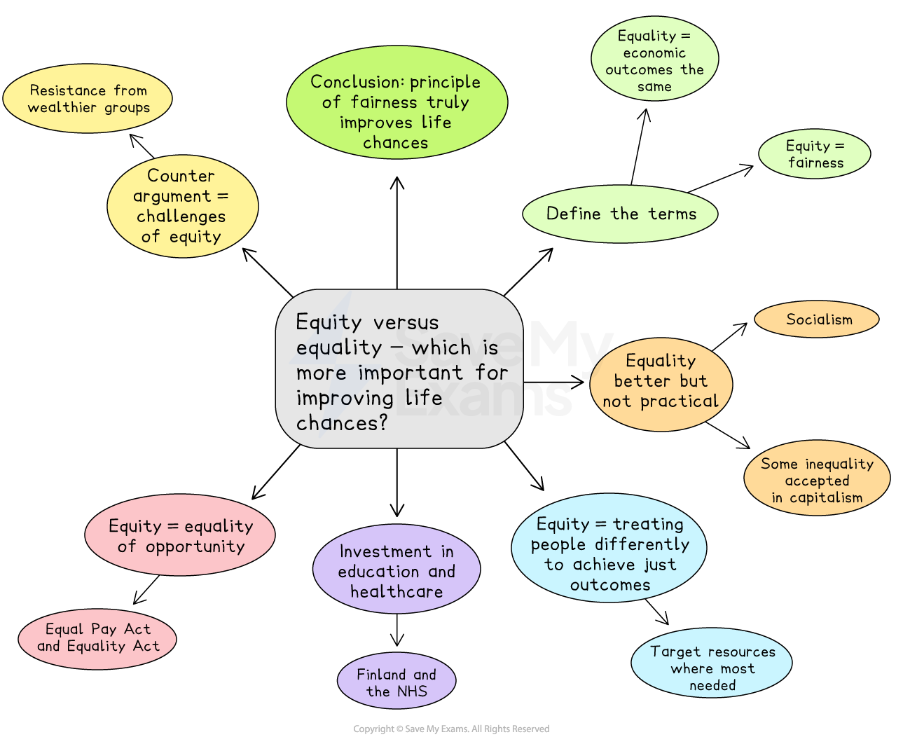

# Paper 1 Topics: Economics and Equality Model Answer

- Paper 1 of the CIE AS English General Paper is the essay component
- You will **select one question** from a list of **ten options** to write an essay of approximately **600-700 words**
- The questions concern **contemporary issues**

Here, you will find an example of a plan and a top-mark model answer to a sample Paper 1 essay question covering the broad themes of economics and equality.

## Paper 1 essay question and plan

> **Spec point** — `spcpt_QNj8KPp7XtQyf9j8`

## Paper 1 essay question and plan

**Q.“Equity refers to the idea of fairness, whereas equality describes situations where economic outcomes are similar.” Evaluate which of these concepts is more crucial for improving the life chances of disadvantaged groups.**

**[30 marks]**

*Equity versus equality*

## Paper 1 essay model answer

> **Spec point** — `spcpt_BFg9d8V7DCMs7CR9`

## Paper 1 essay model answer

> **Worked Example**
> *The question demands an evaluation of two interconnected but distinct principles: equality and equity, in their capacity to improve the life chances of disadvantaged groups.* Equality refers to a state where economic outcomes are uniform, while equity prioritises fairness by recognising that those who begin at a disadvantage may require greater support to achieve comparable results. Although the pursuit of equality remains a valuable social aspiration, equity emerges as the more crucial concept for improving life chances, as it actively confronts the structural barriers that perpetuate disadvantage.
> 
> *The idea of equality, particularly in economic terms, has a powerful moral appeal but limited practical utility.* *Absolute equality of outcome, where everyone earns the same regardless of occupation or effort, has historically been linked with socialist systems. While such models aim to eliminate poverty, they often undermine incentives for innovation and productivity, producing economic stagnation rather than shared prosperity.* Modern capitalist economies, by contrast, accept some inequality as a necessary driver of growth and individual motivation. However, unrestrained inequality leads to wealth concentration, reduced social mobility, and the marginalisation of vulnerable groups. *Thus, equality alone, interpreted as identical outcomes, risks both economic inefficiency and the neglect of those most in need.*
> 
> Equity, on the other hand, acknowledges that fairness often requires treating people differently to achieve just outcomes. It is founded on the recognition that individuals face unequal starting points due to systemic disparities in education, health, and opportunity. Equity-based approaches therefore target resources where they are most needed. For example, progressive taxation ensures higher earners contribute proportionally more, enabling governments to fund public services such as healthcare, education, and welfare. These redistributive policies directly enhance the quality of life for disadvantaged citizens by improving access to essential services and creating pathways out of poverty.
> 
> *Investment in education and healthcare is particularly vital to equity. *Countries such as Finland have demonstrated how equitable access to education can yield high levels of social mobility, while the British National Health Service exemplifies fairness in access to healthcare, irrespective of income. These systems, underpinned by redistributive taxation, create a more skilled and healthy population, ultimately strengthening the economy as a whole. Similarly, targeted welfare policies, such as unemployment support, disability benefits, and minimum wage legislation, address specific vulnerabilities, offering both financial stability and dignity. Such interventions reflect the moral core of equity: that a fair society supports its weakest members not through uniformity but through need-sensitive assistance.
> 
> Moreover, equity extends beyond redistribution to encompass equality of opportunity, which is a more realistic and sustainable goal than equality of outcome. Legislation such as the Equal Pay Act (1970) and the Equality Act (2010) in the United Kingdom exemplify this, seeking to remove discrimination based on gender, race, disability, or religion. These measures ensure that access to employment and promotion is determined by merit, not prejudice. Internationally, affirmative action policies in the United States and reservation systems in India serve similar equitable purposes by addressing historical exclusion and improving representation among disadvantaged groups. Although sometimes criticised for creating new forms of bias, these initiatives have been instrumental in expanding opportunity and social participation for marginalised populations.
> 
> *Nevertheless, the pursuit of equity is not without challenges. *Redistribution can provoke political resistance from wealthier groups and may risk dependency if poorly implemented. However, these drawbacks are outweighed by the long-term benefits of a fairer, more cohesive society. In contrast, a purely equality-based model offers little capacity to rectify entrenched disadvantages and may even reinforce inequality by ignoring the unequal conditions from which individuals start.
> 
> *In conclusion, while equality of outcome remains an ideal that symbolises social justice, it is equity, the principle of fairness adjusted to need, that truly improves the life chances of disadvantaged groups.* By addressing structural inequalities through redistributive policies, equitable access to healthcare and education, and protections against discrimination, societies can transform unfair beginnings into fair opportunities. Equity therefore provides not only the moral foundation but also the practical framework for social progress, ensuring that prosperity is shared not uniformly but justly.

## Marking and guidance

> **Spec point** — `spcpt_9yKGdbtMYfyJdkZH`

## Marking and guidance

This example would achieve Level 5 across the three Assessment Objectives because:

- The argument is disciplined and the essay selects fully relevant material that directly serves the task **(AO1)**
- The essay defines the distinction between equity and equality clearly and applies these definitions consistently throughout **(AO1)**
- It sustains a balanced, evaluative argument that moves beyond description to judge which concept is more effective for improving life chances **(AO2)**
- The analysis is conceptually mature, linking fairness, opportunity, and redistribution to measurable social outcomes **(AO2)**
- Counterarguments are acknowledged, including the risks of dependency and resistance to redistribution, and these are effectively refuted **(AO2)**
- The conclusion delivers a decisive judgement that explicitly answers the evaluative question and reinforces the essay’s moral and practical reasoning **(AO2)**
- The writing is clear, precise, and fluent, using varied syntax and sophisticated vocabulary appropriately **(AO3)**
- Topic sentences signal argument progression, and transitions ensure a smooth, logical flow between paragraphs **(AO3)**
- The structure is cohesive and tightly controlled, maintaining focus and balance across conceptual discussion, real-world examples, and evaluation **(AO3)**
