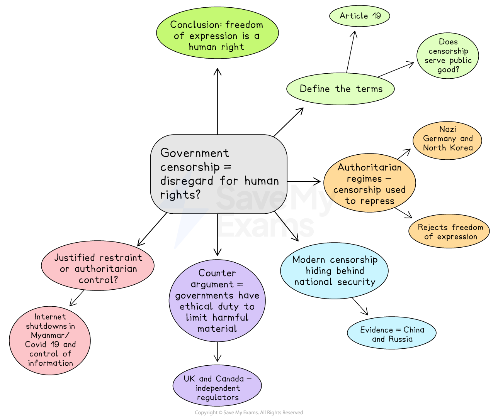

# Paper 1 Topics: Human Rights Model Answer

- Paper 1 of the CIE AS English General Paper is the essay component
- You will **select one question** from a list of **ten options** to write an essay of approximately **600-700 words**
- The questions concern **contemporary issues**

Here, you will find an example of a plan and a top-mark model answer to a sample Paper 1 essay question covering the broad theme of **human rights**.

## Paper 1 essay question and plan

> **Spec point** — `spcpt_g9mT4FrZ7kDqYKy3`

## Paper 1 essay question and plan

**Q. To what extent does government censorship of the arts and media indicate a disregard for human rights**?

**[30 marks]**

*Government censorship and human rights*

## Paper 1 essay model answer

> **Spec point** — `spcpt_58PvBsfqMkg7WgzX`

## Paper 1 essay model answer

*Government censorship, the deliberate restriction of artistic or journalistic expression, tests the limits of a society’s respect for freedom.* The Universal Declaration of Human Rights, particularly Article 19, guarantees everyone the right to hold opinions and express them without interference. When states control the arts or media to maintain power or suppress dissent, they breach this principle and demonstrate disregard for human rights. Yet censorship can, in limited circumstances, be justified to prevent immediate harm or to protect vulnerable groups. *The real question, therefore, is one of intent and proportionality: whether censorship serves the public good or the interests of those in power.*

*In authoritarian regimes, censorship has long been a deliberate strategy of oppression.* *During Nazi Germany, Joseph Goebbels’ Reich Chamber of Culture determined what citizens could read, watch and hear.* Artists, writers and composers who rejected Nazi ideology were silenced; books by Jewish and liberal thinkers were burned in public displays of conformity. Such manipulation of culture aimed to erase independent thought and enforce obedience. Here, censorship was not protective but coercive, a calculated assault on intellectual and moral autonomy. *Similar practices have persisted in more recent contexts, such as North Korea, where every publication, film and performance exists solely to glorify the state.* *These examples show that censorship used to secure political control embodies an unequivocal rejection of the right to freedom of expression.*

Modern censorship often hides behind claims of national security or public morality, yet its effects can be equally corrosive. In China, the “Great Firewall” blocks vast portions of the internet, preventing citizens from accessing global information or criticising the Communist Party. This control extends into the arts, where films and online content are filtered to remove references to democracy, religion or LGBTQ+ rights. By determining what citizens can see or discuss, the government denies them the ability to form informed opinions, a central element of human rights. In Russia, independent journalists have faced arrest or exile for questioning the invasion of Ukraine, proving that digital tools have simply replaced print as the new battleground for freedom. Such cases illustrate how censorship in the digital age continues to reflect contempt for human dignity and civic participation.

*However, not all restrictions on expression are inherently oppressive.* Governments have an ethical duty to prevent material that incites violence, hatred or discrimination. Limiting extremist propaganda or child exploitation imagery, for example, is widely accepted as necessary to protect others’ rights. In democratic states, such as the United Kingdom or Canada, independent regulators oversee these processes to ensure transparency and proportionality. This distinction between legitimate regulation and ideological suppression is critical. When censorship operates through accountable institutions and clear legal frameworks, it can uphold rather than undermine human rights by balancing freedom with protection.

*Still, the boundary between justified restraint and authoritarian control is easily crossed.* Under the pretext of countering “fake news”, some governments have introduced vague laws allowing them to silence journalists or activists. In Myanmar, for instance, internet shutdowns and the banning of independent newspapers were justified as efforts to prevent unrest but effectively erased opposition voices. Even in democratic societies, the temptation to censor dissent in times of crisis, such as during the Covid-19 pandemic, has sparked debate about whether the state’s power to control information can ever be truly benign. These cases highlight that censorship, even when framed as protection, risks eroding the very freedoms it claims to defend.

*Ultimately, censorship reveals a government’s moral priorities. When exercised transparently and in proportion to genuine threats, it can safeguard the collective good.* Yet history and contemporary practice alike demonstrate that it is most often wielded to preserve political authority and suppress accountability. Freedom of expression is not merely a privilege but the foundation upon which all other rights rest; once it is compromised, so too is the capacity for citizens to challenge injustice. Therefore, government censorship of the arts and media largely indicates a disregard for human rights, for it undermines the autonomy, creativity and informed judgement that define human freedom. Only in rare and tightly controlled circumstances can it be justified, and even then, the burden of proof must rest with those who seek to silence.

## Marking and guidance

> **Spec point** — `spcpt_mTmpM2kxNcFnH6x3`

## Marking and guidance

Why this would achieve Level 5 across the three Assessment Objectives:

- The essay maintains a disciplined and focused argument, selecting only fully relevant evidence that directly addresses how censorship reflects disregard for human rights **(AO1)**
- It defines its scope and parameters clearly in the introduction by identifying intent and proportionality as the key measures of whether censorship violates rights **(AO2)**
- The argument is logically structured, progressing from historical authoritarian examples to modern digital contexts, then to justified exceptions, showing sustained critical control **(AO2)**
- It evaluates different contexts, including totalitarian, democratic and transitional systems, showing awareness of how political structures shape the morality of censorship **(AO2)**
- Counterarguments are acknowledged and tested, particularly in the discussion of legitimate regulation and protection from harm, ensuring the essay remains balanced rather than one-sided **(AO2)**
- The conclusion explicitly answers the question, reinforcing the “extent” through a nuanced judgement that censorship “largely” indicates disregard but not absolutely **(AO2)**
- The writing is fluent, precise and mature, employing a confident academic register and sophisticated vocabulary throughout **(AO3)**
