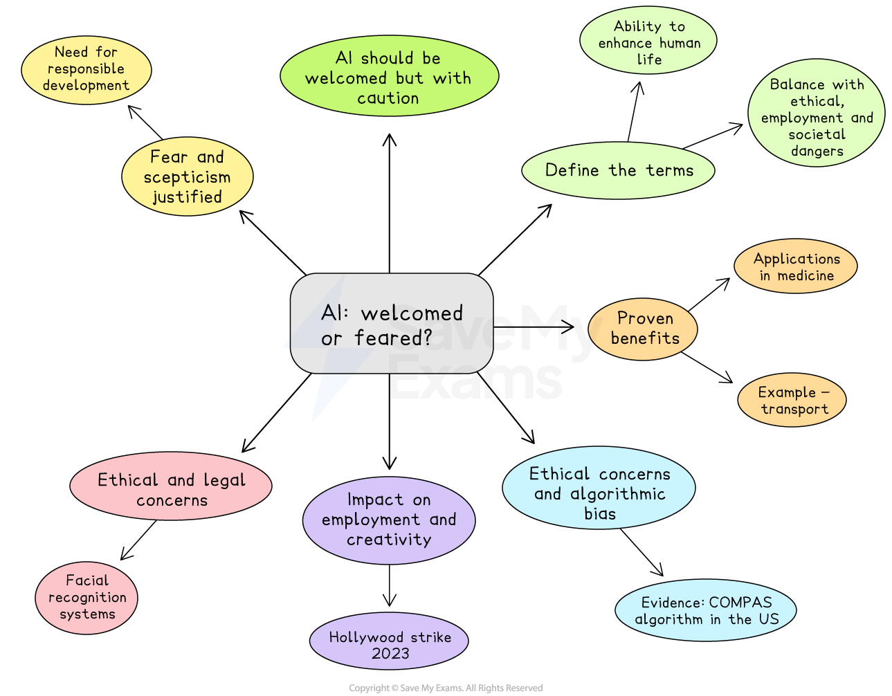

# Paper 1 Topics: Science and Technology Model Answer

- Paper 1 of the CIE AS English General Paper is the essay component
- You will **select one question** from a list of **ten options** to write an essay of approximately **600-700 words**
- The questions concern **contemporary issues**

Here, you will find an example of a plan and a top-mark model answer to a sample Paper 1 essay question covering the broad theme of science and technology.

## Paper 1 essay question and plan

> **Spec point** — `spcpt_5BvGgKSk388mR384`

## Paper 1 essay question and plan

**Q. Artificial intelligence should be welcomed not feared. To what extent do you agree with this statement**?

**[30 marks]**

*AI: welcomed or feared?*

## Paper 1 essay model answer

> **Spec point** — `spcpt_Pqrt7sNm9cBgsm9n`

## Paper 1 essay model answer

*Artificial intelligence (AI), defined as the capacity of machines to perform tasks requiring human-like intelligence, presents a profound dilemma: should it be embraced for its transformative potential or approached with caution because of its risks?* To a considerable extent, AI should be welcomed because of its capacity to enhance human life, increase efficiency and address global challenges. However, this optimism must be balanced with a recognition of its ethical, employment and societal dangers. Fear, in this context, is not irrational, but a necessary safeguard against misuse.

*The most compelling argument for welcoming AI lies in its proven ability to deliver practical benefits and improve human welfare.* *In healthcare, AI-driven systems can process complex data with precision, enabling early diagnosis and improving treatment outcomes.* Machine learning models help detect diseases such as cancer or Alzheimer’s far earlier than traditional methods, saving lives and reducing suffering. AI also enhances research by analysing vast datasets, accelerating medical and scientific breakthroughs. *Beyond healthcare, AI enables efficiency across sectors through automation and predictive analysis.* In transport, intelligent algorithms optimise traffic flow and reduce congestion, while in environmental management, AI supports climate modelling and disaster prediction. For individuals, it removes repetitive burdens, freeing time for creative or interpersonal pursuits. *Such benefits demonstrate that AI, when responsibly implemented, can improve the quality of life across all levels of society.*

*Despite these advantages, apprehension surrounding AI is justified, particularly because of ethical concerns and algorithmic bias.* AI systems depend on large volumes of data, raising significant issues of privacy, consent and security. Algorithms often reflect the biases within their training data, producing outcomes that can reinforce inequality. For example, the COMPAS algorithm, used in the US judicial system to predict criminal reoffending, has been criticised for perpetuating racial bias. Similarly, Amazon’s AI recruitment tool was abandoned after it favoured male applicants, exposing the risk of discrimination embedded within automated systems. Such examples illustrate that AI reflects human prejudices as much as it amplifies them. The fear that these biases might institutionalise injustice is, therefore, both reasonable and necessary.

Concerns also arise regarding AI’s impact on employment and human creativity. Automation has already displaced large numbers of workers in manufacturing and customer service, and its reach now extends into creative industries. The use of AI to generate music, art and scripts has provoked anxiety among artists and writers who fear being replaced by digital replicas of their work. *The Hollywood writers’ and actors’ strikes in 2023 demonstrated this unease, as professionals demanded safeguards against studios using AI to simulate performances or plagiarise creative output.* This technological replication not only threatens livelihoods but undermines human originality and cultural diversity. The creative process is a distinctly human expression of identity, empathy and imagination, qualities AI cannot authentically replicate.

The fear surrounding AI is also rooted in its potential to outpace ethical governance. Rapid innovation has created a gap between technological capability and legal oversight. When corporations and governments deploy AI without transparency or accountability, the technology risks being used for surveillance, misinformation or political manipulation. Examples include facial recognition systems used for mass monitoring or AI-generated misinformation campaigns that distort democratic debate. In such cases, fear functions as a moral compass, compelling society to question how much control should be delegated to machines.

Ultimately, AI should be welcomed for its immense capacity to improve lives, solve global problems and foster innovation. Yet uncritical acceptance would be reckless. Ethical fears concerning privacy, bias, creative displacement and social control are essential checks that prevent technological progress from becoming harmful. Fear, in this context, is not opposition to progress but a demand for responsible development. It urges policymakers, scientists and users alike to ensure that AI evolves under principles of transparency, fairness and accountability.

*In conclusion, AI should indeed be welcomed, but with caution.* Its potential to revolutionise healthcare, infrastructure and science makes it indispensable to human progress. However, its risks, including bias, exploitation and erosion of human creativity, require continuous ethical scrutiny. The coexistence of optimism and vigilance is the only sustainable stance. Fear must not paralyse innovation, but it must remain a vital restraint that ensures artificial intelligence serves humanity rather than replaces it.

## Marking and guidance

> **Spec point** — `spcpt_XzD5YSVgQjTTZGWj`

## Marking and guidance

This example would achieve Level 5 across the three Assessment Objectives because:

- The argument is disciplined and the essay selects fully relevant material that directly serves the evaluative task **(AO1)**
- The essay defines artificial intelligence clearly and maintains a consistent focus on whether it should be welcomed or feared **(AO1)**
- It sustains a balanced and evaluative line of reasoning, weighing AI’s practical and humanitarian benefits against its ethical and social risks **(AO2)**
- The analysis is conceptually mature, linking technological innovation, human welfare, and ethical governance to questions of accountability and progress **(AO2)**
- Counterarguments are acknowledged and integrated, including concerns about bias, creative displacement, and surveillance, and these are carefully addressed rather than dismissed **(AO2)**
- The conclusion delivers a decisive and reasoned judgement that directly answers the “to what extent” question and reaffirms the need for cautious optimism **(AO2)**
- The writing is precise, fluent, and assured, using sophisticated vocabulary and varied sentence structures appropriate for an AS Level academic register **(AO3)**
- Topic sentences guide the reader through the argument logically, with transitions that ensure coherence between ideas and examples **(AO3)**
- The structure is cohesive and tightly controlled, balancing conceptual discussion, real-world illustration, and evaluation to produce a persuasive and polished response **(AO3)**
