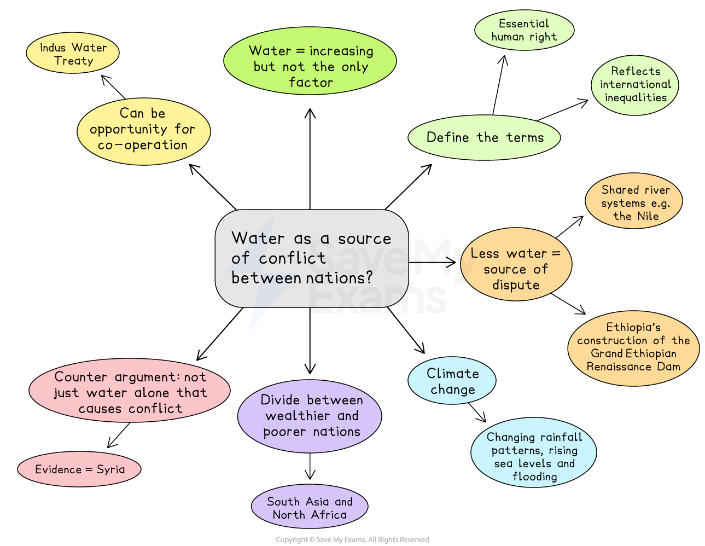

# Paper 1 Topics: The Environment Model Answer

- Paper 1 of the CIE AS English General Paper is the essay component
- You will **select one question** from a list of **ten options** to write an essay of approximately **600-700 words**
- The questions concern **contemporary issues**

Here, you will find an example of a plan and a top-mark model answer to a sample Paper 1 essay question covering the broad theme of the environment.

## Paper 1 essay question and plan

> **Spec point** — `spcpt_8PZG5hH2Zs48nmSs`

## Paper 1 essay question and plan

**Q. Water is becoming a major reason for conflict between nations. Discuss.**

**[30 marks]**

*Water as a source of conflict*

## Paper 1 essay model answer

> **Spec point** — `spcpt_wrMxTrxgBn3Bh4WZ`

## Paper 1 essay model answer

*Water, essential to all life on Earth, is a resource fundamental to national stability and survival.* Access to fresh, clean water for drinking, agriculture and sanitation is recognised as a universal human right. Yet, as global populations grow and climate change intensifies, the availability of this resource is under serious threat. To a significant extent, competition for water has already become a source of tension between nations. However, these disputes often arise not from water scarcity alone but from political, economic and governance failures. *Water therefore acts both as a catalyst for conflict and as a reflection of wider international inequalities.*

*The central importance of water to human survival makes its diminishing supply an immediate source of dispute.* When one nation’s actions threaten another’s water security, particularly where rivers and aquifers cross borders, tensions can quickly escalate. *Shared river systems such as the Nile, the Tigris-Euphrates and the Indus have become flashpoints for diplomatic strain.* For instance, Ethiopia’s construction of the Grand Ethiopian Renaissance Dam has provoked strong opposition from Egypt, which fears reduced access to the Nile’s flow. Such examples reveal how control over water directly influences food security and economic stability, giving it immense strategic value that can fuel regional hostility.

*Climate change has intensified these pressures by disrupting natural water cycles.* Rising temperatures alter rainfall patterns, creating drought in some regions and flooding in others. These environmental shifts undermine agriculture, health and livelihoods, forcing communities to compete for limited resources. Droughts in sub-Saharan Africa and the Middle East have already contributed to displacement and unrest. Rising sea levels also threaten low-lying nations such as Bangladesh and small island states, where the loss of arable land and contamination of freshwater supplies drive migration and border tensions. Increasingly frequent extreme weather events place a heavier burden on fragile governments and deepen inequalities that can erupt into conflict.

The struggle for water highlights sharp economic and moral divides between richer and poorer states. Wealthier nations often have the technology to manage water shortages through desalination or advanced irrigation, while developing countries lack such defences. This imbalance fuels resentment and undermines cooperation. Disputes over shared rivers in South Asia and North Africa are aggravated by unequal bargaining power and historical patterns of exploitation. The reluctance of industrialised countries to act decisively on climate change further worsens tensions, as poorer nations suffer the environmental consequences of others’ emissions. *Water scarcity, therefore, exposes both ecological fragility and the failure of international solidarity.*

*It would, however, be simplistic to claim that water scarcity alone causes conflict.* In many cases, underlying governance problems transform a resource shortage into a humanitarian crisis. Mismanagement, corruption and weak institutions can turn environmental stress into social unrest. In Syria, government neglect of irrigation and rural infrastructure contributed to poverty and displacement before the civil war. The resulting instability showed that resource stress becomes dangerous when governments fail to protect citizens or resolve disputes fairly. Water scarcity is therefore often a trigger rather than the root cause of violence.

Although water can be a source of conflict, it can also be an opportunity for cooperation. The Indus Waters Treaty between India and Pakistan, maintained despite political tension, demonstrates that shared dependency can encourage negotiation. International water management frameworks and technology-based data sharing offer peaceful solutions if nations commit to transparency and mutual benefit. Such cooperation, however, demands sustained political will and trust, both of which remain fragile in a world of growing competition.

*In conclusion, water is increasingly a factor in international conflict, particularly as climate change and population growth exacerbate scarcity. Yet these tensions often emerge where environmental stress intersects with poor governance, inequality and political mistrust. *Water itself does not inherently cause war but magnifies existing divisions between and within nations. Ultimately, the management of shared water resources will determine whether this essential element becomes a source of confrontation or a foundation for collaboration. Effective governance, fair distribution and global cooperation remain the only means of preventing this vital resource from becoming the next great cause of international instability.

## Marking and guidance

> **Spec point** — `spcpt_BYHqQMjYfDGVsxwg`

## Marking and guidance

Why this version would achieve Level 5 across the three Assessment Objectives:

- The argument is disciplined and the essay selects fully relevant examples and evidence that directly address global water-related conflict **(AO1)**
- The essay defines the issue clearly and maintains consistent focus on both environmental and political dimensions **(AO1)**
- It sustains a balanced, evaluative argument that weighs ecological, ethical and geopolitical factors rather than relying on description **(AO2)**
- The analysis is conceptually mature, linking climate change, governance and inequality to patterns of cooperation and confrontation **(AO2)**
- Counterarguments are acknowledged, particularly the view that shared dependency can foster collaboration through treaties and management frameworks **(AO2)**
- The conclusion delivers a decisive and reasoned judgement that directly answers the question and reflects awareness of complexity **(AO2)**
- The writing is fluent, precise and sophisticated, using formal vocabulary and varied syntax appropriate for AS Level **(AO3)**
- Topic sentences guide the reader logically, with transitions ensuring coherence between ideas **(AO3)**
- The structure is cohesive and tightly controlled, maintaining focus and balance throughout the discussion **(AO3)**
