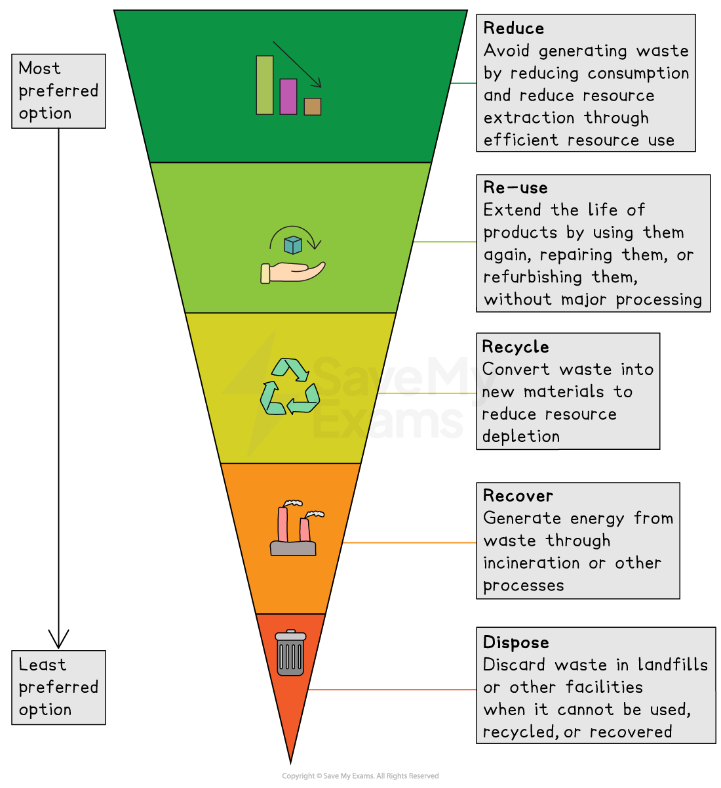
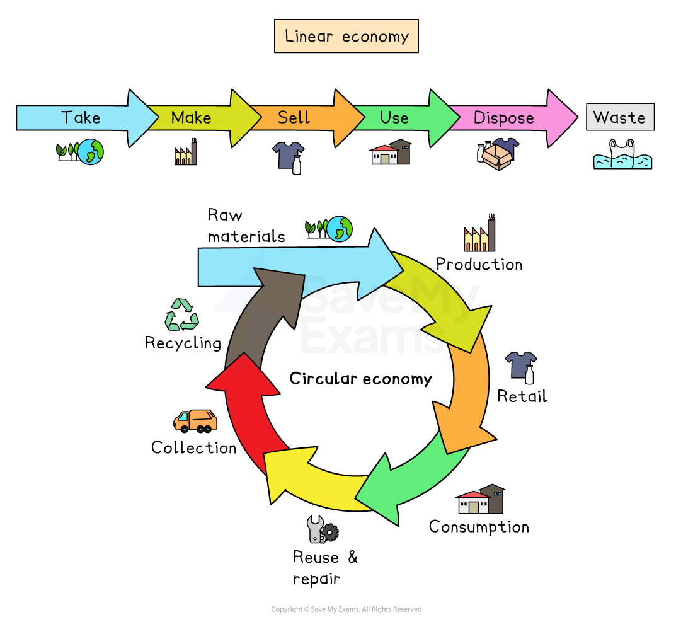

# 1.3.1 Sustainability

## Sustainability

> **Spec point** — `spcpt_wxxRTCv68jqWGyRX`

## Sustainability

- *Sustainability* is the use and management of natural resources that allow **full natural regeneration **of the resources exploited and **full recovery** of the ecosystems affected by their extraction and use

  - Sustainable living involves using resources in a way that allows for their renewal and regeneration
- It is important to manage natural resources in a sustainable manner to avoid **depletion**, **degradation**, or **destruction** of these resources
- Sustainable practices include:

  - Reducing waste (e.g. recycling)
  - Reducing resource use (e.g. reducing water consumption)
  - Conserving energy (e.g. using public transport or cycling, eating locally grown foods)
  - Using renewable resources (e.g. solar or wind power)
  - Protecting biodiversity (e.g. nature reserves)
- Sustainable fashion is a good example of how sustainable practices can be applied to an **industry** (e.g. the clothing industry) that has traditionally been very **wasteful**, as well as very **energy- and resource-intensive**

  - Fashion and clothing can become more sustainable in many ways, some of which are outlined in the table below

**Applying Sustainable Practices to the Clothing Industry**

| Sustainable practice | How this practice improves sustainability |
|---|---|
| Use of sustainable materials | The industry can use more sustainable materials such as organic cotton, hemp, recycled polyester, and lyocell, which have a **lower environmental impact** |
| Circular economy | The industry can adopt a circular economy model where products are designed to be **reused**, **recycled**, or **repurposed**, reducing waste and extending the life of clothing |
| Reduce water usage | The industry can reduce water usage during clothing production by using more efficient manufacturing processes, and using **recycled water** where possible |
| Sustainable packaging | The use of sustainable packaging materials such as **biodegradable** and **compostable** materials can help reduce waste |
| Reduce carbon footprint | The industry can reduce its carbon footprint by using **renewable energy sources** such as wind and solar power, and by implementing energy-efficient practices in production |
| Ethical production | Sustainable fashion also involves ethical production practices such as **fair labour** standards and ensuring **worker safety** |
| Reduce overconsumption | Consumers can also contribute to sustainable fashion by reducing overconsumption, buying **high-quality** clothing that **lasts longer**, and supporting brands that prioritise sustainability |

- Overall, sustainable fashion aims to reduce the environmental and social impact of the fashion industry while still providing consumers with fashionable and functional clothing

*The fashion industry can be made more sustainable by applying a combination of new approaches and practices*

## Sustainable Management

> **Spec point** — `spcpt_hTD33DS6WjWZ4Hkz`

## Sustainable Management

- Sustainable management involves using resources in a way that meets present needs without compromising the ability of future generations to meet their own needs
- Sustainable management:

  - Is crucial for **environmental preservation**, as it can help preserve ecosystems, biodiversity, and natural resources
  - Promotes fair distribution of resources, benefiting **current** and **future** generations
  - Ensures long-term **economic stability** by avoiding resource depletion and environmental degradation
- Many resources, such as fossil fuels and certain minerals, are *finite* and can be exhausted (completely used up) if not managed sustainably
- Overexploitation of resources can also lead to habitat destruction and loss of biodiversity
- **Sustainable forestry** is a good example of sustainable management:

  - Implementing sustainable practices such as selective logging, reforestation, and maintaining biodiversity can ensure the continued provision of timber, non-timber forest products, and ecosystem services while preserving the integrity of forest ecosystems

*Sustainable forestry is a good example of sustainable management*

### Renewable Resources

- Renewable resources can be naturally **replenished** over time (e.g. solar energy, wind power)

  - In other words, these are natural resources that can be **replaced** or **regenerated** at a rate equal to or faster than they are being used
- Living species and ecosystems that can be naturally replaced include forests, wetlands, coral reefs, and grasslands, which can regenerate through **natural processes** - these systems are typically able to do this due to their ability to harness solar energy and use photosynthesis to convert it into biomass

  - For example, **forests** (which provide fuel wood for many communities and are harvested for timber) have the capacity to regenerate through seed dispersal and natural growth, allowing new trees to replace the ones that have been harvested
  - Likewise, **wetlands** (which play a vital role in maintaining water quality, regulating floods, and providing habitat for diverse species) can self-sustain and regenerate, through natural processes like sedimentation and nutrient cycling, even after disturbances such as droughts or human activities like mining or construction
- **Non-living systems** can also be naturally replenished over time

  - For example, **groundwater** is recharged by precipitation and infiltration, ensuring that it can be sustainably used as a freshwater resource
  - The **ozone layer** can also regenerate itself naturally, as long as the emissions of ozone-depleting substances are significantly reduced, allowing the stratospheric ozone concentration to recover over time

### Non-renewable Resources

- Non-renewable resources are **limited in supply** and cannot be replaced within a human timeframe (e.g. fossil fuels, minerals)

  - These are natural resources that cannot be replaced or regenerated at a rate equal to or faster than they are being used
- **Fossil fuels**:

  - Coal, oil, and natural gas are finite resources formed over millions of years from the remains of plants and animals
  - Once extracted and burned for energy production, they cannot be replaced within human timescales
- **Uranium**:

  - Although not a fossil fuel, uranium, which is used in nuclear power plants, is also considered to be a non-renewable energy source, as uranium reserves cannot be replenished within human timescales
- **Soil**:

  - While soil is a renewable resource to some extent, it can be considered non-renewable when it is degraded or eroded at a faster rate than it can be naturally replenished
  - Unsustainable agricultural practices, such as excessive *tilling* and deforestation, can lead to soil erosion and depletion, rendering the soil non-renewable for practical purposes
  - Urbanisation and construction activities can result in the permanent loss of fertile soil, effectively removing its ability to regenerate in those areas
- **Minerals**:

  - These include various elements and metals extracted from the Earth's crust, which are finite and cannot be replenished within human timescales
  - For example, rare-earth minerals used in electronics and technology, such as neodymium and lithium, are non-renewable resources with limited reserves
  - Similarly, precious metals like gold and silver must be recycled or obtained from existing stockpiles once natural reserves have been completely extracted

### Ecosystem Services

- Sustainable management recognises the importance of ecosystems in providing **natural services **like clean water, pollination, and climate regulation

  - These services directly impact **human health and well-being**, so must be preserved for future generations

### Waste Management

- Sustainable management involves **minimising waste generation** and promoting practices that reduce, reuse, and recycle materials

  - The **circular economy** is a model of production and consumption, which involves sharing, leasing, reusing, repairing, refurbishing and recycling existing materials and products for as long as possible
  - The ideal scenario is a closed-loop system where products and materials are repeatedly reused, reducing the demand for new resources

#### Hierarchy of waste management strategies

- Different waste management strategies can also be viewed as being part of a hierarchy

  - The hierarchy of waste management strategies ranks options from the most to least sustainable
  - It prioritises reducing waste at the source, followed by reusing, recycling, recovering energy, and finally, disposing of waste in landfills or through incineration

*Hierarchy of waste management strategies*

#### The circular economy and sustainable waste management

- A **circular economy** is a sustainable approach to managing resources and waste by:

  - Keeping materials in use for as long as possible
  - Minimising waste
  - Recovering resources at the end of a product's life
- This system contrasts with the traditional **linear economy**

  - This is where products are made, used and then discarded
- Principles of the circular economy:

  - **Design for longevity**: making products that last longer and can be reused or repaired
  - **Resource efficiency**: minimising the use of raw materials by recycling and reusing
  - **Product recovery**: recovering and reusing materials at the end of a product’s life

*Linear vs. circular economy*

- Example of a **circular economy path** (aluminium cans):

  - **Manufacturing**: aluminium cans are made from recycled aluminium
  - **Use**: consumers purchase and use the cans
  - **Collection**: used cans are collected through recycling bins or deposit-return schemes
  - **Recycling**: the cans are cleaned, melted and reformed into new cans, reducing the need for new raw materials
  - **Reuse**: the recycled cans are used to package new products (e.g. soft drinks) and the cycle begins again
- This example demonstrates how the circular economy reduces waste, conserves resources and reduces the need for raw material extraction
