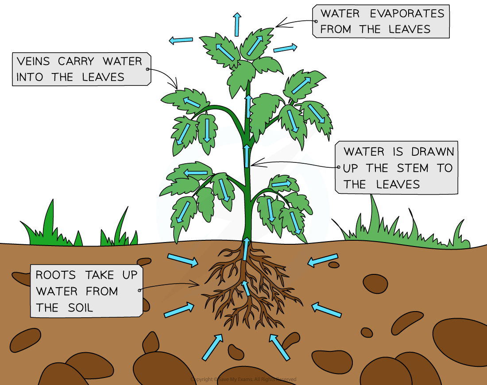

# 1.4.1 The Water Cycle

## Water Cycle Processes

> **Spec point** — `spcpt_QnJC7MycgwgHJ5VB`

## Water Cycle Processes

### Water on Earth

- Fresh water only makes up a **very small fraction** (approximately 2.5% by volume) of the Earth’s water storages

  - The rest is saltwater
- Of this fresh water, approximately 68.7% is stored in **glaciers** and **ice** sheets and 30% is stored as **groundwater**
- The remaining 1.3% of freshwater is in rivers, lakes and the atmosphere
- **All water** (both saltwater and freshwater) is part of the** water cycle**

*Comparison of the world's freshwater stores*

### Water Cycle

- Globally, the water cycle is a closed system

  - This means that there is a **constant amount** of water on the planet
- Within the water cycle, there are **stores** and **transfers**
- The water cycle is a series of processes in which water is constantly **recycled** through the system

  - The cycle also shapes landscapes, transports minerals and is essential to all life on Earth
- The main processes (transfers) occurring within the water cycle are:

  - **Evaporation** - the sun evaporates surface water into vapour
  - **Condensation** - water vapour condenses and precipitates
  - **Flows** - water runs off the surface into streams and reservoirs or beneath the surface as groundwater flow
- These processes transfer the water on Earth from one store to another (e.g. river to ocean or ocean to atmosphere)
- The water cycle involves **energy exchange**, leading to local temperature fluctuations

  - As water evaporates, it absorbs energy from its surroundings
  - This effectively cools the environment
  - The reverse happens when water condenses (heat is released)
  - This heat exchange influences the local climate

*The transfers and stores of the water cycle*

#### Storages & Processes

- **Storages** in the water cycle include:

  - Rivers, lakes and oceans
  - Groundwater (aquifers)
  - Soils
  - The atmosphere
  - Glaciers and ice caps
  - Organisms (e.g. trees)
- The main **processes** in the water cycle include:

  - Condensation
  - Precipitation
  - Interception
  - Infiltration
  - Surface run-off
  - Through-flow
  - Groundwater flow
  - Transpiration
  - Evaporation

**Water Cycle Processes**

| Process | Description |
|---|---|
| Condensation | The process through which water **vapour** in the atmosphere transforms into **liquid** water, forming clouds or dew, as a result of **cooling** |
| Precipitation | The process of water falling from the atmosphere to the Earth's surface in the form of rain, snow, sleet, or hail |
| Interception | The process through which precipitation is **prevented from reaching the ground**, usually by being caught on leaves or branches |
| Infiltration | The process of water **seeping into the soil** from the surface, entering the soil layers and becoming groundwater |
| Surface run-off | The movement of water over the Earth's surface, typically occurring when the ground is **saturated** or **impermeable**, leading to excess water |
| Through-flow | The movement of water through the soil **between** the groundwater store (water table) and the surface |
| Groundwater flow | The movement of water through **underground rock layers** |
| Transpiration | The process by which plants absorb water from the soil through their roots and release it as water **vapour** through tiny openings called stomata in their leaves |
| Evaporation | The process by which **liquid** water changes into a gaseous state (water **vapour**) and enters the atmosphere from water bodies such as oceans, lakes, and rivers |

*The loss of water vapour from the leaves of the plant (transpiration) causes water to move upwards through the plant, allowing more water to be drawn in through the roots*
