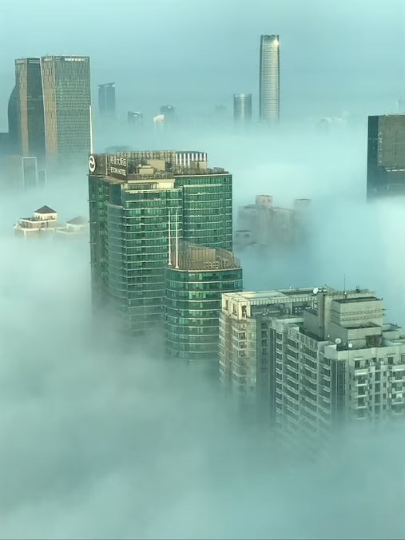

# 7.2.1 Photochemical Smog

## Photochemical Smog

> **Spec point** — `spcpt_v6CfwNYJCVSWKRnD`

## Photochemical Smog

### Trophospheric Ozone

- Air pollution is a significant environmental issue, and one of the pollutants of concern is tropospheric ozone
- Tropospheric ozone, also referred to as **ground-level ozone**, is formed through a series of chemical reactions involving nitrogen oxides and volatile organic compounds in the presence of sunlight:

  - This process occurs **near the Earth's surface**, primarily in the lower part of the atmosphere known as the **troposphere**
  - Nitrogen oxides, mainly released from human activities such as industrial processes, vehicle emissions, and combustion of fossil fuels, react with sunlight and oxygen to produce ozone
- Tropospheric ozone is highly reactive and has several negative impacts

### What is Photochemical Smog?

*Only the highest city buildings protrude above this smog, which has been trapped in the cooler air near ground-level by a layer of warm air above the city (Photo by Mikel Letona on Unsplash)*

- Smog is a type of air pollution characterised by a complex **mixture** of primary and secondary pollutants:

  - **Tropospheric ozone** is a major component of smog
  - Deforestation and burning of biomass release large amounts of **particulate matter**, volatile organic compounds and other pollutants into the atmosphere
  - These emissions can contribute to the formation of smog by increasing the concentration of primary pollutants and providing additional reactive substances for secondary pollutant formation
  - To some extent, forested areas can act as natural sinks for air pollutants, so their removal can exacerbate smog formation in surrounding regions

## Impacts of Photochemical Smog

> **Spec point** — `spcpt_QZNcPBs8YwdPP5XW`

## Impacts of Photochemical Smog

### Why is Tropospheric Ozone Harmful?

#### Plant Damage

- High levels of ozone can damage plant tissues, **impair photosynthesis**, reduce crop yields and cause visible symptoms such as leaf damage
- It affects a wide range of crops, including staple crops like wheat, rice and soybeans

#### Respiratory Issues

- Tropospheric ozone **irritates** the respiratory system, causing coughing, throat irritation, and contributes to **asthma** and other respiratory conditions
- Prolonged exposure to high ozone levels can lead to chronic respiratory illnesses and **reduced lung function**

#### Eye Irritation

- Exposure to tropospheric ozone can irritate the eyes, leading to redness, tearing and discomfort

#### Material Degradation

- Tropospheric ozone can damage materials such as rubber, fabrics and certain plastics
- It accelerates the degradation and ageing of rubber components in vehicles, tires and industrial equipment
- Ozone exposure can cause cracking, brittleness and discolouration of materials

*Don't get confused between "good" stratospheric ozone, which provides organisms with protection from harmful ultraviolet radiation, and "bad" tropospheric ozone, which can negatively impact life on Earth at high concentrations*

- The impacts of tropospheric ozone extend beyond local areas, as it can be **transported** over long distances by **wind**
- This makes it a **global environmental issue** with the potential for widespread damage to vegetation, human health and materials
