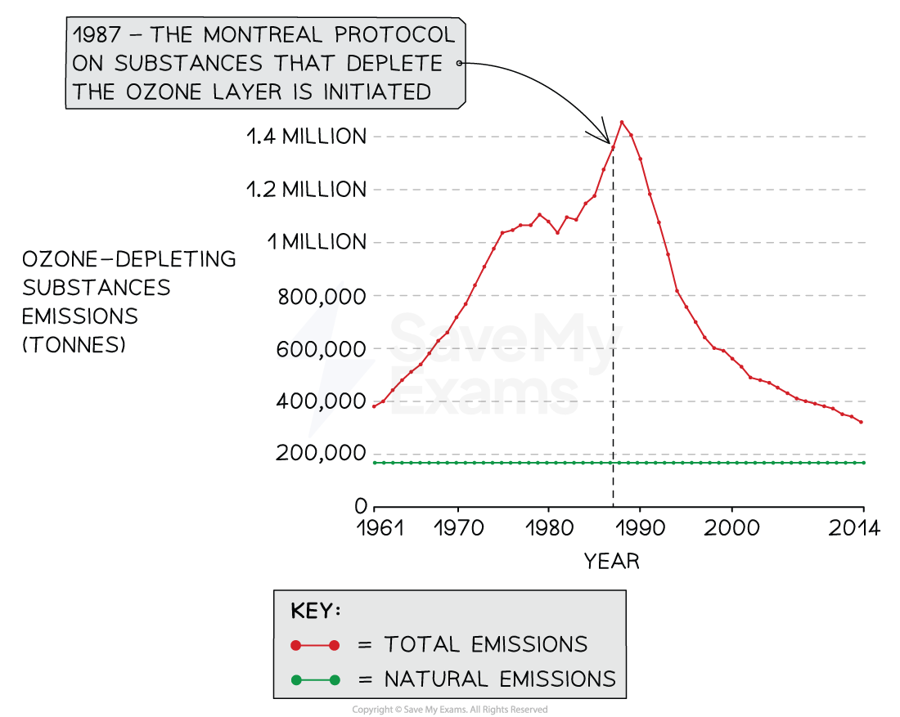

# 7.4.2 Impacts of Ozone Depletion

## Impacts of Ozone Depletion

> **Spec point** — `spcpt_J6nvQqxTM75GF5sR`

## Impacts of Ozone Depletion

- Ultraviolet radiation from the **Sun** can have damaging effects on human **living tissues**:

  - When excessive UV radiation reaches the surface of the Earth, it can lead to various health issues by damaging cells and tissues

### Effects on Human Health

**UV Radiation Effects on Humans**

| Health issue caused by UV radiation | Explanation |
|---|---|
| Cataracts | - Prolonged exposure to UV radiation can contribute to the development of cataracts - Cataracts cause **clouding** of the **lens** in the eye, leading to blurry vision and eventual vision loss if left untreated |
| UV radiation effects on cells | - UV radiation has the potential to induce **mutations** in **DNA** during cell division - When cells are exposed to UV radiation, it can lead to genetic alterations and mutations, which can disrupt normal cell growth and increase the risk of developing **cancer** |
| Skin cancer | - UV radiation is a major risk factor for the development of **skin cancer** - UV rays can damage the DNA in skin cells, leading to uncontrolled cell growth and the formation of cancerous **tumours** - Prolonged or intense exposure to UV radiation, especially without proper** protection**, increases the risk of developing skin cancer |
| Sunburn | - When the skin is exposed to excessive UV rays, it triggers an **inflammatory response** as a defence mechanism - Sunburned skin becomes red, painful and may blister, indicating damage to the skin cells |
| Premature skin ageing | - Chronic exposure to UV radiation accelerates the **ageing** process of the skin - It can cause the breakdown of collagen and elastin fibres, leading to wrinkles, sagging skin and the development of age spots |

*Measures such as wearing sunscreen with a high sun protection factor (SPF), using sunglasses that block certain UV rays, seeking shade during peak sun hours and wearing protective clothing can help reduce the risk of UV-related health issues (Photo by Dimitris Chapsoulas on Unsplash )*

### Effects on Biological Productivity

- Ozone depletion allows more harmful ultraviolet (UV) radiation to reach the Earth's surface, affecting plant growth and productivity:

  - Increased UV exposure can lead to reduced photosynthesis rates, altered plant metabolism and decreased crop yields
- Exposure to increased ultraviolet radiation can affect other photosynthetic organisms such as **phytoplankton**, which play a crucial role in **aquatic food webs**:

  - Phytoplankton convert sunlight, carbon dioxide and nutrients into organic matter through **photosynthesis**
- Increased UV radiation damages photosynthetic organisms, such as phytoplankton, by causing DNA damage and inhibiting photosynthesis:

  - When exposed to increased UV radiation, phytoplankton may experience **reduced** **photosynthetic activity and growth**, leading to a decrease in primary productivity in aquatic ecosystems
- Phytoplankton play a vital role in **nutrient cycling**:

  - They absorb nutrients from the water, convert them into biomass, and serve as a food source for other organisms
  - Reduced phytoplankton populations due to UV radiation damage can disrupt nutrient cycling processes, leading to imbalances and nutrient **deficiencies** in the ecosystem
- Reduced phytoplankton productivity can have cascading effects on **higher trophic levels** in aquatic ecosystems:

  - **Zooplankton**, which feed on phytoplankton, may experience decreased food availability, affecting their growth and reproduction
  - This, in turn, can impact higher-level consumers, such as **fish** and **marine mammals**, which rely on phytoplankton and zooplankton as a food source
  - This can significantly reduce the biodiversity of aquatic ecosystems

### Degradation of Materials Used in Clothing and Construction

- UV radiation accelerated by ozone depletion can damage materials commonly used in clothing and construction:

  - Fabrics, plastics, paints and building materials may become brittle, faded or weakened, reducing their durability and lifespan
  - This degradation not only affects the aesthetic appearance of materials but also compromises their structural integrity and functionality

### Impacts Associated with Alternatives to Ozone-Depleting Substances

- **Hydrochlorofluorocarbons (HCFCs):**

  - HCFCs were introduced as alternatives to ozone-depleting substances like chlorofluorocarbons (CFCs)
  - While less harmful to the ozone layer, HCFCs still contribute to global warming and have adverse environmental impacts
  - Their production and use are regulated under the Montreal Protocol, with efforts underway to phase them out completely
- **Fluorinated Gases (F-gases):**

  - F-gases, including hydrofluorocarbons (HFCs) and perfluorocarbons (PFCs), are commonly used as alternatives in refrigeration, air conditioning and insulation
  - While they do not deplete the ozone layer, many F-gases are potent greenhouse gases with high global warming potentials
  - Efforts are underway to regulate and reduce the use of F-gases through international agreements like the Kigali Amendment to the Montreal Protocol

## International Efforts to Reduce Ozone Depletion

> **Spec point** — `spcpt_ChjQd4n696YwgsYX`

## International Efforts to Reduce Ozone Depletion

### The Role of UNEP

- The United Nations Environment Programme (UNEP) has played a critical role in the **protection** of the **stratospheric ozone layer** through its efforts in providing information and creating **international agreements**:
- UNEP has been instrumental in raising awareness about the depletion of the ozone layer, its causes and the associated environmental and health impacts:

  - Through research, monitoring and dissemination of information, UNEP has helped educate governments, industries and the public about the importance of ozone layer protection
  - UNEP has been actively involved in the creation and evaluation of international agreements aimed at **reducing** the use of **ozone-depleting substances **(ODSs)

*The Montreal Protocol on Substances that Deplete the Ozone Layer, initiated in 1987, played a crucial role in reducing the production, use and emissions of ozone-depleting substances ( natural sources of halogen gases that deplete stratospheric ozone include biological activity in terrestrial and aquatic ecosystems)*

- The **Montreal Protocol on Substances that Deplete the Ozone Layer**, initiated in 1987 under the guidance of UNEP, is a landmark international agreement:

  - It has been updated and strengthened through subsequent amendments, reflecting the evolving scientific understanding and technological advancements (a later amendment at a summit in Copenhagen in 1992 tightened restrictions further)
  - 24 countries initially signed the initial Protocol and the total now stands at **197 countries**
  - Largely as a result of this, emissions of ODSs have **rapidly fallen** from around 1.5 million tonnes in 1987 to around 400 000 tonnes in 2010
  - UNEP hopes to end production of all HCFCs by 2040

*The effects of CFC reduction on predicted skin cancer rates in Northwest Europe*

- The **illegal market** for ozone-depleting substances poses a significant challenge to the effectiveness of ozone protection efforts:

  - UNEP recognises the need for consistent **monitoring** and **enforcement** to tackle this issue
  - By collaborating with national authorities, customs agencies and other relevant stakeholders, UNEP works towards curbing the illegal trade of ozone-depleting substances and ensuring **compliance with international regulations**
- **National governments** play a crucial role in implementing the agreements made under the direction of UNEP:

  - In response to the Montreal Protocol, governments have enacted **national laws** and **regulations** to decrease the consumption and production of halogenated organic gases, such as chlorofluorocarbons (CFCs)
  - These measures help enforce the reduction targets and promote the **transition** to **ozone-friendly alternatives**
  - The collective efforts of UNEP, governments, industries and other stakeholders are vital in achieving the goals of ozone layer protection, mitigating the illegal trade of ozone-depleting substances and fostering global cooperation for a sustainable future

## The Ozone Destruction Hypothesis

> **Spec point** — `spcpt_BFxQcND5hhcxjZCv`

## The Ozone Destruction Hypothesis

- Initially proposed by scientists Sherwood Rowland and Mario Molina in the 1970s, the ozone destruction hypothesis suggested that CFCs released into the atmosphere could lead to **ozone depletion**:

  - They were the first people to suggest that Earth's protective ozone layer was being damaged by these chemicals
- At first, the hypothesis faced **skepticism** and **resistance** from industries (e.g. big businesses that produced CFCs) and policymakers:

  - Some of the *auxiliary hypotheses* were not backed up by scientific data
- Over time, increasing amounts of experimental evidence supported the hypothesis, leading to widespread acceptance and the eventual implementation of regulatory measures to phase out CFCs and other ozone-depleting substances
- The hypothesis demonstrates the importance of **research** and **experimental evidence** in shaping environmental policies and addressing global environmental challenges

*The main Ozone Destruction Hypothesis is supported by many auxiliary hypotheses*
