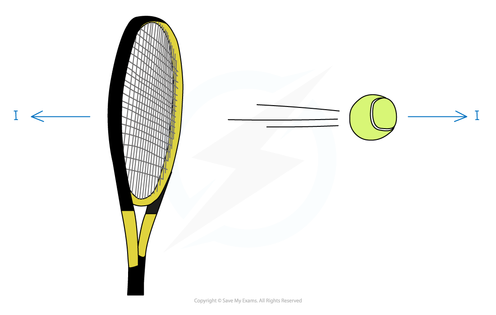

# Momentum

## Momentum

> **Spec point** — `spcpt_sbN2WmtqbjBPGhqj`

## Momentum

### What is momentum?

- Any object that has mass and is moving has **momentum**
- **Momentum **measures the quantity of motion that an object has
- The **momentum **of a particle is defined as the **product** of its **mass (** $m$**kg)** and its **velocity (**$vms^{-1}$**)**

  - Momentum **=*****mv***
- The SI unit for momentum is $\mathrm{kg}ms^{-1}$(equivalent to newton seconds N s)
- Momentum is a **vector** quantity - so it has a **magnitude** and **direction**

  - The **direction of the momentum** of a particle is the **same** as the **direction of motion** of the particle
  - The **momentum is negative** if the **velocity is negative**
  - If an object is falling vertically then momentum will be downwards

#### What happens when two objects are in contact?

- If two objects are in contact with each other then by **Newton’s Third Law **there will be **equal** and **opposite** reaction forces
- One object gains momentum from the impact and the other loses momentum
- The change in momentum will be equal for each particle provided there are no external forces

  - Remember momentum is a vector and can be negative
- For example, consider the scenario where a tennis ball is struck by a racket, suppose the momentum of the racket and the ball before the impact is 5 kg m s-1  and  -3 kg m s-1  and the momentum of the racket afterwards is -2 kg m s-1

  - This means the racket has a loss of 7 kg m s-1 in momentum
  - Therefore the ball has a gain of 7 kg m s-1 in momentum
  - Therefore the momentum of ball after the impact is 4 kg m s-1

> **Worked Example**
> A dog of mass  15 kg is running with speed $6ms^{-1}$.
> 
> Find the momentum of the dog.
> 
> **Answer:**
> 
> 
