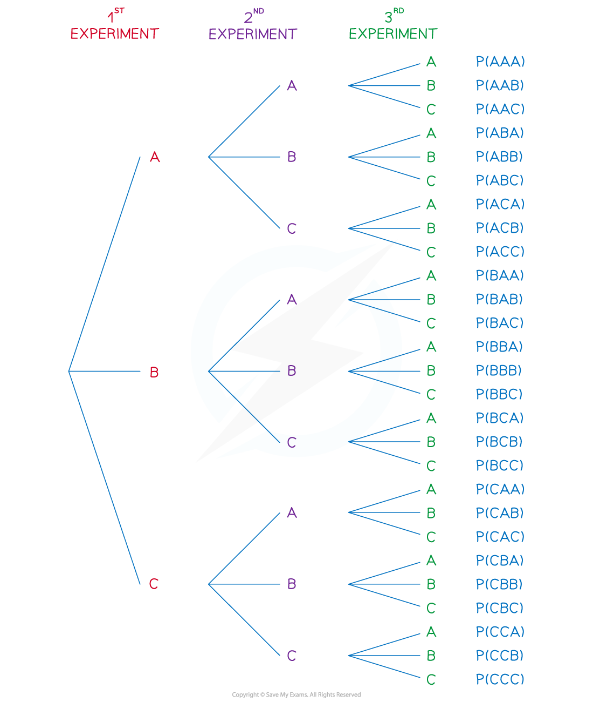
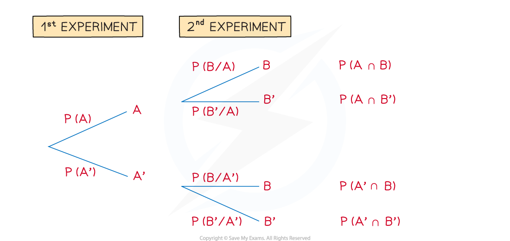

# Tree Diagrams with Conditional Probability

## Further Tree Diagrams

> **Spec point** — `spcpt_qqShgKnf3SR5y4KX`

## Further Tree Diagrams

#### What do you mean by further tree diagrams?

- The tree diagrams used here are no more complicated than those in the first **Tree Diagrams **revision note, however

  - questions may use **set** **notation** as well, or alongside contextual questions $\cup$(**union**),  $\cap$(**intersection**) , ‘ (**complement**), | ("**given that**")
  - more detailed use of **conditional** **probability**
  - three ***events*** for each ***experiment ***and three experiments could be used

#### How do I solve conditional probability problems using tree diagrams?

- Interpreting questions in terms of **AND** ($\cap$), **OR** ($\cup$),** complement** ( ‘ ) and **“given that”** ( | )
- **Condition probability** may now be involved too
- This makes it harder to know where to start and how to complete the probabilities on a tree diagram

  - e.g. If given, possibly in words, $P ( B \vert A )$ then **event *****A*** has already occurred so start by looking for the branch **event *****A*** in the **1****st**** experiment, **and** **then P(B | A)  would be the** **branch** **for** event *****B*** in the **2****nd** **experiment**

Similarly, $\mathrm{P} ( B \vert A ' )$ would require starting with **event “**$notA$ **”** in the **1****st**** experiment** and **event *****B*** in the **2****nd**** experiment**

- The diagram above gives rise to some probability formulae you will see in Probability Formulae
- `Error converting from MathML to accessible text.` (“**given** **that**”) is the probability on the branch of the 2nd experiment
- However, the “**given** **that**” statement `Error converting from MathML to accessible text.` is more complicated and a matter of working backwards

  - from Conditional Probability,  $\mathrm{P} ( A \vert B ) = \frac{ \mathrm{P} ( A \cap B )}{ \mathrm{P} ( B )}$
  - from the diagram above, $P(B)=P(A\capB)+P(A'\capB)$
  - leading to ** **$P ( A \vert B ) = \frac{P ( A \cap B )}{P ( A \cap B ) + P ( A ' \cap B )}$
  - This is quite a complicated looking formula to try to remember so use the logical steps instead – and a clearly labelled tree diagram!

> **Worked Example**
> The event $F$ has a 75% probability of occurring.
> 
> The event $W$ follows event $F$, and if event $F$ has occurred, event $W$ has an 80% chance of occurring.
> 
> It is also known that $P(F'\capW)=0.15$ .
> 
> Find
> 
> (i) $\mathrm{P} ( W \vert F ' )$
> 
> (ii) $\mathrm{P} ( F \vert W ' )$
> 
> (iii) the probability that event $F$ didn’t occur, given that event $W$ didn’t occur.
> 
> **Answer:**
> 
> 
> 
> 

> **Exam Hint**
> - Be wary of assuming that “given that” statements will always be referring to something on the second set of branches (2nd experiment), they can work the other way!
