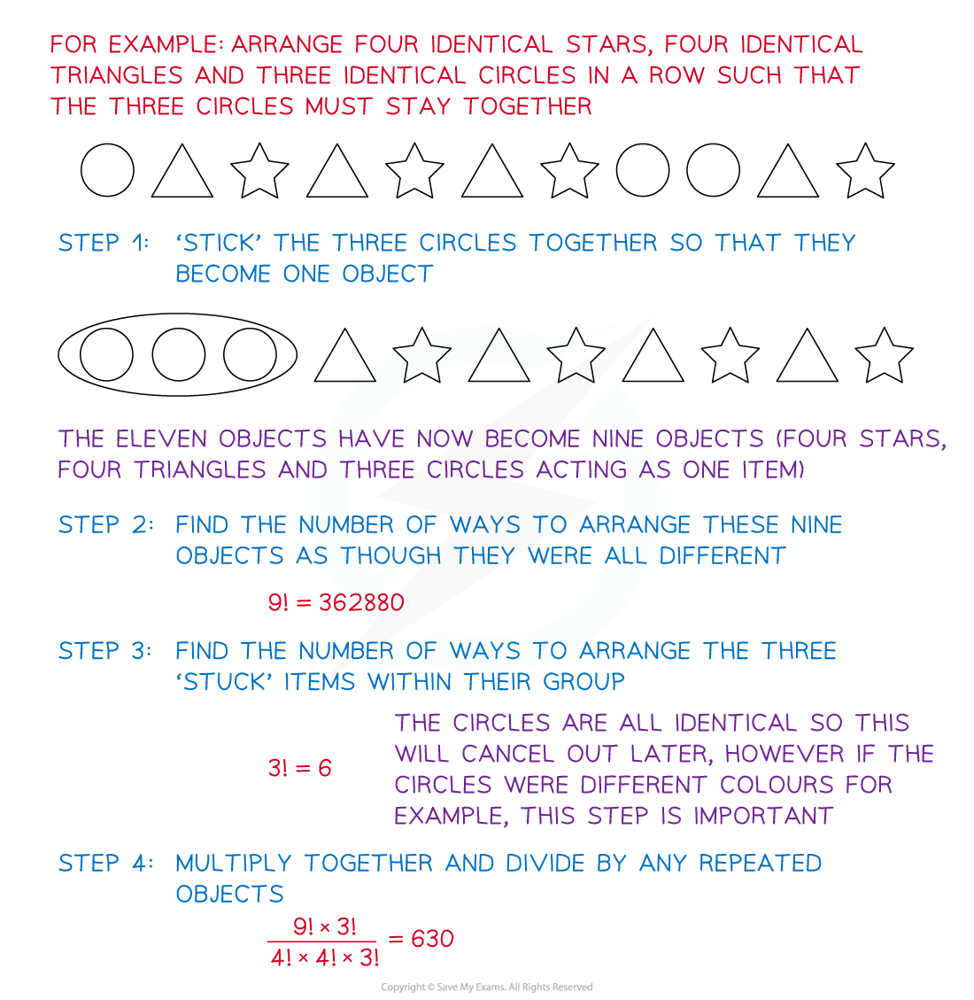
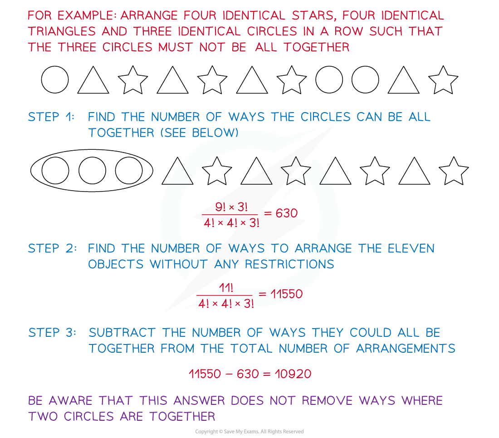
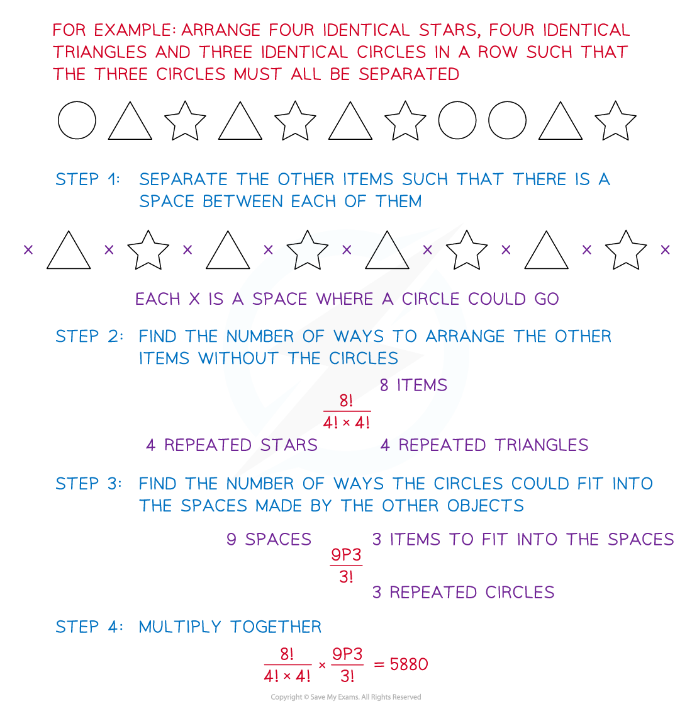

# Permutations

## Permutations

> **Spec point** — `spcpt_89ps9KCVtj4YGq2C`

## Permutations

#### Are permutations and arrangements the same thing?

- Mathematically speaking yes, a **permutation** is the number of possible arrangements of a set of objects when the **order **of the arrangements matters
- A permutation can either be finding the number of ways to arrange *n*  items or finding the number of ways to arrange *r*  out of *n* items
- By the reasoning given in the 2.2.1 Arrangements revision note, the number of permutations of *n* **different **items is $n \text{factorial} = n \times ( n - 1 ) \times ( n - 2 ) \times... \times 2 \times 1$

  - For 5 **different **items there are 5! = 5 × 4 × 3 × 2 = 120 permutations
  - For 6 **different **items there are 6! = 6 × 5 × 4 × 3 × 2 = 720  permutations
  - It is easy to see how quickly the number of possible permutations of different items can increase
  - For 10 different items there are 10! = 3 628 800 possible permutations

#### How do we handle permutations if there are repeated items?

- Again, by the reasoning given in the 2.2.1 Arrangements revision note, the number of permutations of** *****n**** ***different **items, with **one** of the items repeated ***r**** *times, is

$\frac{n factorial}{r factorial} = n \times ( n - 1 ) ) \times... \times ( r + 1 )$

- The number of permutations of ***n *****different **items, with **one** of the items repeated ***r**** *times and **another **repeated ***s ***times, is $\frac{n!}{r!s!}$
- This property will need to be applied to any permutation problem with one or more item(s) repeated a number of times

#### How do we find r  permutations of n items?

- If we only want to find the number of ways to arrange a few out of *n*  different objects, we should consider how many of the objects can go in the first position, how many can go in the second and so on
- If we wanted to arrange 3 out of 5 different objects, then we would have 3 positions to place the objects in, but we would have 5 options for the first position, 4 for the second and 3 for the third

  - This would be 5 × 4 × 3 ways of permutating 3 out of 5 different objects
  - This is equivalent to $\frac{5 factorial}{2 factorial} = \frac{5 factorial}{( 5 - 3 ) factorial}$
- If we wanted to arrange 4 out of 10 different objects, then we would have 4 positions to place the objects in, but we would have 10 options for the first position, 9 for the second, 8 for the third and 7 for the fourth

  - This would be 10 × 9 × 8 × 7 ways of permutating 4 out of 10 different objects
  - This is equivalent to $\frac{10!}{6!}=\frac{10!}{(10-4)!}$
- If we wanted to arrange *r* out of *n* different objects, then we would have *r* positions to place the objects in, but we would have *n* options for the first position, $( n - 1 )$ for the second, $( n - 2 )$ for the third and so on until we reach $( n - ( r - 1 ) )$

  - This would be $n \times ( n - 1 ) \times... \times ( n - r + 1 )$ ways of permutating r out of n different objects
  - This is equivalent to $\frac{n factorial}{( n - r ) factorial}$
- The function $\frac{n!}{(n-r)!}$can be written as $\mathrm{P} pre^{n}_{r}$

  - Make sure you can find and use this button on your calculator
- The same function works if we have *n *spaces into which we want to arrange *r *objects, consider

  - for example arranging five people into a row of ten empty chairs

#### Permutations when two or more items must be together

- If two or more items must stay together within an arrangement, it is easiest to think of these items as ‘stuck’ together
- These items will become one within the arrangement
- Arrange this ‘one’ item with the others as normal
- Arrange the items within this ‘one’ item separately
- Multiply these two arrangements together

#### Permutations when two or more items cannot be all together

- If **two** items must be **separated …**

  - consider the number of ways these two items would be together
  - subtract this from the total number of arrangements without restrictions
- If **more than two** items must be separated…

  - consider whether all of them must be **completely separate** (none can be next to each other) or whether they **cannot all be together** (but two could still be next to each other)
  - If they **cannot all be together** then we can treat it the same way as separating two items and subtract the number of ways they would all be together from the total number of permutations of the items, the final answer will include all permutations where two items are still together

#### Permutations when two or more items must be separated

- If the items must all be **completely separate** then

  - lay out the rest of the items in a line with a space in between each of them where one of the items which cannot be together could go
  - remember that this could also include the space before the first and after the last item
  - You would then be able to fit the items which cannot be together into any of these spaces, using the *r *permutations of *n *items rule `( P _ r _ _ ^ n )`
  - You do not need to fill every space

#### Permutations when two or more items must be in specific places

- Most commonly this would be arranging a word where specific letters would go in the first and last place
- Or arranging objects where specific items have to be at the ends/in the middle

  - Imagine these specific items are stuck in place, then you can find the number of ways to arrange the rest of the items around these ‘stuck’ items
- Sometimes the items must be grouped

  - For example all vowels must be before the consonants
  - Or all the red objects must be on one side and the blue objects must be on the other
  - Find the number of permutations within each group separately and multiply them together
  - Be careful to check whether the groups could be in either place
  
    - e.g. the vowels on one side and consonants on the other
    - or if they must be in specific places (the vowels **before** the consonants)
  - If the groups could be in either place than your answer would be multiplied by two
  - If there were *n* groups that could be in any order then you’re answer would be multiplied by *n*!

> **Worked Example**
> (a) How many ways are there to rearrange the letters in the word BANANAS if the B and the S must be at each end?
> 
> (b) How many ways are there to rearrange the letters in the word ORANGES if
> 
> (i) the three vowels (A, E and O) must be together?
> 
> (ii) the three vowels must NOT all be together?
> 
> (iii) the three vowels must all be separated?
> 
> **Answer:**
> 
> 
> 
> 

> **Exam Hint**
> - The wording is very important in permutations questions, just one word can change how you answer the question.
> - Look out for specific details such as whether three items must all be separated or just cannot be all together (there is a difference).
> - Pay attention to whether items must be in alternating order (e.g. red and blue items must alternate, either RBRB… or BRBR…) or whether a particular item must come first (red **then **blue and so on).
> - If items should be at the ends, look out for whether they can be at either end or whether one must be at the beginning and the other at the end.
